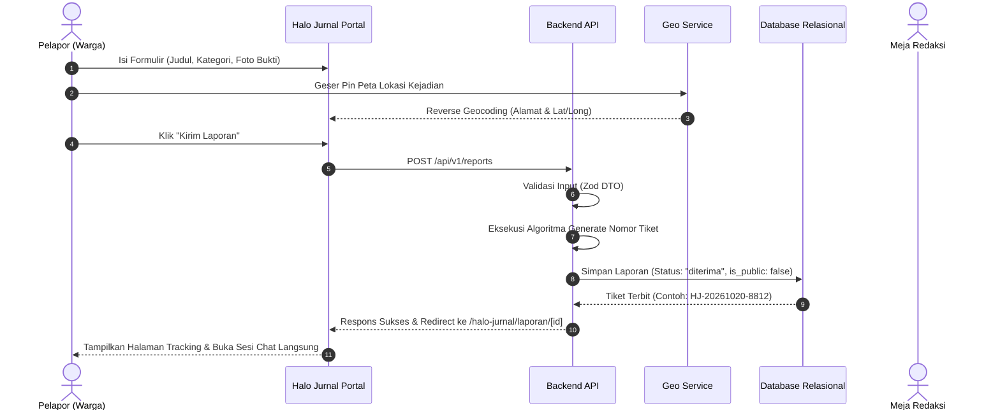
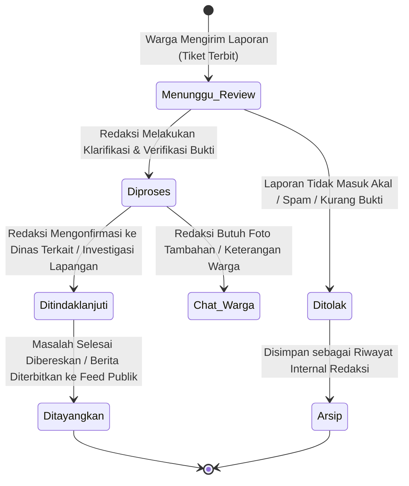

# BLUEPRINT CETAK BIRU SISTEM INFORMASI & RANCANGAN BACKEND
## Media Jurnal Sukabumi (Jurnal Wave & Halo Jurnal)
*Dokumen Spesifikasi Rekayasa Sistem, Alur Informasi, Algoritma, & Arsitektur Backend*

---

## DAFTAR ISI
1. [Penyempurnaan Design System](#1-penyempurnaan-design-system)
2. [Penyempurnaan Alur Sistem Informasi (Information Flow)](#2-penyempurnaan-alur-sistem-informasi-information-flow)
3. [Algoritma Inti Sistem Informasi](#3-algoritma-inti-sistem-informasi)
4. [Komparasi & Rekomendasi Pilihan Backend](#4-komparasi--rekomendasi-pilihan-backend)
5. [Spesifikasi Teknis Backend Terpilih (Enterprise Blueprint)](#5-spesifikasi-teknis-backend-terpilih-enterprise-blueprint)
6. [Skema Basis Data Relasional & Relasi Tabel](#6-skema-basis-data-relasional--relasi-tabel)
7. [Spesifikasi API Endpoint (REST / RPC Contract)](#7-spesifikasi-api-endpoint-rest--rpc-contract)
8. [Arsitektur Keamanan, Autentikasi & RBAC](#8-arsitektur-keamanan-autentikasi--rbac)
9. [Layanan Real-time, Media Storage & Integrasi Eksternal](#9-layanan-real-time-media-storage--integrasi-eksternal)
10. [Roadmap Implementasi Bertahap](#10-roadmap-implementasi-bertahap)

---

## 1. PENYEMPURNAAN DESIGN SYSTEM

### 1.1 Masalah pada Desain Saat Ini
* Variabel CSS di `globals.css` memiliki banyak token Material Design turunan yang redundan dan belum seluruhnya dimanfaatkan secara semantik.
* Masih terdapat perbedaan skala padding dan margin pada tabel serta kartu antar halaman admin dan publik.
* Status badge sebelumnya sempat memiliki warna pelangi yang terlalu ramai sebelum diharmonisasi menjadi monokrom netral.

### 1.2 Standarisasi Token Desain (Modern Editorial Clean)
Design system diselaraskan menggunakan prinsip **Modern Minimalist Editorial** yang mengedepankan keterbacaan data, netralitas, dan aksen brand yang terukur:

```css
/* Token Semantik Desain Sistem Jurnal Sukabumi */
:root {
  /* 1. Brand Accents */
  --brand-primary: #c00015;          /* Carmine Red (Identitas Utama Jurnal) */
  --brand-primary-hover: #a00012;    /* Dark Crimson (Hover state) */
  --brand-primary-subtle: #fef2f2;   /* Soft Red Tint (Active highlight / badge) */

  /* 2. Neutral Monochromes (Slate Matrix) */
  --text-main: #0f172a;              /* Slate-900 (Judul, Header, Teks Primer) */
  --text-muted: #475569;             /* Slate-600 (Deskripsi, Metadata, Label) */
  --text-dim: #94a3b8;               /* Slate-400 (Placeholder, Timestamp) */
  --surface-base: #fbf9f9;           /* Off-white newspaper paper tint */
  --surface-card: #ffffff;           /* Pure white card surface */
  --surface-subtle: #f8fafc;         /* Slate-50 background container */
  --border-subtle: #e2e8f0;          /* Slate-200 border divider */
  --border-strong: #cbd5e1;          /* Slate-300 table separator */

  /* 3. Status Badges (Strict Neutral Typographic System) */
  --badge-review-bg: #f1f5f9;        /* [Menunggu Review] */
  --badge-review-text: #334155;
  --badge-process-bg: #f8fafc;       /* [Diproses] */
  --badge-process-text: #1e293b;
  --badge-followup-bg: #f1f5f9;      /* [Ditindaklanjuti] */
  --badge-followup-text: #0f172a;
  --badge-published-bg: #f0fdf4;     /* [Ditayangkan] */
  --badge-published-text: #166534;
  --badge-rejected-bg: #fef2f2;      /* [Ditolak] */
  --badge-rejected-text: #991b1b;
}
```

### 1.3 Skala Spacing & Komponen Primitif
1. **Tabel Data**: Seluruh tabel diwajibkan menggunakan properti `table-fixed` dengan lebar kolom eksplisit dan padding seragam `px-4 py-3.5` untuk mencegah teks bertumpuk atau mepet.
2. **Formulir Interaktif**: Menggunakan ukuran target sentuh (*touch target*) minimal `44px` pada perangkat mobile dengan radius sudut konsisten (`rounded-xl` untuk container, `rounded-lg` untuk input dan tombol).
3. **Peta GIS**: Rasio tinggi viewport peta adaptif: `280px` di mobile, `400px` di desktop, dengan kontrol zoom yang dinonaktifkan scroll-nya jika disentuh satu jari agar tidak mengganggu scroll halaman.

---

## 2. PENYEMPURNAAN ALUR SISTEM INFORMASI (INFORMATION FLOW)

Sistem informasi ini dibagi ke dalam 3 alur orkestrasi:

### 2.1 Alur Pengaduan Warga (Citizen Flow)


### 2.2 Alur Investigasi & Moderasi Redaksi (Editorial Desk Flow)


### 2.3 Alur Penerbitan Berita & Reels (Jurnal Wave CMS)
1. **Penyusunan Konten**: Jurnalis menulis liputan di Meja Admin (`/halo-jurnal/admin/berita`), menetapkan headline utama (*hero carousel*), memilih kategori, dan mengunggah foto utama.
2. **Koneksi Dual-Source**: Sistem dapat menerbitkan artikel langsung ke database lokal atau melakukan sinkronisasi dua arah via WordPress REST API (`/wp-json/wp/v2/posts`).
3. **Penyebaran Video Reels**: Kurasi link video TikTok / Instagram Reels lokal yang dapat ditonton instan oleh pengunjung portal dalam modal pemutar vertikal.

---

## 3. ALGORITMA INTI SISTEM INFORMASI

Untuk meningkatkan kualitas sistem informasi dari sekadar CRUD menjadi sistem cerdas berstandar enterprise, berikut 4 algoritma yang dirancang:

### 3.1 Algoritma 1: Collision-Proof & Idempotent Ticket Generator
Nomor tiket harus mudah dibaca manusia, unik, tidak bisa ditebak (*tamper-resistant*), serta mencantumkan tanggal pengajuan.

* **Format**: `HJ-[YYYYMMDD]-[KODE_WILAYAH]-[RANDOM_4_ALPHANUMERIC]`
* **Implementasi Kode**:
```typescript
export function generateTicketNumber(kategoriId: string): string {
  const now = new Date();
  const year = now.getFullYear();
  const month = String(now.getMonth() + 1).padStart(2, '0');
  const day = String(now.getDate()).padStart(2, '0');
  const dateStr = `${year}${month}${day}`;

  // Prefix Kategori (3 Huruf)
  const prefixMap: Record<string, string> = {
    infrastruktur: 'INF',
    lingkungan: 'LKG',
    pelayanan: 'PLN',
    keamanan: 'KMN',
    kesehatan: 'KSH',
    pendidikan: 'PND',
    anggaran: 'ANG',
  };
  const categoryCode = prefixMap[kategoriId.toLowerCase()] || 'UMM';

  // Karakter aman tanpa huruf ambigu (I, 1, O, 0 dihindari)
  const charset = 'ABCDEFGHJKLMNPQRSTUVWXYZ23456789';
  let randomSuffix = '';
  for (let i = 0; i < 4; i++) {
    const randomIndex = Math.floor(Math.random() * charset.length);
    randomSuffix += charset[randomIndex];
  }

  return `HJ-${dateStr}-${categoryCode}-${randomSuffix}`;
}
```

### 3.2 Algoritma 2: Geographic Proximity & Duplicate Detection (Haversine Clustering)
Seringkali banyak warga melaporkan masalah yang sama (contoh: jalan berlubang di Jl. Raya Cisaat). Sistem membutuhkan algoritma untuk mendeteksi apakah laporan baru berjarak sangat dekat (< 100 meter) dengan laporan aktif lainnya agar redaksi dapat mengelompokkannya (*clustering*):

* **Formula Haversine**:
$$d = 2r \arcsin \left( \sqrt{\sin^2\left(\frac{\Delta \phi}{2}\right) + \cos(\phi_1)\cos(\phi_2)\sin^2\left(\frac{\Delta \lambda}{2}\right)} \right)$$

* **Implementasi Kode**:
```typescript
export function calculateDistanceMeters(
  lat1: number,
  lon1: number,
  lat2: number,
  lon2: number
): number {
  const R = 6371e3; // Radius bumi dalam meter
  const phi1 = (lat1 * Math.PI) / 180;
  const phi2 = (lat2 * Math.PI) / 180;
  const deltaPhi = ((lat2 - lat1) * Math.PI) / 180;
  const deltaLambda = ((lon2 - lon1) * Math.PI) / 180;

  const a =
    Math.sin(deltaPhi / 2) * Math.sin(deltaPhi / 2) +
    Math.cos(phi1) * Math.cos(phi2) *
    Math.sin(deltaLambda / 2) * Math.sin(deltaLambda / 2);

  const c = 2 * Math.atan2(Math.sqrt(a), Math.sqrt(1 - a));
  return Math.round(R * c); // Mengembalikan jarak dalam meter
}

// Deteksi potensi duplikasi jika jarak < 100 meter & kategori sama
export function findNearbyReports(newReport: { lat: number; lon: number; category: string }, activeReports: any[]) {
  return activeReports.filter((rep) => {
    if (rep.kategori !== newReport.category) return false;
    if (!rep.latitude || !rep.longitude) return false;
    const distance = calculateDistanceMeters(newReport.lat, newReport.lon, rep.latitude, rep.longitude);
    return distance <= 100; // Radius toleransi 100 meter
  });
}
```

### 3.3 Algoritma 3: Trending Feed Ranking dengan Time-Decay (Gravity Algorithm)
Laporan warga di Feed Publik diurutkan berdasarkan tingkat urgensi dan partisipasi warga, dengan bobot penalti waktu agar laporan lama yang sudah selesai digantikan oleh laporan baru yang membutuhkan advokasi:

* **Formula Skor**:
$$\text{Score} = \frac{(U \times 2.5) + (K \times 1.8) + (D \times 1.0)}{(T + 2)^{1.5}}$$
  * $U$ = Jumlah Dukungan Suara Warga
  * $K$ = Jumlah Pesan Komentar Percakapan
  * $D$ = Skor Urgensi Kategori (Infrastruktur/Bencana: 3, Layanan Publik: 2, Saran: 1)
  * $T$ = Usia Laporan dalam Jam
  * $1.5$ = Gravity Decay Factor

### 3.4 Algoritma 4: Finite State Machine (FSM) Status Penanganan
Mencegah perpindahan status laporan yang tidak logis (misalnya dari `Ditolak` langsung meloncat ke `Ditayangkan` tanpa review):

```typescript
export const VALID_STATUS_TRANSITIONS: Record<string, string[]> = {
  diterima: ['diproses', 'ditolak'],
  diproses: ['ditindaklanjuti', 'ditolak'],
  ditindaklanjuti: ['selesai', 'diproses'],
  selesai: ['diproses'], // Dapat dibuka kembali jika masalah kambuh
  ditolak: ['diterima'],  // Dapat diajukan banding review ulang
};

export function canTransitionStatus(current: string, target: string): boolean {
  const allowed = VALID_STATUS_TRANSITIONS[current] || [];
  return allowed.includes(target);
}
```

---

## 4. KOMPARASI & REKOMENDASI PILIHAN BACKEND

Saat ini Anda memiliki frontend Next.js 16 yang sangat solid, namun belum menentukan backend definitif. Berikut perbandingan 3 opsi arsitektur:

| Kriteria | Opsi A: Next.js Native Fullstack + Supabase/PostgreSQL (Rekomendasi) | Opsi B: Terpisah (NestJS / Go API + PostgreSQL) | Opsi C: Backend-as-a-Service (Firebase) |
| :--- | :--- | :--- | :--- |
| **Arsitektur** | Monorepo Fullstack (Next.js App Router API Routes + Prisma ORM) | Decoupled (Frontend terpisah repo dengan Backend Service) | NoSQL Serverless Proprietary |
| **Biaya Server** | **Sangat Murah** (Bisa gratis via Vercel + Supabase Free Tier) | Cukup Tinggi (Perlu VPS terpisah untuk API dan DB) | Mahal jika penggunaan query membengkak |
| **Kecepatan Dev** | **Sangat Cepat** (Satu bahasa TypeScript, skema Prisma sudah ada) | Lambat (Harus membuat DTO, router, dan auth dua kali) | Cepat di awal, kaku di kueri relasional |
| **Dukungan GIS Peta**| **Sangat Bagus** (Dukungan PostGIS di PostgreSQL untuk titik Sukabumi) | Sangat Bagus | Terbatas (NoSQL Geopoints kurang fleksibel) |
| **Keamanan Data** | Tinggi (HTTP-Only Cookie Sessions, kontrol di sisi server) | Tinggi | Tergantung konfigurasi Security Rules |
| **Kesesuaian Projek**| **98% Cocok (Sangat Direkomendasikan)** | 70% Cocok (Terlalu rumit untuk tahap ini) | 40% Cocok (Tidak ideal untuk format berita & laporan) |

### Keputusan Rekomendasi: **OPSI A (Next.js Native Fullstack + PostgreSQL)**
Mengapa?
1. Anda sudah memiliki `prisma/schema.prisma` yang rapi dan teruji.
2. Next.js 16 App Router memiliki fitur Route Handlers (`app/api/...`) dan Server Actions dengan waktu respon sub-100ms.
3. Tidak membutuhkan deployment server terpisah. Frontend dan API berada dalam satu kesatuan yang terintegrasi penuh.

---

## 5. SPESIFIKASI TEKNIS BACKEND TERPILIH (ENTERPRISE BLUEPRINT)

```text
┌────────────────────────────────────────────────────────┐
│               FRONTEND (Next.js 16 Client)            │
│  - Portal Warga Halo Jurnal     - Portal Berita Wave   │
│  - Peta Lokasi Leaflet GIS      - Meja Redaksi Admin   │
└───────────────────────────┬────────────────────────────┘
                            │ HTTPS / REST / Server Actions
┌───────────────────────────▼────────────────────────────┐
│         BACKEND LAYER (Next.js Route Handlers)         │
│  ├── Auth Guard Middleware (JWT / HTTP-Only Cookie)    │
│  ├── Zod Request Validator (Sanitasi Input)            │
│  ├── Business Logic (Tiket, Haversine, State Machine)  │
│  └── Storage Service (Upload Bukti Foto)               │
└─────────────┬────────────────────────────┬─────────────┘
              │ Prisma ORM                 │ S3 Protocol
┌─────────────▼─────────────┐ ┌────────────▼─────────────┐
│    DATABASE RELASIONAL    │ │     OBJECT STORAGE       │
│  PostgreSQL (Supabase /   │ │  Cloudflare R2 / AWS S3  │
│  Self-Hosted Postgres)    │ │  (Foto Bukti Aduan &     │
│  - PostGIS Extension      │ │   Media Berita Warga)    │
└───────────────────────────┘ └──────────────────────────┘
```

---

## 6. SKEMA BASIS DATA RELASIONAL & RELASI TABEL

Berikut skema tabel definitif yang siap digunakan pada basis data PostgreSQL production:

```sql
-- 1. ENUM TIPE & STATUS
CREATE TYPE report_status AS ENUM ('diterima', 'diproses', 'ditindaklanjuti', 'selesai', 'ditolak');
CREATE TYPE report_category AS ENUM ('infrastruktur', 'lingkungan', 'pelayanan', 'keamanan', 'kesehatan', 'pendidikan', 'anggaran');
CREATE TYPE admin_role AS ENUM ('superadmin', 'pemimpin_redaksi', 'redaktur', 'wartawan');

-- 2. TABEL PENGGUNA ADMIN (STAF REDAKSI)
CREATE TABLE admin_users (
    id VARCHAR(36) PRIMARY KEY,
    name VARCHAR(100) NOT NULL,
    email VARCHAR(100) UNIQUE NOT NULL,
    password_hash VARCHAR(255) NOT NULL,
    role admin_role DEFAULT 'wartawan',
    avatar_url TEXT,
    is_active BOOLEAN DEFAULT TRUE,
    created_at TIMESTAMP WITH TIME ZONE DEFAULT CURRENT_TIMESTAMP,
    updated_at TIMESTAMP WITH TIME ZONE DEFAULT CURRENT_TIMESTAMP
);

-- 3. TABEL ARTIKEL BERITA (JURNAL WAVE CMS)
CREATE TABLE articles (
    id VARCHAR(36) PRIMARY KEY,
    title VARCHAR(255) NOT NULL,
    slug VARCHAR(255) UNIQUE NOT NULL,
    excerpt TEXT NOT NULL,
    content TEXT NOT NULL,
    category VARCHAR(50) DEFAULT 'berita',
    image_url TEXT NOT NULL,
    author VARCHAR(100) DEFAULT 'Tim Redaksi',
    reporter VARCHAR(100),
    redaktur VARCHAR(100),
    is_hero BOOLEAN DEFAULT FALSE,
    is_editors_pick BOOLEAN DEFAULT FALSE,
    views_count INT DEFAULT 0,
    created_at TIMESTAMP WITH TIME ZONE DEFAULT CURRENT_TIMESTAMP,
    updated_at TIMESTAMP WITH TIME ZONE DEFAULT CURRENT_TIMESTAMP
);

-- 4. TABEL LAPORAN ADUAN WARGA (HALO JURNAL)
CREATE TABLE reports (
    id VARCHAR(36) PRIMARY KEY,
    ticket_number VARCHAR(50) UNIQUE NOT NULL,
    title VARCHAR(255) NOT NULL,
    description TEXT NOT NULL,
    category report_category DEFAULT 'infrastruktur',
    address TEXT NOT NULL,
    latitude DOUBLE PRECISION,
    longitude DOUBLE PRECISION,
    pelapor_name VARCHAR(100) NOT NULL DEFAULT 'Warga Sukabumi',
    pelapor_phone VARCHAR(30),
    status report_status DEFAULT 'diterima',
    is_public BOOLEAN DEFAULT TRUE,
    support_count INT DEFAULT 0,
    created_at TIMESTAMP WITH TIME ZONE DEFAULT CURRENT_TIMESTAMP,
    updated_at TIMESTAMP WITH TIME ZONE DEFAULT CURRENT_TIMESTAMP
);

-- Indexing Kunci untuk Pencarian Cepat
CREATE INDEX idx_reports_ticket ON reports(ticket_number);
CREATE INDEX idx_reports_status ON reports(status);
CREATE INDEX idx_reports_created ON reports(created_at DESC);

-- 5. TABEL LAMPIRAN FOTO BUKTI
CREATE TABLE report_attachments (
    id VARCHAR(36) PRIMARY KEY,
    report_id VARCHAR(36) REFERENCES reports(id) ON DELETE CASCADE,
    file_url TEXT NOT NULL,
    file_type VARCHAR(50) DEFAULT 'image/jpeg',
    file_size_kb INT,
    created_at TIMESTAMP WITH TIME ZONE DEFAULT CURRENT_TIMESTAMP
);

-- 6. TABEL LOG AUDIT PERUBAHAN STATUS
CREATE TABLE report_status_logs (
    id VARCHAR(36) PRIMARY KEY,
    report_id VARCHAR(36) REFERENCES reports(id) ON DELETE CASCADE,
    admin_id VARCHAR(36) REFERENCES admin_users(id) ON DELETE SET NULL,
    previous_status report_status,
    new_status report_status NOT NULL,
    note TEXT,
    created_at TIMESTAMP WITH TIME ZONE DEFAULT CURRENT_TIMESTAMP
);

-- 7. TABEL CHAT DUA ARAH PER TIKET
CREATE TABLE chat_messages (
    id VARCHAR(36) PRIMARY KEY,
    ticket_number VARCHAR(50) REFERENCES reports(ticket_number) ON DELETE CASCADE,
    sender_id VARCHAR(100) NOT NULL,
    sender_name VARCHAR(100) NOT NULL,
    role VARCHAR(20) DEFAULT 'warga', -- 'warga' atau 'redaksi'
    message TEXT NOT NULL,
    is_read BOOLEAN DEFAULT FALSE,
    created_at TIMESTAMP WITH TIME ZONE DEFAULT CURRENT_TIMESTAMP
);
CREATE INDEX idx_chat_ticket ON chat_messages(ticket_number);
```

---

## 7. SPESIFIKASI API ENDPOINT (REST CONTRACT)

### 7.1 Laporan Warga
| Method | Endpoint | Akses | Fungsi |
| :--- | :--- | :--- | :--- |
| `GET` | `/api/v1/reports` | Publik | Mengambil daftar laporan feed publik (pagination, filter kategori, search). |
| `POST` | `/api/v1/reports` | Publik | Mengirim aduan baru warga, upload foto, generate nomor tiket otomatis. |
| `GET` | `/api/v1/reports/:ticket` | Publik | Mengambil detail laporan, riwayat status log, dan titik peta koordinat. |
| `PATCH`| `/api/v1/reports/:id/status`| Redaksi | Mengubah status penanganan (diterima, diproses, selesai) + catat note log. |
| `PATCH`| `/api/v1/reports/:id/visibility`| Redaksi | Mengubah status tayang feed warga (publik / privat). |
| `POST` | `/api/v1/reports/:id/support`| Publik | Menambahkan dukungan suara (vote up) dengan proteksi IP anti-spam. |

### 7.2 Percakapan Chat
| Method | Endpoint | Akses | Fungsi |
| :--- | :--- | :--- | :--- |
| `GET` | `/api/v1/chat?ticket=...` | Publik / Redaksi | Mengambil riwayat pesan dua arah pada tiket bersangkutan. |
| `POST` | `/api/v1/chat` | Publik / Redaksi | Mengirim balasan chat (warga atau admin redaksi). |
| `POST` | `/api/v1/chat/read` | Redaksi | Menandai seluruh pesan pada tiket telah dibaca oleh staf redaksi. |

### 7.3 Autentikasi Redaksi
| Method | Endpoint | Akses | Fungsi |
| :--- | :--- | :--- | :--- |
| `POST` | `/api/v1/admin/auth/login` | Publik | Verifikasi email & password hash argon2id/bcrypt, terbitkan cookie sesi. |
| `GET` | `/api/v1/admin/auth/me` | Redaksi | Mengecek sesi aktif dan profil admin yang sedang bertugas. |
| `POST` | `/api/v1/admin/auth/logout`| Redaksi | Menghapus token cookie sesi dan membersihkan cache. |

---

## 8. ARSITEKTUR KEAMANAN, AUTENTIKASI & RBAC

1. **Role-Based Access Control (RBAC)**:
   * `superadmin`: Akses penuh konfigurasi sistem, kelola akun staf redaksi, dan database.
   * `pemimpin_redaksi`: Akses moderasi berita, penolakan/persetujuan aduan, dan penghapusan data.
   * `redaktur`: Akses investigasi laporan, membalas chat warga, dan menerbitkan berita.
   * `wartawan`: Akses menulis draft artikel berita dan melihat peta sebaran aduan warga.

2. **Keamanan Cookie Sesi**:
   * Token disimpan dalam cookie dengan flag: `HttpOnly = true`, `Secure = true` (di production), `SameSite = 'Lax'`, `Path = '/'`.
   * Melindungi sistem dari serangan XSS (skrip berbahaya tidak bisa mencuri token via JavaScript).

3. **Proteksi Anti-Spam Laporan**:
   * Rate limiting pada endpoint `/api/v1/reports`: Maksimal 3 laporan per IP per jam untuk mencegah bot flood.
   * Sanitasi teks (mencegah SQL Injection & XSS pada deskripsi laporan warga).

---

## 9. LAYANAN REAL-TIME, MEDIA STORAGE & INTEGRASI EKSTERNAL

1. **Penyimpanan Berkas Foto (Media Storage)**:
   * **Pilihan Terbaik**: **Cloudflare R2** (Kompatibel dengan AWS S3 API, tanpa biaya egress bandwidth keluar, dan sangat hemat biaya).
   * Alur Upload: Frontend meminta pre-signed upload URL ke API -> Frontend mengunggah foto langsung ke R2 -> URL foto disimpan ke database.

2. **Perpesanan Real-time**:
   * Menggunakan **Server-Sent Events (SSE)** atau **Supabase Realtime Channels** agar saat redaksi membalas pesan, browser warga langsung berdering dan pesan muncul tanpa perlu memuat ulang (*refresh*) halaman.

3. **Notifikasi WhatsApp Webhook (Opsional Tahap Lanjut)**:
   * Integrasi dengan WhatsApp Gateway (Fonnte / Wablas) sehingga saat status laporan diubah menjadi `[Ditindaklanjuti]` atau `[Ditayangkan]`, pelapor otomatis menerima pemberitahuan resmi via WhatsApp.

---

## 10. ROADMAP IMPLEMENTASI BERTAHAP

* **Tahap 1 (Selesai)**:
  * Desain antarmuka, layout responsif, table-fixed rapi, pembersihan AI slop, dan eliminasi modul KTP.
* **Tahap 2 (Implementasi Backend Database Relasional)**:
  * Hubungkan PostgreSQL production (via Supabase atau Neon).
  * Jalankan `npx prisma db push` untuk memigrasikan tabel skema definitif.
* **Tahap 3 (Validasi Zod & REST Endpoints)**:
  * Terapkan algoritma nomor tiket cerdas dan FSM status transition pada Route Handlers API.
* **Tahap 4 (Media Bucket & Realtime Chat)**:
  * Pasang Cloudflare R2 untuk penyimpanan foto bukti aduan warga.
  * Aktifkan SSE / WebSocket untuk chat langsung dua arah.

---
*Dokumen ini dirancang khusus sebagai panduan arsitektur baku pengembangan Media Jurnal Sukabumi.*
