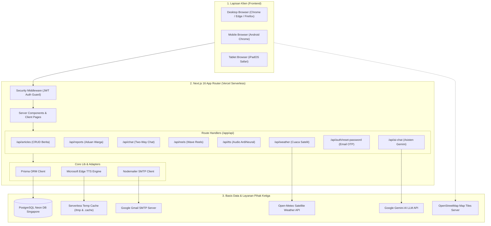
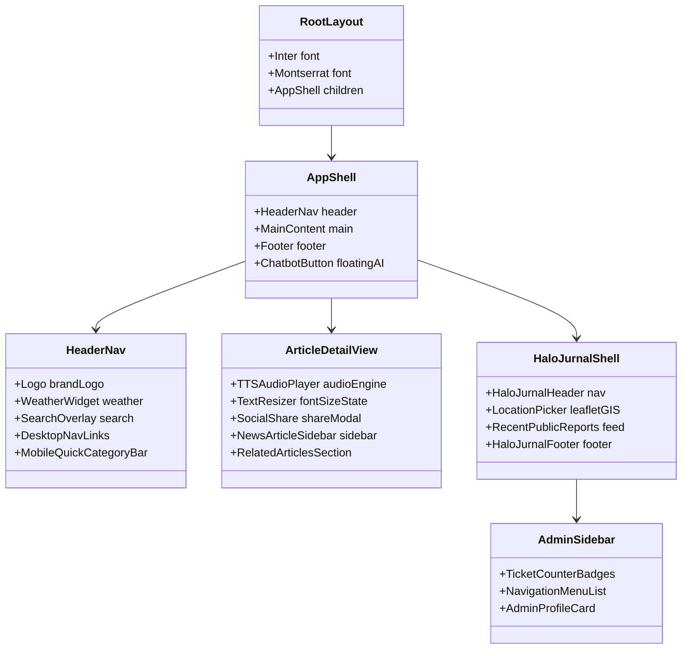
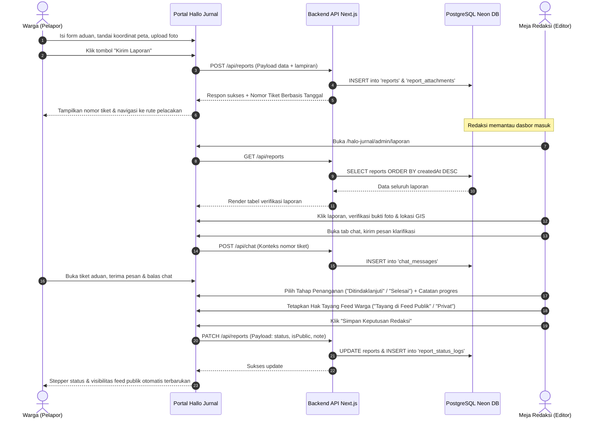
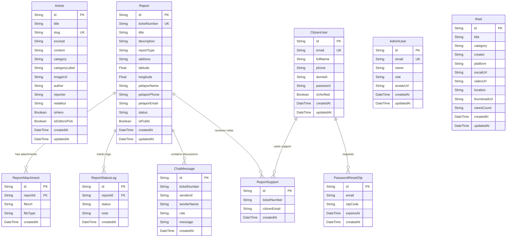

# DOKUMENTASI SISTEM INFORMASI MEDIA DIGITAL & ADVOKASI PUBLIK
## PT. Media Jurnal Sukabumi (Jurnal Wave & Hallo Jurnal)
*Dokumentasi Teknis Komprehensif untuk Laporan Magang dan Artikel Jurnal Pengabdian Masyarakat*

---

## 1. Gambaran Umum Sistem

### 1.1 Identitas dan Profil Singkat Instansi
Sistem ini dikembangkan pada **PT. Media Jurnal Sukabumi**, Divisi Teknologi Informasi (IT). Media ini berfokus pada jurnalisme lokal dan penyediaan informasi terpercaya untuk masyarakat Kota dan Kabupaten Sukabumi, Jawa Barat.

### 1.2 Tujuan Pengembangan Sistem
Tujuan utama pengembangan sistem adalah membangun platform media digital *hyperlocal* modern yang memadukan dua fungsi strategis:
1. **Jurnal Wave**: Kanal diseminasi berita, artikel peristiwa, gaya hidup (*lifestyle*), lowongan kerja (*loker*), otomotif, teknologi, sains, olahraga, serta video vertikal (*Wave Reels*) wilayah Sukabumi.
2. **Hallo Jurnal**: Kanal advokasi publik dan jurnalisme warga (*citizen journalism*) yang memfasilitasi pelaporan permasalahan infrastruktur, lingkungan, pelayanan publik, sosial, hingga keamanan secara transparan dan terukur.

### 1.3 Latar Belakang dan Masalah yang Diselesaikan
* **Ketiadaan Kanal Aspirasi Warga yang Terintegrasi dengan Pers Lokal**: Selama ini masyarakat menyampaikan keluhan fasilitas umum secara sporadis melalui media sosial tanpa kepastian tindak lanjut verifikasi jurnalis. Hallo Jurnal memecahkan masalah ini dengan menyediakan alur pelaporan berbasis nomor tiket otomatis, pemetaan titik kejadian menggunakan geolokasi interaktif (GIS), obrolan dua arah (*two-way chat*) langsung ke meja redaksi, serta moderasi ke kanal feed publik.
* **Aksesibilitas Informasi di Era Digital**: Pembaca memiliki mobilitas tinggi dan sebagian masyarakat berkebutuhan khusus (tunanetra/lansia) membutuhkan metode konsumsi berita tanpa harus membaca teks layar. Sistem menyelesaikan ini dengan menghadirkan pemutar audio berita (*Text-to-Speech*) suara pria resmi bahasa Indonesia (`id-ID-ArdiNeural`) dengan kontrol Media Session API.
* **Pergeseran Tren Konsumsi Video Pendek**: Generasi muda dan masyarakat umum beralih ke format video vertikal. Sistem menjawab kebutuhan ini melalui modul *Wave Reels* yang mengagregasi video pendek seputar peristiwa Sukabumi dengan filter kategori dan analitik tayangan.
* **Transparansi Kerja Meja Redaksi**: Redaksi membutuhkan dasbor terpadu untuk menyaring aduan warga, memverifikasi fakta lapangan, mengarsipkan berkas foto bukti, dan mempublikasikan tindak lanjut berita secara terstruktur.

---

## 2. Pengguna Sistem dan Perannya

Berdasarkan implementasi kode pada `prisma/schema.prisma`, `middleware.ts`, dan modul otentikasi di `lib/auth.ts`, sistem mengidentifikasi 3 (tiga) peran pengguna:

### 2.1 Pembaca Publik / Warga Anonim (*Guest/Public*)
* Menjelajahi seluruh artikel berita, opini, lifestyle, loker, dan reels tanpa kewajiban login.
* Memutar audio TTS (*Text-to-Speech*) pada halaman detail berita.
* Melihat informasi cuaca terkini dan prakiraan cuaca satelit 8 hari serta 192 jam wilayah Sukabumi.
* Menyimpan artikel favorit ke bookmark peramban (*browser localStorage*).
* Membaca umpan laporan warga yang telah disetujui redaksi (*Feed Publik Hallo Jurnal*).
* Melacak status aduan tertentu menggunakan input nomor tiket laporan.

### 2.2 Warga Terdaftar (*Citizen User*)
* Model data: `CitizenUser` (`prisma/schema.prisma:113-125`).
* Mendaftar dan masuk ke akun warga melalui `/daftar` dan `/login`.
* Mengirimkan laporan masalah publik melalui `/halo-jurnal/lapor` lengkap dengan koordinat geolokasi peta (*pinpoint Leaflet*), deskripsi peristiwa, dan unggahan lampiran bukti visual.
* Mengakses dasbor pribadi `/halo-jurnal/laporan-saya` untuk memantau tahapan proses laporan (*Diterima*, *Diproses*, *Ditindaklanjuti*, *Selesai*, *Ditolak*).
* Melakukan komunikasi dua arah (*two-way chat*) secara privat dengan meja redaksi per nomor tiket laporan (`ChatMessage`).
* Memberikan dukungan publik (*support/vote*) pada laporan warga lain di kanal feed publik (`ReportSupport`).
* Mengelola profil data diri dan melakukan pemulihan kata sandi via kode OTP email resmi.

### 2.3 Staf Redaksi / Editor / Pimpinan (*Admin User*)
* Model data: `AdminUser` (`prisma/schema.prisma:100-110`).
* Masuk melalui autentikasi aman JWT bertingkat pada `/login` dengan verifikasi token HTTP-only cookie.
* Mengelola laporan aduan warga di dasbor `/halo-jurnal/admin/laporan`: memverifikasi data lapangan, mengubah status laporan, memberikan catatan resmi perkembangan kasus, mengarsipkan bukti, dan menentukan visibilitas publik.
* Membalas obrolan pelapor (*two-way chat*) langsung dari meja redaksi.
* Mengelola konten berita di `/halo-jurnal/admin/berita` (membuat berita baru, mengedit naskah, menyematkan reporter & redaktur, mengatur badge *Headline / Hero Carousel*, serta *Editor's Pick*).
* Mengelola konten video pendek pada `/halo-jurnal/admin/reels`.
* Memantau direktori warga terdaftar di `/halo-jurnal/admin/warga`.
* Mengatur taksonomi kategori portal pada `/halo-jurnal/admin/kategori`.

---

## 3. Daftar Halaman dan Fitur Lengkap

### 3.1 Portal Berita & Lifestyle (Jurnal Wave)
| Rute Halaman | Nama Halaman | Fitur Utama | Bukti File Sumber |
| :--- | :--- | :--- | :--- |
| `/` | Beranda Portal | Hero Carousel berita utama swipeable, Berita Terkini, Widget Wave Reels, Banner Hallo Jurnal, Kategori Unggulan, Widget Cuaca, Chatbot AI. | `app/page.tsx`, `app/HomeClient.tsx` |
| `/berita` | Kanal Berita | Daftar liputan peristiwa Sukabumi dengan filter sub-kategori (Semua, Kampus, Sekolah). | `app/berita/page.tsx`, `app/berita/BeritaClient.tsx` |
| `/artikel/[id]` | Detail Artikel Berita | Teks berita lengkap, lead ringkasan, box *BACA JUGA*, Audio TTS Player presenter pria ArdiNeural dengan Media Session API, pengatur ukuran teks (A-/A/A+), tombol bagikan media sosial, bookmark. | `app/artikel/[id]/page.tsx`, `app/artikel/[id]/ArticleDetailView.tsx` |
| `/lifestyle` | Kanal Lifestyle | Berita gaya hidup, tren anak muda, kuliner (*culinary*), busana (*style*), dan wisata (*traveling*) Sukabumi. | `app/lifestyle/page.tsx`, `app/lifestyle/LifestyleClient.tsx` |
| `/loker` | Lowongan Kerja | Informasi peluang karir dan rekrutmen kerja terkini di wilayah Sukabumi dan sekitarnya. | `app/loker/page.tsx`, `components/cards/JobCard.tsx` |
| `/reels` | Video Wave Reels | Galeri video pendek vertikal lokal Sukabumi, filter kategori video, modal pemutar video, dan hitung tayangan (*views count*). | `app/reels/page.tsx`, `components/cards/ReelsSection.tsx` |
| `/otomotif` | Kanal Otomotif | Liputan otomotif, modifikasi, dan review kendaraan lokal. | `app/otomotif/page.tsx`, `components/layout/CategoryTemplate.tsx` |
| `/sport` | Kanal Olahraga | Kabar olahraga lokal (Persib, turnamen daerah) dan e-sport Sukabumi. | `app/sport/page.tsx`, `components/layout/CategoryTemplate.tsx` |
| `/tech` | Kanal Teknologi | Kabar transformasi digital, startup, dan inovasi IT lokal. | `app/tech/page.tsx`, `components/layout/CategoryTemplate.tsx` |
| `/science` | Kanal Sains | Kabar lingkungan, sains kelautan, dan ekologi daerah. | `app/science/page.tsx`, `components/layout/CategoryTemplate.tsx` |
| `/health` | Kanal Kesehatan | Informasi kesehatan, fasilitas medis, dan tips kesehatan warga. | `app/health/page.tsx`, `components/layout/CategoryTemplate.tsx` |
| `/cuaca` | Informasi Cuaca | Pantauan cuaca realtime Open-Meteo, prakiraan 8 hari & 192 jam, kelembapan, kecepatan angin, dan indeks kualitas udara (AQI). | `app/cuaca/page.tsx`, `components/widgets/WeatherWidget.tsx` |
| `/bookmark` | Artikel Tersimpan | Daftar berita yang disimpan pengguna secara lokal untuk dibaca luring (*offline reading*). | `app/bookmark/page.tsx`, `lib/bookmarks.ts` |
| `/indeks-berita` | Indeks Berita | Kalender pencarian berita terbit berdasarkan rentang tanggal dan filter kategori. | `app/indeks-berita/page.tsx`, `app/indeks-berita/IndeksBeritaClient.tsx` |
| `/tentang-kami` | Profil Perusahaan | Informasi struktur redaksi, sejarah media, dan visi misi PT. Media Jurnal Sukabumi. | `app/tentang-kami/page.tsx` |
| `/pedoman-media-siber` | Pedoman Media Siber | Kepatuhan hukum dan regulasi Dewan Pers mengenai pemberitaan siber. | `app/pedoman-media-siber/page.tsx` |
| `/kebijakan-privasi` | Kebijakan Privasi | Pernyataan perlindungan data pribadi dan privasi pengguna. | `app/kebijakan-privasi/page.tsx` |
| `/hubungi-kami` | Hubungi Redaksi | Formulir kontak redaksi, alamat kantor, dan saluran komunikasi resmi. | `app/hubungi-kami/page.tsx` |

### 3.2 Layanan Aduan & Partisipasi Warga (Hallo Jurnal)
| Rute Halaman | Nama Halaman | Fitur Utama | Bukti File Sumber |
| :--- | :--- | :--- | :--- |
| `/halo-jurnal` | Beranda Hallo Jurnal | Ringkasan statistik laporan, peta sebaran titik aduan, panduan alur advokasi, cuplikan laporan publik terhangat. | `app/halo-jurnal/page.tsx`, `app/halo-jurnal/beranda/page.tsx` |
| `/halo-jurnal/lapor` | Formulir Pengaduan | Pemilihan kategori aduan, isian kronologi masalah, dan pemetaan spasial via modul LocationPicker: tab opsi **"Peta & Titik GPS"** vs **"Ketik Manual Saja"**, tombol **"Lokasi Saya (GPS)"** (isi pin otomatis dari posisi GPS perangkat), **geser pin (draggable)** atau klik peta, **pencarian lokasi** nama tempat Sukabumi dengan tombol **"Cari"**, dua tampilan peta (**"Peta Jalan"** dan **"Satelit"**), **alamat otomatis** dari koordinat pin (reverse geocoding) & ketik manual, kolom **patokan lokasi** untuk memandu petugas lapangan, serta kewajiban mengunggah **lampiran bukti foto/video**. | `app/halo-jurnal/lapor/page.tsx`, `components/halo-jurnal/LocationPicker.tsx` |
| `/halo-jurnal/laporan/[id]` | Detail Tiket Aduan | Pelacakan status laporan (stepper visual), koordinat peta lokasi, galeri bukti foto, tab obrolan privat dua arah (*two-way chat*) dengan redaksi, dan tombol vote dukungan warga. | `app/halo-jurnal/laporan/[id]/page.tsx` |
| `/halo-jurnal/laporan-saya` | Riwayat Aduan Saya | Dasbor pelapor menampilkan daftar aduan milik akun warga yang sedang login, nomor tiket unik, tanggal, dan status penanganan. | `app/halo-jurnal/laporan-saya/page.tsx` |
| `/halo-jurnal/feed-publik` | Kanal Feed Publik | Umpan linimasa laporan warga yang telah diverifikasi dan disetujui tayang oleh redaksi, filter kategori aduan, dan counter dukungan warga. | `app/halo-jurnal/feed-publik/page.tsx`, `components/halo-jurnal/RecentPublicReports.tsx` |
| `/halo-jurnal/profil` | Profil Akun Warga | Pengelolaan biodata warga, nomor telepon, dan domisili kecamatan. | `app/halo-jurnal/profil/page.tsx` |
| `/halo-jurnal/tentang` | Tentang Hallo Jurnal | Informasi visi misi, latar belakang kanal advokasi publik, dan tim redaksi Hallo Jurnal. | `app/halo-jurnal/tentang/page.tsx` |
| `/halo-jurnal/hubungi-kami` | Hubungi Hallo Jurnal | Formulir kontak dan saluran komunikasi resmi kanal Hallo Jurnal. | `app/halo-jurnal/hubungi-kami/page.tsx` |
| `/halo-jurnal/kebijakan-privasi` | Kebijakan Privasi Hallo Jurnal | Pernyataan perlindungan data pribadi pelapor dan pengguna Hallo Jurnal. | `app/halo-jurnal/kebijakan-privasi/page.tsx` |
| `/halo-jurnal/syarat-ketentuan` | Syarat & Ketentuan Hallo Jurnal | Ketentuan penggunaan layanan pelaporan dan partisipasi warga. | `app/halo-jurnal/syarat-ketentuan/page.tsx` |

### 3.3 Autentikasi Pengguna
| Rute Halaman | Nama Halaman | Fitur Utama | Bukti File Sumber |
| :--- | :--- | :--- | :--- |
| `/login` | Masuk Akun | Form login universal (mendukung masuk sebagai redaksi/admin atau warga terdaftar), otentikasi kata sandi terenkripsi, pembuatan cookie JWT. | `app/login/page.tsx`, `lib/auth.ts` |
| `/daftar` | Pendaftaran Warga | Registrasi akun baru bagi warga masyarakat (nama, email, nomor telepon, domisili, password). | `app/daftar/page.tsx` |
| `/reset-password` | Reset Kata Sandi | Permintaan kode verifikasi OTP 6-digit via email SMTP Gmail (`nodemailer`), verifikasi OTP berbatas waktu 15 menit, dan pembaruan sandi baru. | `app/reset-password/page.tsx`, `app/api/auth/reset-password/route.ts` |

### 3.4 Dasbor Meja Redaksi (Admin Dashboard)
Struktur meja redaksi terbagi ke dalam 3 kelompok navigasi operasional sesuai implementasi pada `components/admin/AdminSidebar.tsx`:

#### A. Jurnal Wave CMS (Portal Berita & Multimedia)
| Rute Halaman | Nama Halaman | Fitur Utama | Bukti File Sumber |
| :--- | :--- | :--- | :--- |
| `/halo-jurnal/admin` | Dashboard Media | Metrik statistik portal berita, rekapitulasi artikel terbit, metrik video reels, ringkasan performa media. | `app/halo-jurnal/admin/page.tsx`, `components/admin/AdminSidebar.tsx` |
| `/halo-jurnal/admin/berita` | Artikel Berita | CMS penulisan dan penyuntingan artikel berita, pengunggahan foto sampul, penugasan reporter & redaktur pelaksana, penandaan status *Headline Carousel* & *Editor's Pick*. | `app/halo-jurnal/admin/berita/page.tsx` |
| `/halo-jurnal/admin/kategori` | Kategori & Headline | Pengaturan taksonomi kategori portal berita, penataan urutan rubrik, dan kurasi headline. | `app/halo-jurnal/admin/kategori/page.tsx` |
| `/halo-jurnal/admin/reels` | Wave Reels | CMS kurasi video pendek vertikal, penambahan tautan video reels (TikTok/Instagram), thumbnail, kategori video, pembuat konten, dan hitung views. | `app/halo-jurnal/admin/reels/page.tsx` |
| `/halo-jurnal/admin/loker` | Lowongan Kerja | CMS manajemen info lowongan pekerjaan dan rekrutmen wilayah Sukabumi. | `app/halo-jurnal/admin/loker/page.tsx` |

#### B. Hallo Jurnal (Layanan & Partisipasi Warga)
| Rute Halaman | Nama Halaman | Fitur Utama | Bukti File Sumber |
| :--- | :--- | :--- | :--- |
| `/halo-jurnal/admin/halo` | Dashboard Pemantauan | Dasbor ringkasan statistik aduan masuk, persentase penyelesaian laporan warga, distribusi kategori aduan, dan metrik penanganan. | `app/halo-jurnal/admin/halo/page.tsx` |
| `/halo-jurnal/admin/laporan` | Buku Induk Laporan | Tabel induk seluruh laporan aduan warga (`table-fixed`), filter status (diterima, diproses, ditindaklanjuti, selesai, ditolak), filter kategori, pencarian tiket/nama. | `app/halo-jurnal/admin/laporan/page.tsx` |
| `/halo-jurnal/admin/laporan/[id]` | Detail Investigasi & Meja Eksekusi | Panel Meja Eksekusi Redaksi: penentuan **Tahap Penanganan** (*Diterima*, *Diproses*, *Ditindaklanjuti*, *Selesai*, *Ditolak*), pengaturan **Hak Tayang Feed Warga** (*Tayang di Feed Publik* vs *Privat/Arsip Redaksi*), pengisian Catatan Progres Redaksi (rilis resmi dinas), tombol aksi redaksi (**Hubungi via WhatsApp** ke kontak pelapor dan **Buka Chat di Web**), tautan titik peta Google Maps, dan log kronologi riwayat milestone penanganan. | `app/halo-jurnal/admin/laporan/[id]/page.tsx` |
| `/halo-jurnal/admin/chat` | Chat Warga | Pusat komunikasi langsung dua arah (*two-way chat*) antara redaksi dengan warga pelapor yang terarsip per tiket laporan. | `app/halo-jurnal/admin/chat/page.tsx` |
| `/halo-jurnal/admin/feed-publik` | Moderasi Feed Publik | Pengelolaan dan moderasi visibilitas laporan warga yang tampil di linimasa feed publik Hallo Jurnal. | `app/halo-jurnal/admin/feed-publik/page.tsx` |
| `/halo-jurnal/admin/warga` | Warga Terdaftar | Tabel direktori warga terdaftar, nomor WhatsApp/telepon, email, domisili kecamatan, dan status verifikasi akun. | `app/halo-jurnal/admin/warga/page.tsx` |

#### C. Pengaturan
| Rute Halaman | Nama Halaman | Fitur Utama | Bukti File Sumber |
| :--- | :--- | :--- | :--- |
| `/halo-jurnal/admin/pengguna` | Tim Redaksi | Manajemen direktori staf redaksi dan hak akses akun admin/editor. | `app/halo-jurnal/admin/pengguna/page.tsx` |
| `/halo-jurnal/admin/pengaturan` | Pengaturan Web | Konfigurasi informasi identitas redaksi, narasi portal, dan parameter operasional. | `app/halo-jurnal/admin/pengaturan/page.tsx` |

---

## 4. Sistem dan Teknologi yang Digunakan

| Kategori | Teknologi / Pustaka | Versi | Fungsi di Proyek | Alasan Pemilihan Berdasarkan Bukti Kode |
| :--- | :--- | :--- | :--- | :--- |
| **Bahasa & Runtime** | Node.js | v26.13.0 (LTS) | Runtime eksekusi JavaScript server-side. | Standar kompatibilitas Next.js 16 dan Prisma ORM. |
| **Bahasa & Pengetikan** | TypeScript | `^5` | Bahasa pemrograman bertipe data statis ketat (*strict typing*). | Mencegah runtime bug pada struktur artikel, laporan, dan otentikasi (`tsconfig.json: compilerOptions.strict = true`). |
| **Framework Fullstack** | Next.js | `16.4.3` | Framework utama penyedia SSR, App Router, Route Handlers, dan Turbopack. | Mengoptimalkan SEO berita, kompilasi cepat via Turbopack, dan integrasi frontend-backend tanpa server terpisah. |
| **Library Frontend** | React & React-DOM | `19.2.8` | Library antarmuka komponen reaktif. | Versi React mutakhir pendukung Server Components dan Concurrent Mode. |
| **Styling Engine** | Tailwind CSS & PostCSS | `^4` / `@tailwindcss/postcss` | Framework CSS utilitas modern berbasis variabel tema CSS `@theme`. | Menyediakan token desain editorial konsisten di `globals.css` tanpa file CSS berukuran besar. |
| **Komponen UI Primitif** | Radix UI | Dialog `^1.1.23`, Dropdown `^2.1.24`, Slot `^1.3.3` | Komponen primitif tanpa gaya bawaan yang menjamin standar aksesibilitas WAI-ARIA. | Digunakan pada modal dialog, popup status laporan, dan menu dropdown navigasi. |
| **Utilitas Styling** | `clsx` & `tailwind-merge` | `2.1.1` & `3.7.0` | Helper penggabung kelas CSS kondisional yang aman dari konflik. | Diimplementasikan pada fungsi utilitas `cn()` di `lib/utils.ts`. |
| **Ikon Antarmuka** | Lucide React & React Icons | `^1.37.0` & `^5.7.0` | Set ikon SVG vektor berukuran ringan dan berestetika bersih. | Menggantikan ikon AI slop generik demi estetika editorial profesional (`RANCANGAN_BACKEND_DAN_SISTEM.md:47`). |
| **Sistem Basis Data** | PostgreSQL (Neon DB Singapore) | Cloud Serverless | Database relasional penyimpanan data artikel, laporan, percakapan, pengguna, dan reels. | Mendukung koneksi serverless pooling di AWS Asia Tenggara (`.env: DATABASE_URL`). |
| **ORM Basis Data** | Prisma ORM | `^6.19.3` | Object-Relational Mapping bertipe aman untuk migrasi dan kueri basis data. | Menyediakan client type-safe, schema declarative (`prisma/schema.prisma`), dan auto-generation model TypeScript. |
| **Sistem Pemetaan GIS** | Leaflet & React-Leaflet | `^1.9.4` & `^5.0.0` | Peta interaktif OpenStreetMap untuk pinpoint lokasi laporan warga. | Berjalan ringan di peramban tanpa kewajiban biaya lisensi Google Maps API (`components/halo-jurnal/LocationPicker.tsx`). |
| **Mesin Audio TTS** | Edge TTS & MsEdge TTS | `@andresaya/edge-tts: ^1.9.1`, `msedge-tts: ^2.1.0` | Sintesis teks naskah berita menjadi berkas suara pembaca berita TV pria (`id-ID-ArdiNeural`). | Menghasilkan suara neural alami berwibawa tanpa biaya API berbayar (`app/api/tts/route.ts`). |
| **Keamanan & Autentikasi** | `jose` | `^6.2.13` | Pembuatan dan verifikasi token JWT (*JSON Web Token*) pada runtime Edge/Node.js. | Menjaga keamanan sesi cookie admin dan warga secara Stateless tanpa beban memori server (`lib/auth.ts`). |
| **Enkripsi Kata Sandi** | `bcryptjs` | `^3.0.3` | Algoritma *one-way cryptographic hashing* untuk kata sandi pengguna. | Menjamin proteksi kata sandi warga dan admin di basis data (`prisma/schema.prisma`). |
| **Validasi Skema** | `zod` | `^4.6.7` | Validasi tipe dan struktur data input dari payload request API. | Mencegah injeksi payload malformed pada endpoint registrasi dan pelaporan. |
| **Layanan Email OTP** | `nodemailer` | `^10.2.1` | Pengiriman kode OTP 6-digit pemulihan sandi via protokol SMTP Google Mail. | Menjamin kode reset sandi sampai ke kotak masuk email pelapor secara instan (`lib/mail.ts`). |
| **Layanan Cuaca Satelit**| Open-Meteo Satellite API | REST v1 | Pengambilan data cuaca, suhu, kelembapan, angin, dan AQI Sukabumi secara berkala. | Layanan cuaca akurat tanpa batasan API key komersial (`lib/weather.ts`). |
| **Layanan AI Chatbot** | Google Gemini API | REST / SDK | Mesin percakapan asisten berita cerdas untuk menjawab pertanyaan pembaca. | Mengintegrasikan model LLM multimodal untuk asisten virtual portal berita (`app/api/ai-chat/route.ts`). |
| **Package Manager** | npm | v11+ | Manajemen paket dependensi pustaka JavaScript. | Terlihat dari keberadaan file `package-lock.json`. |
| **Linter Kode** | ESLint & Next Linter | `^9` / `16.4.3` | Pemeriksaan kepatuhan standar sintaksis kode dan aturan Next.js. | Dikonfigurasi pada `eslint.config.mjs` dan skrip `npm run lint`. |
| **Version Control** | Git & GitHub | Git 2.x | Pelacak riwayat perubahan kode, branching, dan kolaborasi tim magang. | Terlihat dari 202 commit riwayat git dan alur Pull Request di repositori `jurnal-vibes/jurnalvibes-website`. |
| **Infrastruktur Hosting** | Vercel Cloud Platform | Production | Layanan hosting serverless Next.js, CDN global edge network, dan CI/CD otomatis. | Terlihat dari konfigurasi build, log deploy, dan variabel lingkungan `VERCEL` di kode. |

### 4.1 Environment Variables yang Dibutuhkan (Nama Variabel Saja)
Berdasarkan pemeriksaan file `.env`, `.env.example`, dan `lib/`:
1. `DATABASE_URL` (Koneksi pooling basis data PostgreSQL Neon DB)
2. `DIRECT_URL` (Koneksi langsung non-pooling untuk Prisma migration)
3. `ADMIN_JWT_SECRET` (Kunci rahasia enkripsi tanda tangan JWT sesi admin)
4. `GEMINI_API_KEY` (Kunci otorisasi Google Gemini AI API)
5. `SMTP_USER` (Akun pengguna layanan SMTP Gmail pengirim email OTP)
6. `SMTP_PASS` (Kata sandi aplikasi layanan SMTP Gmail)
7. `SMTP_FROM` (Identitas nama dan alamat email pengirim resmi)
8. `NEXT_PUBLIC_WORDPRESS_URL` (URL basis integrasi WordPress REST API eksternal - opsional)
9. `NEXT_PUBLIC_SITE_URL` (URL domain kanonikal portal publik untuk metadata SEO)
10. `VERCEL` (Indikator runtime cloud otomatis yang disediakan platform Vercel)

---

## 5. Struktur Folder Proyek dan Modul Utama

```text
d:\jurnalvibes-website/
├── .env.example                      # Template variabel lingkungan
├── AGENTS.md                         # Panduan dan aturan operasional pengembangan
├── package.json                      # Konfigurasi dependensi dan skrip proyek
├── tsconfig.json                     # Konfigurasi kompilasi TypeScript
├── next.config.ts                    # Konfigurasi Next.js (kompresi, remote images, security headers)
├── middleware.ts                     # Interceptor proteksi rute halaman admin
├── DOKUMENTASI_PROJEK.md             # Dokumen teknis arsitektur awal proyek
├── RANCANGAN_BACKEND_DAN_SISTEM.md   # Dokumen cetak biru rekayasa sistem informasi
│
├── prisma/
│   └── schema.prisma                 # Definisi skema basis data PostgreSQL (11 model data)
│
├── types/
│   └── index.ts                      # Definisi kontrak tipe data global TypeScript
│
├── lib/
│   ├── auth.ts                       # Utilitas enkripsi kata sandi (bcrypt) dan token JWT (jose)
│   ├── bookmarks.ts                  # Utilitas manajemen bookmark artikel pada localStorage
│   ├── mail.ts                       # Layanan pengiriman email kode OTP via Nodemailer SMTP
│   ├── prisma.ts                     # Singleton instance koneksi client Prisma
│   ├── reels.ts                      # Pengelola data video Wave Reels (kombinasi DB & cache)
│   ├── utils.ts                      # Helper format tanggal Indonesia, slugify, dan tailwind merge
│   ├── weather.ts                    # Layanan client integrasi cuaca satelit Open-Meteo
│   └── wordpress.ts                  # Adapter sinkronisasi konten berita (DB, API, cache fallback)
│
├── data/
│   ├── dummyArticles.ts              # Dataset artikel berita lokal Sukabumi
│   ├── dummyJobs.ts                  # Dataset lowongan kerja wilayah Sukabumi
│   ├── dummyPolls.ts                 # Dataset polling pembaca dan metadata reels
│   ├── dummyReports.ts               # Dataset awal laporan warga Hallo Jurnal
│   ├── haloJurnalCategories.ts       # Taksonomi kategori dan ikon aduan masyarakat
│   ├── sukabumiKnowledge.ts          # Basis pengetahuan ensiklopedia daerah Sukabumi
│   ├── sukabumiPOI.ts                # Titik landmark koordinat penting Kota/Kab Sukabumi
│   └── sukabumiRegions.ts            # Daftar nama kecamatan Kota dan Kabupaten Sukabumi
│
├── components/
│   ├── admin/
│   │   ├── AdminHeader.tsx           # Topbar dasbor meja redaksi dan notifikasi
│   │   └── AdminSidebar.tsx          # Navigasi samping meja redaksi dengan counter badge
│   ├── cards/
│   │   ├── HalloJurnalBanner.tsx     # Banner ajakan partisipasi advokasi publik
│   │   ├── HeroCarousel.tsx          # Slider berita utama interaktif (swipe/drag touch gesture)
│   │   ├── HomeCategorySection.tsx   # Blok artikel per kategori di halaman utama
│   │   ├── JobCard.tsx               # Kartu display informasi lowongan kerja
│   │   ├── NewsCard.tsx              # Kartu display berita standar dengan cover, tag, & waktu
│   │   └── ReelsSection.tsx          # Carousel video vertikal Wave Reels di beranda
│   ├── halo-jurnal/
│   │   ├── HaloJurnalFooter.tsx      # Footer tematik kanal Hallo Jurnal
│   │   ├── HaloJurnalHeader.tsx      # Header navigasi tematik Hallo Jurnal
│   │   ├── HaloJurnalShell.tsx       # Pembungkus layout konsisten kanal Hallo Jurnal
│   │   ├── LocationPicker.tsx        # Komponen peta interaktif Leaflet untuk penentuan titik koordinat
│   │   └── RecentPublicReports.tsx   # Daftar feed laporan aduan yang disetujui tayang
│   ├── layout/
│   │   ├── AppShell.tsx              # Layout wrapper aplikasi utama
│   │   ├── CategoryTemplate.tsx      # Template reusable halaman kategori berita tematik
│   │   ├── Footer.tsx                # Footer resmi portal berita Jurnal Wave
│   │   ├── HeaderNav.tsx             # Navbar utama (desktop menu, search overlay, mobile category bar)
│   │   ├── NewsArticleSidebar.tsx    # Sidebar editorial artikel (Terpopuler, Suara Warga, Tag)
│   │   └── SearchOverlay.tsx         # Modal overlay pencarian berita cepat
│   ├── ui/                           # Komponen antarmuka atomik (Button, Badge, Logo, Modal)
│   └── widgets/
│       ├── ChatbotButton.tsx         # Floating button asisten virtual AI
│       ├── EditorsPickWidget.tsx     # Widget daftar artikel pilihan redaksi
│       └── WeatherWidget.tsx         # Widget cuaca ringkas pada navbar
│
└── app/                              # Next.js App Router (Rute Halaman & Endpoint Backend API)
    ├── layout.tsx                    # Root layout HTML, font injection (Inter, Montserrat, Literata)
    ├── page.tsx / HomeClient.tsx     # Beranda portal berita utama
    ├── not-found.tsx                 # Halaman penanganan Error 404 kustom
    ├── error.tsx / loading.tsx       # Penanganan error boundary dan visual skeleton loading
    ├── sitemap.ts / robots.ts        # Generator peta situs dan robots.txt untuk SEO Google
    ├── artikel/[id]/                 # Halaman pembaca berita detail dan pemutar audio TTS
    ├── berita/                       # Halaman arsip berita
    ├── lifestyle/                    # Halaman kanal gaya hidup
    ├── loker/                        # Halaman lowongan kerja
    ├── reels/                        # Halaman galeri video Wave Reels
    ├── cuaca/                        # Halaman detail cuaca Sukabumi
    ├── bookmark/                     # Halaman artikel favorit tersimpan
    ├── indeks-berita/                # Halaman penelusuran arsip kalender
    ├── login/ / daftar/              # Halaman autentikasi pengguna
    ├── reset-password/               # Halaman reset sandi akun warga via OTP
    ├── halo-jurnal/                  # Direktori kanal jurnalisme warga (publik & admin)
    └── api/                          # Backend REST Route Handlers
        ├── articles/                 # Endpoint CRUD & kueri artikel berita
        ├── reports/                  # Endpoint pengiriman & kueri laporan aduan
        ├── reports/support/          # Endpoint dukungan/vote warga pada laporan
        ├── chat/                     # Endpoint percakapan dua arah warga-redaksi
        ├── reels/ / reels/[id]/      # Endpoint video pendek reels
        ├── tts/                      # Endpoint streaming audio presenter berita ArdiNeural
        ├── auth/reset-password/      # Endpoint permintaan & verifikasi OTP email
        ├── weather/                  # Endpoint agregasi cuaca Open-Meteo
        ├── ai-chat/                  # Endpoint asisten percakapan cerdas Gemini AI
        └── admin/citizens/           # Endpoint administrasi akun warga oleh redaksi
```

---

## 6. Struktur Database dan Model Data (Prisma ORM)

Skema database PostgreSQL didefinisikan pada file [`prisma/schema.prisma`](file:///d:/jurnalvibes-website/prisma/schema.prisma) dengan 11 model relasional:

### 6.1 `Article` (Tabel: `articles`)
Menyimpan naskah artikel berita, kategori editorial, visual, serta metadata jurnalis.
* `id` (`String`, Primary Key, default `cuid()`): Pengidentifikasi unik artikel.
* `title` (`VarChar(255)`): Judul naskah berita.
* `slug` (`VarChar(255)`, Unique): URL ramah SEO.
* `excerpt` (`Text`): Ringkasan singkat (*lead paragraph*) naskah.
* `content` (`Text`): Isi naskah berita lengkap (mendukung format teks dan HTML markup).
* `category` (`VarChar(50)`, default `"berita"`): Kategori sistem berita.
* `categoryLabel` (`VarChar(50)`, opsional): Label tampilan kategori (misal: "SPORT & E-SPORT").
* `imageUrl` (`Text`): Tautan gambar cover utama berita.
* `imageAlt` (`VarChar(255)`, opsional): Keterangan teks aksesibilitas gambar.
* `author` (`VarChar(100)`, default `"Tim Redaksi"`): Nama penulis artikel.
* `reporter` (`VarChar(100)`, opsional): Nama jurnalis lapangan peliput peristiwa.
* `redaktur` (`VarChar(100)`, opsional): Nama editor pemeriksa naskah berita.
* `readTime` (`VarChar(50)`, default `"5 min read"`): Perkiraan durasi membaca.
* `isHero` (`Boolean`, default `false`): Penanda apakah artikel tayang di slider Headline Carousel.
* `isEditorsPick` (`Boolean`, default `false`): Penanda artikel pilihan editor.
* `badge` (`VarChar(50)`, opsional): Label khusus (misal: "HOT", "EKSKLUSIF").
* `publishedDate` (`VarChar(50)`, opsional): Label tanggal rilis berita.
* `createdAt` (`DateTime`, default `now()`): Waktu pembuatan naskah.
* `updatedAt` (`DateTime`, `@updatedAt`): Waktu pembaruan terakhir.

### 6.2 `Report` (Tabel: `reports`)
Menyimpan data laporan pengaduan masalah warga masyarakat pada kanal Hallo Jurnal.
* `id` (`String`, Primary Key, default `cuid()`): ID internal laporan.
* `ticketNumber` (`VarChar(50)`, Unique): Nomor tiket unik berbasis tanggal.
* `title` (`VarChar(255)`): Ringkasan pokok permasalahan laporan.
* `description` (`Text`): Penjelasan kronologi dan rincian masalah di lapangan.
* `reportType` (`VarChar(50)`, default `"infrastruktur"`): Kategori aduan (`infrastruktur`, `lingkungan`, `pelayanan`, `sosial`, `keamanan`).
* `address` (`Text`, opsional): Alamat fisik lokasi kejadian.
* `latitude` (`Float`, opsional): Koordinat lintang hasil penandaan peta Leaflet.
* `longitude` (`Float`, opsional): Koordinat bujur hasil penandaan peta Leaflet.
* `pelaporName` (`VarChar(100)`, default `"Warga Sukabumi"`): Nama pelapor.
* `pelaporPhone` (`VarChar(50)`, opsional): Nomor WhatsApp/telepon pelapor.
* `pelaporEmail` (`VarChar(100)`, opsional): Alamat email pelapor.
* `status` (`VarChar(50)`, default `"diterima"`): Tahapan laporan (`diterima`, `diproses`, `ditindaklanjuti`, `selesai`, `ditolak`).
* `isPublic` (`Boolean`, default `true`): Penanda apakah laporan tayang di kanal feed publik.
* `createdAt` (`DateTime`, default `now()`): Waktu pengiriman aduan.
* `updatedAt` (`DateTime`, `@updatedAt`): Waktu pembaruan status aduan.
* Relasi: Memiliki banyak `attachments` (`ReportAttachment[]`) dan `statusLogs` (`ReportStatusLog[]`).

### 6.3 `ReportAttachment` (Tabel: `report_attachments`)
Menyimpan berkas foto bukti fisik yang diunggah warga untuk memperkuat laporan.
* `id` (`String`, Primary Key): ID lampiran.
* `reportId` (`String`): Foreign key relasi ke model `Report` (aturan: `onDelete: Cascade`).
* `fileUrl` (`Text`): Tautan URL berkas bukti foto / dokumen.
* `fileType` (`VarChar(50)`, opsional): Tipe berkas gambar (JPEG/PNG/WebP).
* `createdAt` (`DateTime`, default `now()`): Waktu berkas diunggah.

### 6.4 `ReportStatusLog` (Tabel: `report_status_logs`)
Mencatat riwayat audit perubahan status laporan oleh meja redaksi secara transparan.
* `id` (`String`, Primary Key): ID log status.
* `reportId` (`String`): Foreign key relasi ke model `Report` (`onDelete: Cascade`).
* `status` (`VarChar(50)`): Status yang ditetapkan pada fase tersebut.
* `note` (`Text`, opsional): Catatan redaksi (misal: "Tim redaksi telah mengonfirmasi pihak Dinas PU Sukabumi").
* `createdAt` (`DateTime`, default `now()`): Waktu perubahan status dilakukan.

### 6.5 `ChatMessage` (Tabel: `chat_messages`)
Menyimpan riwayat pesan obrolan interaktif dua arah antara pelapor dan redaksi.
* `id` (`String`, Primary Key): ID pesan.
* `ticketNumber` (`VarChar(50)`, Indexed): Nomor tiket aduan yang menjadi konteks obrolan.
* `senderId` (`VarChar(100)`): ID pengirim pesan.
* `senderName` (`VarChar(100)`): Nama identitas pengirim.
* `role` (`VarChar(50)`, default `"warga"`): Peran pengirim (`warga` atau `admin`).
* `message` (`Text`): Isi pesan obrolan.
* `createdAt` (`DateTime`, default `now()`): Waktu pesan terkirim.

### 6.6 `AdminUser` (Tabel: `admin_users`)
Menyimpan akun staf dan pimpinan meja redaksi pengelola portal.
* `id` (`String`, Primary Key): ID staf redaksi.
* `name` (`VarChar(100)`): Nama lengkap staf redaksi.
* `email` (`VarChar(100)`, Unique): Alamat email resmi redaksi.
* `role` (`VarChar(50)`, default `"editor"`): Tingkatan hak akses (`admin`, `editor`, `journalist`).
* `avatarUrl` (`Text`, opsional): Foto profil staf.
* `createdAt` & `updatedAt`: Timestamp audit akun.

### 6.7 `CitizenUser` (Tabel: `citizen_users`)
Menyimpan identitas akun warga masyarakat pengguna portal Hallo Jurnal.
* `id` (`String`, Primary Key): ID pengguna warga.
* `email` (`VarChar(100)`, Unique): Email identitas masuk.
* `fullName` (`VarChar(100)`): Nama lengkap sesuai KTP.
* `phone` (`VarChar(50)`): Nomor kontak seluler.
* `domisili` (`Text`, opsional): Nama kecamatan tempat tinggal warga.
* `password` (`Text`, opsional): Kata sandi terenkripsi algoritma bcrypt.
* `isVerified` (`Boolean`, default `true`): Status verifikasi akun.
* `createdAt` & `updatedAt`: Timestamp audit akun.

### 6.8 `PasswordResetOtp` (Tabel: `password_reset_otps`)
Menyimpan kode OTP 6-digit sementara untuk autentikasi pemulihan kata sandi warga.
* `id` (`String`, Primary Key): ID transaksi OTP.
* `email` (`VarChar(100)`, Indexed): Email tujuan reset sandi.
* `otpCode` (`VarChar(10)`): Kode numerik acak 6 digit.
* `expiresAt` (`DateTime`): Waktu kedaluwarsa kode (standar: 15 menit dari pembuatan).
* `createdAt` (`DateTime`, default `now()`): Waktu penerbitan kode.

### 6.9 `ReportSupport` (Tabel: `report_supports`)
Mencatat dukungan (*vote*) dari masyarakat untuk laporan publik di feed.
* `id` (`String`, Primary Key): ID dukungan.
* `ticketNumber` (`VarChar(50)`, Indexed): Nomor tiket yang didukung.
* `citizenEmail` (`VarChar(100)`): Email warga pemberi dukungan.
* `createdAt` (`DateTime`, default `now()`): Waktu pemberian dukungan.
* Unique Constraint: `@@unique([ticketNumber, citizenEmail])` (mencegah satu warga memberi dukungan ganda).

### 6.10 `Reel` (Tabel: `reels`)
Menyimpan video pendek vertikal (*Wave Reels*) peristiwa dan lifestyle Sukabumi.
* `id` (`String`, Primary Key): ID video reels.
* `title` (`VarChar(255)`): Judul video.
* `category` (`VarChar(50)`, default `"Berita"`): Kategori konten reels.
* `creator` (`VarChar(100)`, default `"@jurnalwave"`): Akun pembuat konten video.
* `platform` (`VarChar(50)`, default `"tiktok"`): Platform asal video (*tiktok*, *instagram*, *youtube*).
* `socialUrl` (`Text`, opsional): Tautan URL video asli di media sosial.
* `videoUrl` (`Text`, opsional): Tautan berkas MP4 langsung jika diunggah lokal.
* `location` (`VarChar(100)`, default `"Sukabumi"`): Lokasi peristiwa video.
* `thumbnailUrl` (`Text`): Gambar cuplikan (*cover poster*) video.
* `imageAlt` (`VarChar(255)`, opsional): Teks alternatif aksesibilitas gambar.
* `viewsCount` (`VarChar(50)`, default `"0"`): Jumlah akumulasi tayangan video.
* `createdAt` & `updatedAt`: Timestamp audit rekaman video.

---

## 7. Sumber Data dan Cara Sistem Mengambilnya

Arsitektur sistem menerapkan konsep **Multi-Tier Resilience Layer** (`lib/wordpress.ts`, `lib/reels.ts`):

```
┌─────────────────────────────────────────────────────────────┐
│                 PENGAMBILAN DATA ARTIKEL                    │
├─────────────────────────────────────────────────────────────┤
│ 1. Server-Side Cache (In-Memory Timestamped Cache)          │
│    └─► Kecepatan < 1ms, membaca data hangat di server.      │
│                                                             │
│ 2. PostgreSQL Relational Database (Prisma ORM)             │
│    └─► Mengambil data terkini dari tabel 'articles'.        │
│                                                             │
│ 3. Client-Side API Route (/api/articles)                    │
│    └─► Pemanggilan AJAX fetch dinamis dari sisi browser.    │
│                                                             │
│ 4. Local Storage Fallback (jurnal_wave_articles)            │
│    └─► Menjamin konten tetap muncul meski server offline.   │
│                                                             │
│ 5. Static Seed Data (data/dummyArticles.ts)                 │
│    └─► Penjaga terakhir (*safety net*) kegagalan jaringan. │
└─────────────────────────────────────────────────────────────┘
```

1. **Database Relasional Primer**: Menggunakan Prisma Client yang terhubung ke PostgreSQL (Neon DB). Data artikel berita, akun warga, laporan aduan, dan reels diambil secara real-time melalui Server Component atau Route Handler.
2. **In-Memory Server Caching**: Pada `lib/wordpress.ts`, data artikel disimpan dalam variabel `serverArticlesCache` selama batas waktu `CACHE_TTL_MS` (60 detik) untuk memangkas kueri basis data berulang (*connection pooling optimization*).
3. **Layanan Satelit Eksternal**: Data cuaca diambil secara berkala langsung dari Open-Meteo REST API (`https://api.open-meteo.com/v1/forecast`) dengan koordinat geografis Sukabumi (`-6.9277`, `106.9300`).
4. **Browser LocalStorage Resilience**: Di sisi klien peramban, setiap data artikel yang berhasil di-fetch otomatis disimpan ke `localStorage` (`jurnal_wave_articles`). Jika terjadi gangguan koneksi internet, antarmuka pembaca tetap menyajikan berita tanpa menampilkan layar putih.

---

## 8. Pendekatan Antarmuka Pengguna (UI/UX)

### 8.1 Desain Responsif & Breakpoint
Antarmuka dibangun secara adaptif memanfaatkan titik henti (*breakpoint*) Tailwind CSS:
* **Mobile (< 640px)**:
  * Navigasi utama diringkas ke dalam *Mobile Quick Category Bar* horizontal dengan fitur geser (*no-scrollbar*).
  * Pemutar audio TTS beralih menjadi *floating player bar* tersemat di bagian bawah layar agar tidak menghalangi pembacaan teks artikel.
  * Form laporan Hallo Jurnal mengaktifkan kontrol peta dengan *single-touch pan* terisolasi agar pengguna tidak macet saat menggulir layar.
  * Tabel admin diubah secara responsif menggunakan container pembungkus horizontal (`overflow-x-auto`) atau kartu ringkas.
* **Tablet (640px - 1023px)**:
  * Hero Carousel menampilkan grid proporsi `2/1` dengan navigasi gestur sentuh geser (*swipe touch gesture*).
  * Quick Category Bar navbar diselaraskan secara simetris (`max-w-container-max mx-auto px-4 md:px-6`) agar lurus vertikal dengan logo brand.
* **Desktop (≥ 1024px)**:
  * Menampilkan navigasi penuh: 6 menu editorial ramping dengan menu dropdown bertingkat (*Berita ▾*, *Lifestyle ▾*, *Eksplor ▾*).
  * Tata letak dua kolom editorial ala koran digital: kolom utama naskah artikel (kiri) bersanding dengan *NewsArticleSidebar* sticky (kanan) yang memuat Berita Terpopuler, Video Populer, dan Aduan Warga.

### 8.2 Sistem Desain (Design System Tokens)
Sesuai standarisasi pada `app/globals.css` dan `RANCANGAN_BACKEND_DAN_SISTEM.md:28-61`:
* **Warna Utama Brand**:
  * `Primary Carmine Red`: `#c00015` (Warna aksen utama brand Jurnal Wave dan Hallo Jurnal).
  * `Primary Dark`: `#a00012` (State tombol hover).
  * `Primary Subtle Tint`: `#fef2f2` (Background badge dan active highlight).
* **Matriks Monokrom (Slate Matrix)**:
  * `Teks Utama (Headings)`: `#0f172a` (Slate-900).
  * `Teks Sekunder (Body/Muted)`: `#475569` (Slate-600).
  * `Teks Keterangan (Dim/Timestamp)`: `#94a3b8` (Slate-400).
  * `Latar Belakang Dasar (Surface Base)`: `#fbf9f9` (Off-white berkarakter kertas koran cetak).
  * `Latar Belakang Kartu (Card Surface)`: `#ffffff`.
  * `Garis Pembatas (Borders)`: `#e2e8f0` (Slate-200).
* **Tipografi**:
  * Font Judul & Display: `Montserrat` (`next/font/google`), berkarakter tegas, modern, dan berketerbacaan tinggi.
  * Font Isi Teks & Antarmuka: `Inter` (`next/font/google`), font sans-serif netral untuk keterbacaan artikel panjang.
  * Font Khusus Editorial: `Literata` (`next/font/google`), font serif opsional untuk nuansa koran sastra/opini.
* **Sistem Spacing & Bentuk**:
  * Menggunakan kelipatan 4px (`--spacing-base: 4px`). Target sentuh tombol minimal `44px` pada perangkat bergerak. Radius sudut kartu memakai `rounded-2xl` (16px) untuk komponen publik dan `rounded-xl` (12px) untuk elemen formulir admin.

---

## 9. Alur Kerja Sistem dari Sisi Pengguna

### 9.1 Alur Pembacaan Berita & Pemutaran Audio TTS
```
[Pembaca] ──► Buka Portal (/) ──► Klik Judul Berita (/artikel/[id])
                    │
                    ▼
          Teks Artikel Terbuka
                    │
                    ├──► [Klik Tombol "Dengarkan Artikel"]
                    │           │
                    │           ▼
                    │    Kirim GET /api/tts?id=...
                    │           │
                    │           ▼
                    │    Server Cek Cache Disk MP3
                    │    ├── Ada: Langsung Stream Audio (0.001s)
                    │    └── Belum: EdgeTTS Synthesize (id-ID-ArdiNeural)
                    │           │
                    │           ▼
                    │    Audio HTML5 Diputar di Peramban
                    │    (Media Session API terpasang di Layar Kunci HP)
                    │
                    └──► [Baca Teks / Simpan Bookmark / Bagikan]
```

### 9.2 Alur Pengaduan Warga (Hallo Jurnal)
```
[Warga] ──► Akses /halo-jurnal/lapor
               │
               ▼
    1. Pilih Kategori Masalah (Infrastruktur/Lingkungan/Pelayanan/Sosial/Keamanan)
    2. Isi Judul & Deskripsi Kronologi
    3. Tentukan Lokasi Kejadian (Modul LocationPicker):
       ├── Mode Tab: "Peta & Titik GPS" atau "Ketik Manual Saja"
       ├── Opsi Otomatis: Klik tombol "Lokasi Saya (GPS)" untuk isi pin dari posisi perangkat
       ├── Opsi Interaktif: Geser pin (draggable) atau klik langsung pada peta
       ├── Opsi Pencarian: Ketik nama tempat Sukabumi lalu tekan tombol "Cari"
       ├── Opsi Layer Tampilan: Pilih "Peta Jalan" atau "Satelit"
       ├── Alamat terisi otomatis dari titik pin (reverse geocoding) & dapat disunting
       └── Isi kolom "Patokan Lokasi" (membantu petugas menemukan titik di lapangan)
    4. Unggah Berkas Lampiran Bukti Foto atau Video (Wajib untuk Pengaduan)
    5. Masukkan Identitas Kontak Pelapor
               │
               ▼
    [Klik "Kirim Laporan"] ──► POST /api/reports
               │
               ▼
    Sistem Menerbitkan Nomor Tiket Unik Berbasis Tanggal
               │
               ▼
    Laporan Masuk Status: "Diterima"
               │
               ▼
    Pelapor Memantau di /halo-jurnal/laporan-saya
    & Dapat Melakukan Two-Way Chat dengan Meja Redaksi
```

### 9.3 Alur Verifikasi & Pengelolaan Meja Redaksi
```
[Redaksi] ──► Login Meja Redaksi (/login) ──► Dasbor Admin (/halo-jurnal/admin)
                    │
                    ├──► [Buku Induk Laporan (/halo-jurnal/admin/laporan)]
                    │           │
                    │           ├── Masuk ke Detail Investigasi (/halo-jurnal/admin/laporan/[id])
                    │           ├── Periksa Bukti Visual & Titik Koordinat Peta GIS Leaflet / Google Maps
                    │           ├── Hubungi Pelapor via Chat Warga Dua Arah / Kontak WhatsApp
                    │           ├── Koordinasi Lapangan & Konfirmasi Dinas Terkait
                    │           ├── [Meja Eksekusi Redaksi]:
                    │           │     ├── Pilih Tahap Penanganan: Diterima ──► Diproses ──► Ditindaklanjuti ──► Selesai (atau Ditolak)
                    │           │     ├── Tetapkan Hak Tayang Feed Warga: "Tayang di Feed Publik" (isPublic: true) vs "Privat (Arsip Redaksi)" (isPublic: false)
                    │           │     └── Input Catatan Progres Redaksi (Rilis Resmi Dinas / Klarifikasi)
                    │           └── Klik "Simpan Keputusan Redaksi" (Otomatis Catat ke Log Status & Notifikasi Warga)
                    │
                    ├──► [Manajemen Artikel Berita (/halo-jurnal/admin/berita)]
                    │           ├── Tulis Artikel Berita Baru / Liputan Khusus
                    │           ├── Sematkan Reporter, Redaktur, & Label Kategori
                    │           └── Tetapkan sebagai Headline Carousel / Editor's Pick
                    │
                    └──► [Manajemen Video Reels (/halo-jurnal/admin/reels)]
                                └── Unggah Tautan Video Pendek Peristiwa Sukabumi
```

---

## 10. Metode Pengembangan dan Pengujian

### 10.1 Pola Pengerjaan Berdasarkan Riwayat Git
Berdasarkan analisis 202 commit riwayat Git dari tanggal **29 Agustus 2026 hingga 29 Oktober 2026**:
* **Pola Iterasi Berbasis Feature-Branching**: Seluruh penambahan fitur dan perbaikan bug dikerjakan pada branch terpisah bernama `revisi-terbaruN` (tercatat mulai dari `revisi-terbaru10` hingga `revisi-terbaru28`).
* **Mekanisme Integrasi Kode Melalui Pull Request (PR)**: Penggabungan kode ke branch utama (`main`) selalu melalui proses Pull Request formal di GitHub (tercatat bukti merge dari PR #29 hingga PR #46).
* **Komitmen Perubahan Berskala Atomik**: Commit difokuskan pada perbaikan spesifik, misalnya commit `d73d35a` (TTS voice pria ArdiNeural), `0dcc601` (swipe touch gesture HeroCarousel), dan `89f695c` (penyelarasan navbar mobile).

### 10.2 Tahapan Pengembangan yang Terlihat dari Repositori
1. **Tahap 1: Inisiasi Arsitektur & Migrasi (Akhir Agustus 2026)**
   * *Bukti Commit*: `feat: Migrasi Jurnal Vibes ke Next.js App Router` (29 Agustus 2026).
   * Menyiapkan fondasi Next.js App Router, konfigurasi TypeScript, perancangan komponen `HeaderNav`, `Footer`, dan desain logo hybrid transparan.
2. **Tahap 2: Implementasi Modul Utama & Ekosistem Data (September 2026)**
   * Mengembangkan modul Berita Terkini, kanal tematik, agregasi data cuaca Open-Meteo, integrasi GIS Leaflet, perancangan skema Prisma PostgreSQL Neon DB, serta pembuatan modul advokasi Hallo Jurnal.
3. **Tahap 3: Fitur Multimedia, Aksesibilitas TTS & Meja Redaksi (Oktober 2026)**
   * Mengintegrasikan pemutar video pendek *Wave Reels*, autentikasi JWT aman, sistem reset OTP email, mesin Edge TTS suara pria ArdiNeural, integrasi Media Session API, serta dasbor meja redaksi.
4. **Tahap 4: Refinement, Pengujian Multi-Perangkat & Optimasi (Akhir Oktober 2026)**
   * *Bukti Commit*: Rangkaian commit `revisi-terbaru20` s.d. `revisi-terbaru28` (28–29 Oktober 2026) yang memfokuskan pada kompatibilitas audio tablet iPad/Android, eliminasi timeout streaming, penambahan gesture geser *swipe* pada headline carousel, dan penyelarasan tata letak kontainer responsif.

### 10.3 Pengujian yang Ada di Repositori
* **Type-Checking Kompilasi TypeScript**: File `tsconfig.json` mengaktifkan `strict: true`. Setiap proses kompilasi (`npm run build`) secara otomatis memverifikasi keabsahan seluruh tipe data.
* **Linting Kode Statis**: Konfigurasi ESLint pada `eslint.config.mjs` dengan preset `eslint-config-next` dieksekusi melalui skrip `npm run lint`.
* **Prisma Schema Validation**: Perintah `prisma generate` dieksekusi sebelum proses kompilasi build Next.js (`package.json: scripts.build`).
* **Pengujian Manual Lintas Perangkat (*Manual Multi-Device Testing*)**: Berdasarkan catatan git commit dan artefak tangkapan layar di repositori (`screenshots/`), pengujian aktif dilakukan langsung pada perangkat desktop (Chrome, Edge), smartphone Android (Chrome Mobile), dan tablet/iPad (Safari/WebKit).

### 10.4 Dokumen Perancangan di Repositori
Repositori memuat dokumen spesifikasi teknis:
* `DOKUMENTASI_PROJEK.md`: Arsitektur komponen, routing, dan integrasi modul.
* `RANCANGAN_BACKEND_DAN_SISTEM.md`: Algoritma sistem, diagram alur, dan cetak biru backend.
* `AGENTS.md`: SOP panduan teknis dan aturan modifikasi kode.

---

## 11. Diagram Sistem (Format Mermaid)

### 11.1 Diagram Arsitektur Sistem (High-Level Architecture)


### 11.2 Diagram Struktur Navigasi Halaman (Sitemap)

```mermaid
graph TD
    Root["Portal Utama (/)"]
    
    %% Kanal Berita
    Root --> Berita["/berita (Kanal Berita)"]
    Berita --> SubKampus["/berita?sub=kampus"]
    Berita --> SubSekolah["/berita?sub=sekolah"]
    Root --> DetailArtikel["/artikel/[id] (Detail Berita & TTS)"]
    
    %% Kanal Tematik
    Root --> Lifestyle["/lifestyle (Gaya Hidup & Wisata)"]
    Root --> Loker["/loker (Lowongan Kerja)"]
    Root --> Reels["/reels (Video Pendek Sukabumi)"]
    Root --> Tematik["Kanal Tematik (/otomotif, /sport, /tech, /science, /health)"]
    
    %% Utilitas Pembaca
    Root --> Cuaca["/cuaca (Detail Satelit Cuaca)"]
    Root --> Bookmark["/bookmark (Artikel Tersimpan)"]
    Root --> Indeks["/indeks-berita (Kalender Berita)"]
    Root --> Info["Informasi (/tentang-kami, /pedoman-media-siber, /kebijakan-privasi, /hubungi-kami)"]
    
    %% Hallo Jurnal Warga
    Root --> HaloJurnal["/halo-jurnal (Beranda Advokasi Warga)"]
    HaloJurnal --> HJLapor["/halo-jurnal/lapor (Formulir Aduan & Peta GIS)"]
    HaloJurnal --> HJTiket["/halo-jurnal/laporan/[id] (Pelacakan Tiket & Chat)"]
    HaloJurnal --> HJSaya["/halo-jurnal/laporan-saya (Daftar Aduan Saya)"]
    HaloJurnal --> HJFeed["/halo-jurnal/feed-publik (Umpan Aduan Publik)"]
    HaloJurnal --> HJProfil["/halo-jurnal/profil (Profil Akun Warga)"]
    HaloJurnal --> HJInfo["Informasi Hallo Jurnal (/tentang, /hubungi-kami, dll)"]
    
    %% Autentikasi
    Root --> Auth["Autentikasi (/login, /daftar, /reset-password)"]
    
    %% Meja Redaksi
    Auth --> AdminDash["Dashboard Media (/halo-jurnal/admin)"]
    
    %% Grup 1: Jurnal Wave CMS
    AdminDash --> AdminBerita["/halo-jurnal/admin/berita (CMS Berita)"]
    AdminDash --> AdminKategori["/halo-jurnal/admin/kategori (Kategori & Headline)"]
    AdminDash --> AdminReels["/halo-jurnal/admin/reels (CMS Wave Reels)"]
    AdminDash --> AdminLoker["/halo-jurnal/admin/loker (CMS Lowongan Kerja)"]
    
    %% Grup 2: Hallo Jurnal Layanan Warga
    AdminDash --> AdminHalo["/halo-jurnal/admin/halo (Dashboard Pemantauan)"]
    AdminDash --> AdminLaporan["/halo-jurnal/admin/laporan (Buku Induk Laporan)"]
    AdminLaporan --> AdminDetailLaporan["/halo-jurnal/admin/laporan/[id] (Meja Eksekusi Redaksi)"]
    AdminDash --> AdminChat["/halo-jurnal/admin/chat (Pusat Chat Warga)"]
    AdminDash --> AdminFeed["/halo-jurnal/admin/feed-publik (Moderasi Feed Publik)"]
    AdminDash --> AdminWarga["/halo-jurnal/admin/warga (Warga Terdaftar)"]
    
    %% Grup 3: Pengaturan
    AdminDash --> AdminPengguna["/halo-jurnal/admin/pengguna (Tim Redaksi)"]
    AdminDash --> AdminPengaturan["/halo-jurnal/admin/pengaturan (Pengaturan Web)"]
```


### 11.3 Diagram Arsitektur Komponen Antarmuka


### 11.4 Diagram Alur Proses Laporan Warga & Moderasi Redaksi


### 11.5 Diagram Hubungan Entitas Basis Data (Entity Relationship Diagram)


---

## 12. Panduan Instalasi dan Menjalankan Sistem

Langkah-langkah penginstalan dan pengoperasian sistem pada lingkungan pengembangan lokal:

### 12.1 Prasyarat Sistem (*System Prerequisites*)
* **Node.js**: Versi 20.x atau 22.x LTS.
* **Package Manager**: npm (v10+) atau yarn/pnpm.
* **Basis Data**: Akses instance PostgreSQL aktif (disarankan akun serverless Neon DB).
* **Git**: Versi 2.30+.

### 12.2 Langkah Instalasi

1. **Mengkloning Repositori Proyek**:
   ```bash
   git clone https://github.com/jurnal-vibes/jurnalvibes-website.git
   cd jurnalvibes-website
   ```

2. **Menginstal Dependensi Pustaka**:
   ```bash
   npm install
   ```

3. **Menyiapkan Berkas Variabel Lingkungan (*Environment Variables*)**:
   Salin template `.env.example` menjadi `.env`:
   ```bash
   cp .env.example .env
   ```
   Lengkapi variabel wajib di dalam file `.env`:
   * `DATABASE_URL`: URL koneksi pool basis data PostgreSQL Neon.
   * `DIRECT_URL`: URL koneksi langsung basis data PostgreSQL.
   * `ADMIN_JWT_SECRET`: String acak aman untuk penandatanganan token JWT.
   * `SMTP_USER` & `SMTP_PASS`: Kredensial email Gmail untuk fitur OTP reset sandi.
   * `GEMINI_API_KEY`: Kunci API Google Gemini untuk asisten AI.

4. **Sinkronisasi Skema Basis Data & Prisma Client**:
   Jalankan sinkronisasi skema ke database dan generate client TypeScript:
   ```bash
   npx prisma generate
   npx prisma db push
   ```

5. **Menjalankan Server Pengembangan (*Development Mode*)**:
   ```bash
   npm run dev
   ```
   Aplikasi akan berjalan pada port lokal: `http://localhost:3000`.

6. **Kompilasi & Menjalankan Mode Produksi (*Production Mode*)**:
   ```bash
   npm run build
   npm run start
   ```

---

## 13. Kronologi Pengerjaan Berdasarkan Riwayat Git

Berdasarkan kompilasi 202 commit riwayat Git repositori `jurnal-vibes/jurnalvibes-website`:

### 13.1 Periode Agustus 2026 (24 Commit)
* **29–31 Agustus 2026**:
  * Inisiasi proyek dan migrasi arsitektur Jurnal Vibes ke Next.js 16 App Router.
  * Penyusunan tata letak dasar: perancangan `HeaderNav`, `Footer`, dan sistem branding logo transparan matematis (*unmatting* presisi) agar kontras di latar belakang terang dan gelap.
  * Perancangan struktur awal sitemap, rute kanal berita, dan integrasi Tailwind CSS v4.

### 13.2 Periode September 2026 (78 Commit)
* **Minggu 1 & 2 September 2026**:
  * Perancangan skema awal basis data relasional Prisma ORM.
  * Implementasi kanal berita, filter sub-kategori kampus/sekolah, dan halaman lowongan kerja (`/loker`).
  * Integrasi data satelit cuaca Open-Meteo pada widget navbar dan halaman detail cuaca.
* **Minggu 3 & 4 September 2026**:
  * Pengembangan arsitektur kanal advokasi publik **Hallo Jurnal**.
  * Integrasi sistem pemetaan koordinat GIS menggunakan Leaflet dan OpenStreetMap.
  * Pembuatan sistem nomor tiket unik berbasis tanggal dan alur pelaporan warga.
  * Perancangan dasbor awal meja redaksi (`/halo-jurnal/admin`) untuk verifikasi laporan.

### 13.3 Periode Oktober 2026 (100 Commit)
* **Minggu 1 & 2 Oktober 2026**:
  * Implementasi sistem autentikasi stateless berbasis JWT HTTP-only cookie (`lib/auth.ts`) dan enkripsi bcrypt.
  * Pengembangan fitur pengiriman kode OTP pemulihan kata sandi via email SMTP Google Mail (`nodemailer`).
  * Pengembangan fitur *Two-Way Chat* interaktif antara pelapor dan redaksi berbasis tiket laporan.
* **Minggu 3 Oktober 2026**:
  * Pengembangan modul video pendek lokal *Wave Reels* (`/reels`) dan dasbor pengelolaannya.
  * Pembuatan komponen layout editorial koran digital: kotak *BACA JUGA*, lead ringkasan, dan sidebar berita ala portal berita nasional (`b4e4c7a`, `5ee0a70`).
* **Minggu 4 Oktober 2026 (23–29 Oktober 2026 - Tahap Intensif)**:
  * **23–27 Oktober 2026**: Penyelarasan desain sistem status badge menjadi monokromatis slate ala Linear (`29f0919`), perbaikan form admin reporter (`d6e916c`), sinkronisasi database server reels (`673be76`), penyesuaian Vercel auto-deploy (`99cea0c`).
  * **28 Oktober 2026**: Implementasi mesin audio TTS berita presenter pria ArdiNeural (`app/api/tts/route.ts`), integrasi Media Session API, implementasi pre-cache audio background, dan penyempurnaan fallback browser Web Speech API.
  * **29 Oktober 2026**:
    * Perbaikan pemutaran audio di perangkat tablet (iPadOS Safari & Android Tablet): eliminasi `AbortError` pada media pipeline dan instant play gesture (`bf08f72`, `8e78081`).
    * Perbaikan logika label tombol audio: pencegahan munculnya status *"Lanjutkan Dengarkan"* secara prematur sebelum audio berputar (`01ad79a`).
    * Penyelarasan tata letak container bar kategori mobile/tablet dengan wrapper header utama (`89f695c`).
    * Implementasi fitur gestur sentuh geser (*swipe touch gesture*) dan *mouse drag* interaktif pada banner Headline HeroCarousel (`0dcc601`).
    * Penguatan mekanisme URL decoding dan server-side cache fallback untuk mencegah error 404 pada artikel berita (`16ce808`).

---

## 14. Aspek Menonjol Proyek untuk Topik Jurnal Ilmiah

Berikut adalah 6 (enam) aspek unggulan dari arsitektur proyek yang berpotensi tinggi untuk diangkat sebagai topik artikel jurnal pengabdian kepada masyarakat atau jurnal teknologi informasi:

### 1. Inovasi Aksesibilitas Informasi Hyperlocal melalui Integrasi Edge Neural TTS & Media Session API
* **Fokus Masalah**: Membuka aksesibilitas berita bagi masyarakat tunanetra, lansia, dan pembaca dengan mobilitas tinggi agar dapat mendengarkan berita tanpa membaca teks layar.
* **Solusi Teknis**: Pemanfaatan Microsoft Edge Neural TTS bahasa Indonesia suara pria berwibawa (`id-ID-ArdiNeural`), dipadukan dengan kamus fonetik serapan lokal (`PHONETIC_REPLACEMENTS`), HTTP Range 206 audio streaming, dan integrasi kontrol media di layar kunci smartphone melalui navigator Media Session API.
* **Bukti Kode di Proyek**:
  * `app/api/tts/route.ts:12-79` (Konfigurasi ArdiNeural dan kamus fonetik serapan).
  * `app/artikel/[id]/ArticleDetailView.tsx:450-480` (Integrasi Media Session API).
  * Git commit `d73d35a`, `bf08f72`, `01ad79a`.

### 2. Digitalisasi Advokasi Publik dan Jurnalisme Warga Berbasis Sistem Informasi Geografis (GIS) Leaflet
* **Fokus Masalah**: Menjembatani aspirasi keluhan infrastruktur dan layanan publik warga Sukabumi ke meja redaksi media pers dengan validasi titik koordinat presisi tinggi tanpa bergantung pada lisensi API komersial berbayar.
* **Solusi Teknis**:
  * **Interaktivitas Pemetaan Ganda**: Tab pemilihan mode antara **"Peta & Titik GPS"** dan **"Ketik Manual Saja"** untuk menjamin fleksibilitas pelapor di berbagai kondisi koneksi.
  * **Integrasi Sensor GPS Perangkat (W3C Geolocation API)**: Tombol **"Lokasi Saya (GPS)"** yang secara instan mengambil koordinat lintang/bujur fisik gawai pelapor (`navigator.geolocation.getCurrentPosition`), dilengkapi validasi pembatas area batas wilayah Kota dan 47 Kecamatan Kabupaten Sukabumi (`SUKABUMI_BOUNDS`).
  * **Manipulasi Titik Spasial Fleksibel**: Kemudahan menggeser pin penanda (*draggable marker*) maupun klik langsung pada peta untuk memposisikan titik laporan ke gang sempit atau ruas jalan spesifik.
  * **Pencarian Tempat Cerdas & POI Lokal**: Input pencarian tempat yang terhubung secara instan (0 ms) ke basis data landmark lokal Sukabumi (`data/sukabumiPOI.ts`: kampus, sekolah, kantor pemerintah, RS) dan geocoding online OpenStreetMap Nominatim secara *debounced* dilengkapi tombol **"Cari"**.
  * **Lapisan Peta Dinamis (Dual-Layer Switcher)**: Pemilih layer peta melayang (*floating switcher*) yang memungkinkan pelapor beralih antara tampilan **"Peta Jalan"** (*Roadmap*) dan citra **"Satelit"** (*Satellite Imagery*) beresolusi tinggi.
  * **Penyelarasan Alamat Otomatis & Patokan Fisik**: Reverse geocoding otomatis dari koordinat ke alamat tekstual, dipadukan dengan kolom input **"Patokan Lokasi"** (misal: "Dekat Indomaret / Depan Masjid") untuk mempermudah jurnalis memvalidasi lokasi di lapangan.
  * **Validasi Berkas Bukti Visual**: Formulir mewajibkan pengunggahan lampiran bukti foto atau video nyata kejadian guna memastikan laporan aduan valid dan terverifikasi sebelum masuk ke meja redaksi.
* **Bukti Kode di Proyek**:
  * `components/halo-jurnal/LocationPicker.tsx:8-20` (Definisi batas koordinat wilayah Sukabumi `SUKABUMI_BOUNDS` dan fungsi `isInsideSukabumi`).
  * `components/halo-jurnal/LocationPicker.tsx:568-594` (Tab pemilih mode "Peta & Titik GPS" vs "Ketik Manual Saja").
  * `components/halo-jurnal/LocationPicker.tsx:600-653` (Input pencarian tempat pintar dan tombol "Cari").
  * `components/halo-jurnal/LocationPicker.tsx:655-668` (Tombol "Lokasi Saya (GPS)" via Geolocation API).
  * `components/halo-jurnal/LocationPicker.tsx:748-776` (Tombol pemilih layer peta "Peta Jalan" dan "Satelit").
  * `components/halo-jurnal/LocationPicker.tsx:90-108` (Penggabungan alamat otomatis dengan kolom "Patokan Lokasi").
  * `app/halo-jurnal/lapor/page.tsx:660-720` (Validasi wajib unggah lampiran bukti foto/video pengaduan).
  * `prisma/schema.prisma:37-84` (Skema relasi tabel `reports`, `report_attachments`, dan `report_status_logs`).

### 3. Arsitektur Komunikasi Dua Arah Berbasis Nomor Tiket (Ticket-Scoped Threading)
* **Fokus Masalah**: Menghilangkan hambatan komunikasi antara wartawan peliput dan pelapor masalah masyarakat yang kerap terputus setelah laporan dikirim, tanpa membebani infrastruktur serverless dengan koneksi persisten yang mahal.
* **Solusi Teknis**:
  * **Threading Terisolasi per Nomor Tiket**: Percakapan dibatasi (*scoped*) secara ketat per `ticketNumber` sehingga privasi antar-kasus terjamin dan tidak saling silang.
  * **Mekanisme Sinkronisasi Auto-Polling Berkala (Interval 5 Detik)**: Pada antarmuka pelapor (`app/halo-jurnal/laporan/[id]/page.tsx`), sistem menjalankan polling otomatis setiap 5000 ms (`setInterval`) untuk menarik pesan terbaru dari endpoint `/api/chat` tanpa overhead WebSocket pada lingkungan serverless Next.js.
  * **Sinkronisasi Antar-Tab via Browser Event**: Di meja redaksi (`app/halo-jurnal/admin/chat/page.tsx`), sistem memanfaatkan event listener `window.addEventListener('storage')` dan `focus` sehingga pesan yang dikirim/diterima langsung sinkron antar-tab dan jendela peramban.
  * **Umpan Balik Audio Interaktif (Web Audio API)**: Menghasilkan notifikasi nada harmonis ramah secara sintetis via osilator audio peramban (`AudioContext`, frekuensi 587.33Hz ke 880Hz) saat balasan dari tim redaksi masuk.
  * **Ketahanan Data Berlapis (*Dual-Layer Persistence*)**: Pesan disimpan secara permanen pada tabel `chat_messages` PostgreSQL Neon DB via Prisma ORM, dengan fallback cache ke browser `localStorage` (`halo_jurnal_chat_{ticketNumber}`) untuk mitigasi koneksi seluler lambat.
* **Bukti Kode di Proyek**:
  * `app/api/chat/route.ts:15-128` (Endpoint `GET` & `POST` validasi Zod dan otorisasi sesi admin).
  * `app/halo-jurnal/laporan/[id]/page.tsx:58-77` (Fungsi `playNotificationChime` Web Audio API).
  * `app/halo-jurnal/laporan/[id]/page.tsx:254-260` (Mekanisme polling berkala interval 5 detik).
  * `app/halo-jurnal/admin/chat/page.tsx:113-265` (Pusat kendali meja chat redaksi, scanner unread, dan multi-tab storage listener).
  * `prisma/schema.prisma:86-97` (Skema tabel `chat_messages`).

### 4. Strategi Ketahanan Data Multi-Tier (Multi-Tier Data Resilience) pada Media Siber Hyperlocal
* **Fokus Masalah**: Menjaga ketersediaan konten portal media daerah agar tetap 100% dapat diakses pembaca meskipun serverless database mengalami *cold-start* atau batas kuota koneksi pooling.
* **Solusi Teknis**: Pendekatan arsitektur *graceful fallback* 5 lapis: In-Memory Server Cache ──► Prisma PostgreSQL ──► Client Route Handler ──► Browser LocalStorage ──► Static Fallback Seed.
* **Bukti Kode di Proyek**:
  * `lib/wordpress.ts:140-224` (Logika ketahanan data artikel 5 lapis).
  * `lib/reels.ts:10-50` (Caching in-memory data video reels).
  * Git commit `7dba4d9` (*perf: hilangkan delay dengan in-memory reels cache dan ISR revalidate*).

### 5. Peningkatan Pengalaman Pembaca Berita melalui Format Video Vertikal (Wave Reels)
* **Fokus Masalah**: Mengadaptasi tren generasi muda (Gen-Z) yang menyukai konten video singkat di media sosial ke dalam ekosistem portal berita daerah resmi.
* **Solusi Teknis**: Pembangunan kanal *Wave Reels* dengan antarmuka video vertikal responsif, pengelompokan kategori peristiwa lokal, penampil kreator orisinal, dan pelacakan metrik jumlah penayangan (*views*).
* **Bukti Kode di Proyek**:
  * `app/reels/page.tsx` (Kanal galeri Wave Reels).
  * `components/cards/ReelsSection.tsx` (Widget reels di beranda).
  * `prisma/schema.prisma:152-168` (Model basis data `Reel`).
  * Git commit `673be76` (*feat: integrasi database server wave reels*).

### 6. Rekayasa Antarmuka Sentuh Responsif (Touch Gesture Carousel) dan Penyelarasan Tata Letak Multi-Device
* **Fokus Masalah**: Banner berita utama (*Hero Carousel*) pada layar sentuh ponsel dan tablet kerap kaku karena hanya mengandalkan tombol titik kecil (*indicator dots*), serta layout navbar yang sering bergeser di layar lebar tablet.
* **Solusi Teknis**: Perancangan penanganan gestur *Touch* (`onTouchStart`, `onTouchMove`, `onTouchEnd`) dan *Mouse Drag* dengan perhitungan offset dinamis secara *real-time* tanpa pustaka pihak ketiga berukuran besar, dilengkapi proteksi klik tautan tidak sengaja dan penyelarasan kontainer simetris.
* **Bukti Kode di Proyek**:
  * `components/cards/HeroCarousel.tsx:42-120` (Implementasi matematika swipe drag gesture).
  * `components/layout/HeaderNav.tsx:308-333` (Penyelarasan kontainer bar kategori mobile/tablet).
  * Git commit `0dcc601`, `89f695c`.

---

## 15. Hal-Hal yang Perlu Dilengkapi Sendiri (PERLU DATA DARI SAYA)

Poin-poin berikut **tidak tercatat di dalam kode maupun repositori Git** dan wajib Anda lengkapi secara mandiri berdasarkan catatan kegiatan harian magang Anda di PT. Media Jurnal Sukabumi:

1. **Metode dan Jadwal Pengumpulan Kebutuhan** `[PERLU DATA DARI SAYA]`:
   * Tanggal dan jadwal wawancara dengan Pimpinan Redaksi, Editor, dan Jurnalis PT. Media Jurnal Sukabumi.
   * Notula rapat dan daftar kebutuhan awal yang disampaikan oleh pihak redaksi sebelum sistem dibangun.
   * Catatan hasil observasi alur kerja manual redaksi saat menerima pengaduan warga sebelum ada sistem Hallo Jurnal.

2. **Metode Evaluasi dan Umpan Balik Pengguna** `[PERLU DATA DARI SAYA]`:
   * Kuesioner pengujian kepuasan pengguna (misalnya metode *System Usability Scale / SUS* atau *Technology Acceptance Model / TAM*) jika ada disebarkan ke staf redaksi atau warga.
   * Testimoni, kutipan wawancara evaluasi, atau lembar persetujuan serah terima sistem dari pimpinan redaksi/pembimbing lapangan magang.

3. **Hasil Pengujian Kinerja Nyata & Skor Audit** `[PERLU DATA DARI SAYA]`:
   * Skor riil pengujian Google Lighthouse (Performance, Accessibility, Best Practices, SEO) pada URL produksi `jurnalwave-one.vercel.app` atau `jurnalwave.com`.
   * Data latensi rata-rata pemutaran audio TTS pada koneksi seluler 4G/5G nyata.
   * Daftar tipe smartphone dan tablet fisik spesifik yang dipakai menguji tampilan selama magang (misal: tipe Samsung Galaxy Tab, iPad generasi ke berapa, atau seri smartphone Android tertentu).

4. **Statistik Pengunjung dan Pengguna Riil** `[PERLU DATA DARI SAYA]`:
   * Jumlah pengunjung harian/bulanan berdasarkan Google Analytics atau dasbor analitik Vercel.
   * Jumlah warga yang telah mendaftar dan jumlah laporan riil yang telah masuk di database produksi.

5. **Artefak Desain Visual di Luar Repositori** `[PERLU DATA DARI SAYA]`:
   * Tautan atau berkas desain purwarupa (*wireframe/mockup*) Figma jika Anda membuatnya sebelum mengoding.
   * Desain sketsa awal di buku catatan atau papan tulis kantor redaksi.

6. **Spesifikasi Perangkat Kerja Selama Magang** `[PERLU DATA DARI SAYA]`:
   * Spesifikasi laptop/PC yang Anda gunakan selama magang (Prosesor, RAM, Penyimpanan SSD, Sistem Operasi Windows).
   * Perangkat lunak pendukung kerja (Visual Studio Code / Antigravity IDE, Postman, Git GUI, peramban Chrome).
