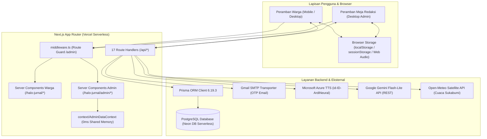
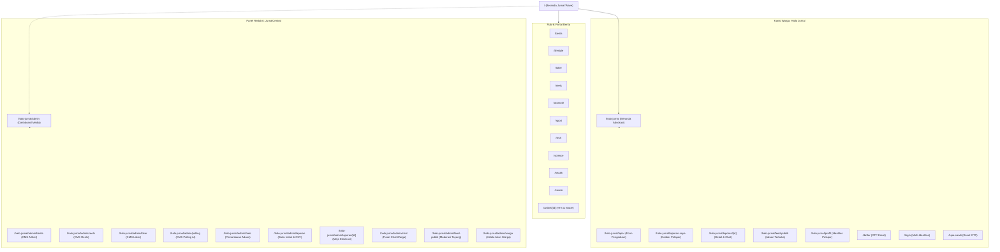
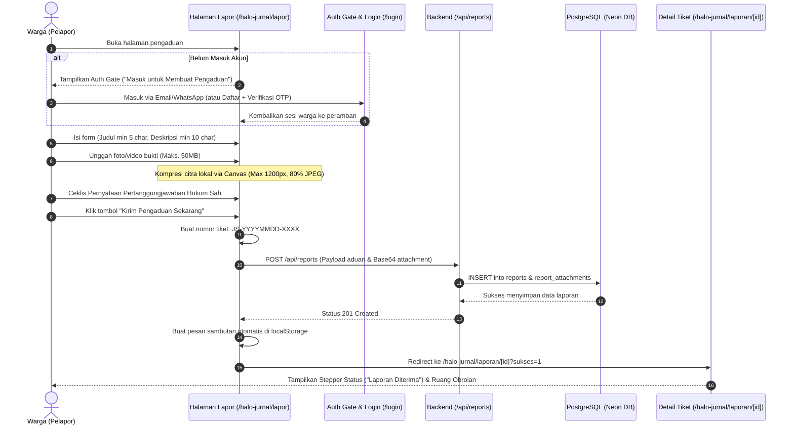
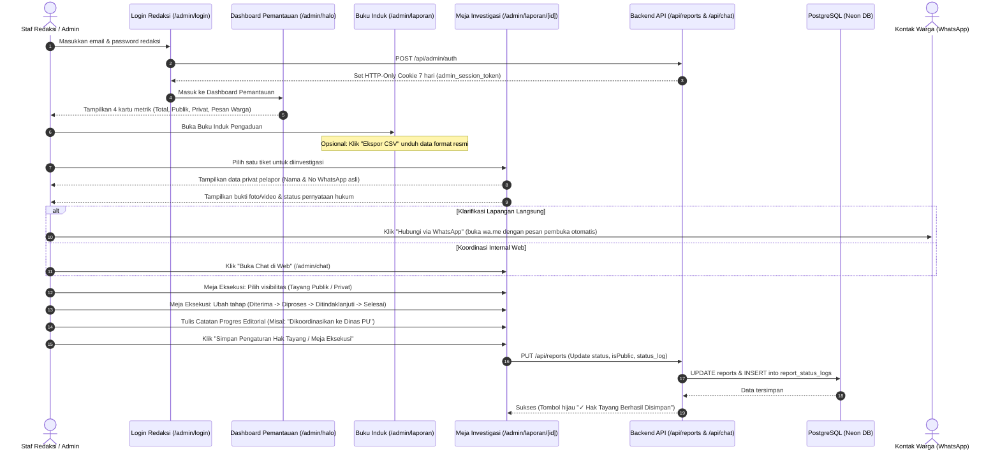
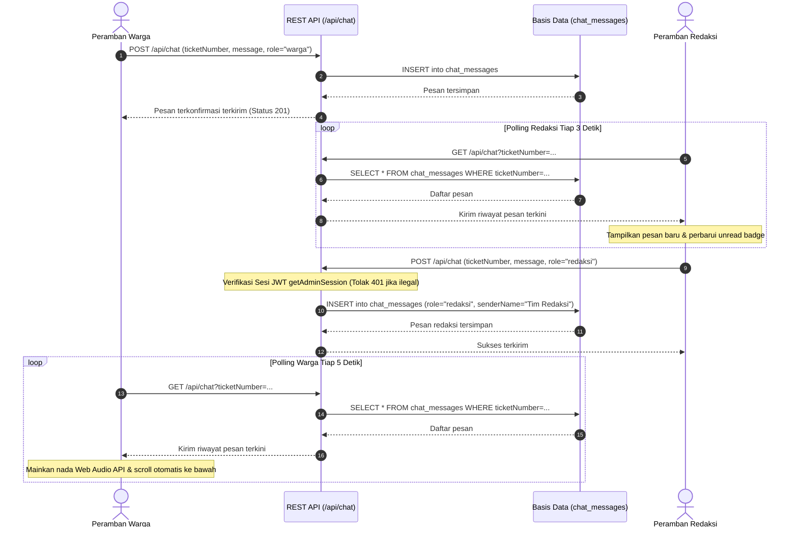

# DOKUMENTASI SISTEM RESMI JURNAL WAVE & HALLO JURNAL SUKABUMI (VERSI 6.0)

> **Status Dokumen**: Resmi & Terverifikasi terhadap Kode Sumber Berjalan  
> **Tanggal Pembaruan Terakhir**: 6 November 2026  
> **Basis Audit**: Kode repositori `d:\jurnalvibes-website` (Git Commit `bce5305` + revisi pembersihan profil warga)  
> **Sifat Dokumen**: Dokumen teknis komprehensif tunggal sebagai sumber rujukan utama untuk:  
> 1. **Penulis A (Jurnal Pengabdian Warga)**: Khusus Bab Sisi Warga pada kanal Hallo Jurnal.  
> 2. **Penulis B (Jurnal Pengabdian Redaksi/Admin)**: Khusus Bab Sisi Admin/Redaksi pada kanal Hallo Jurnal.  
> 3. **Laporan Magang Divisi IT**: Seluruh Bab (Jurnal Wave & Hallo Jurnal secara menyeluruh).  

---

## DAFTAR ISI

- [VERIFIKASI PERUBAHAN TERBARU (6 NOVEMBER 2026)](#verifikasi-perubahan-terbaru-6-november-2026)
- [BAB 0 - RINGKASAN ARSITEKTUR SISTEM `[DIPAKAI OLEH: SEMUA]`](#bab-0---ringkasan-arsitektur-sistem-dipakai-oleh-semua)
- [BAB 1 - LANDASAN TEKNIS BERSAMA `[DIPAKAI OLEH: SEMUA]`](#bab-1---landasan-teknis-bersama-dipakai-oleh-semua)
  - [1.1 Skema Basis Data Relasional Prisma ORM](#11-skema-basis-data-relasional-prisma-orm)
  - [1.2 Autentikasi, Otorisasi, Sesi JWT & Alur OTP](#12-autentikasi-otorisasi-sesi-jwt--alur-otp)
  - [1.3 Katalog Endpoint REST API Lengkap](#13-katalog-endpoint-rest-api-lengkap)
  - [1.4 Tata Kelola Status Laporan & Hak Tayang Publik](#14-tata-kelola-status-laporan--hak-tayang-publik)
  - [1.5 Standar Pembuatan Nomor Tiket Pengaduan](#15-standar-pembuatan-nomor-tiket-pengaduan)
  - [1.6 Arsitektur Komunikasi Obrolan (Chat Engine)](#16-arsitektur-komunikasi-obrolan-chat-engine)
  - [1.7 Tata Kelola & Validasi Penyimpanan Berkas Bukti](#17-tata-kelola--validasi-penyimpanan-berkas-bukti)
  - [1.8 Arsitektur Cache, Sinkronisasi Lokal & Revalidasi](#18-arsitektur-cache-sinkronisasi-lokal--revalidasi)
  - [1.9 Desain Sistem, Token Warna & Tipografi](#19-desain-sistem-token-warna--tipografi)
  - [1.10 Konfigurasi Lingkungan, Skrip NPM & Alur Deploy](#110-konfigurasi-lingkungan-skrip-npm--alur-deploy)
  - [1.11 Keamanan Informasi, Sanitasi Input & Privasi Data Warga](#111-keamanan-informasi-sanitasi-input--privasi-data-warga)
- [BAB 2 - HALLO JURNAL: SISI WARGA `[DIPAKAI OLEH: PENULIS A & LAPORAN MAGANG]`](#bab-2---hallo-jurnal-sisi-warga-dipakai-oleh-penulis-a--laporan-magang)
  - [2.1 Struktur Rute & Direktori Halaman Warga](#21-struktur-rute--direktori-halaman-warga)
  - [2.2 Beranda Utama Hallo Jurnal](#22-beranda-utama-hallo-jurnal)
  - [2.3 Registrasi Akun Warga, Alur OTP & Hak Akses Terverifikasi](#23-registrasi-akun-warga-alur-otp--hak-akses-terverifikasi)
  - [2.4 Formulir Pembuatan Pengaduan Pelayanan Publik](#24-formulir-pembuatan-pengaduan-pelayanan-publik)
  - [2.5 Konfirmasi Pasca Kirim & Penerbitan Tiket](#25-konfirmasi-pasca-kirim--penerbitan-tiket)
  - [2.6 Dasbor Pemantauan "Laporan Saya"](#26-dasbor-pemantauan-laporan-saya)
  - [2.7 Halaman Detail Tiket Aduan, Stepper Status & Vote Dukungan](#27-halaman-detail-tiket-aduan-stepper-status--vote-dukungan)
  - [2.8 Ruang Obrolan Interaktif Sisi Pelapor](#28-ruang-obrolan-interaktif-sisi-pelapor)
  - [2.9 Feed Pengaduan Publik & Penyamaran Identitas Pelapor](#29-feed-pengaduan-publik--penyamaran-identitas-pelapor)
  - [2.10 Profil Warga, Kebijakan Privasi & Ketentuan Layanan](#210-profil-warga-kebijakan-privasi--ketentuan-layanan)
  - [2.11 Pengalaman Pengguna pada Perangkat Bergerak (Mobile Web)](#211-pengalaman-pengguna-pada-perangkat-bergerak-mobile-web)
- [BAB 3 - HALLO JURNAL: SISI ADMIN & REDAKSI `[DIPAKAI OLEH: PENULIS B & LAPORAN MAGANG]`](#bab-3---hallo-jurnal-sisi-admin--redaksi-dipakai-oleh-penulis-b--laporan-magang)
  - [3.1 Struktur Navigasi & Direktori Halaman Admin Redaksi](#31-struktur-navigasi--direktori-halaman-admin-redaksi)
  - [3.2 Autentikasi Redaksi & Pembagian Hak Akses Peran](#32-autentikasi-redaksi--pembagian-hak-akses-peran)
  - [3.3 Dashboard Pemantauan Hallo Jurnal](#33-dashboard-pemantauan-hallo-jurnal)
  - [3.4 Buku Induk Pengaduan & Modul Ekspor Data CSV](#34-buku-induk-pengaduan--modul-ekspor-data-csv)
  - [3.5 Meja Investigasi Aduan & Meja Eksekusi Redaksi](#35-meja-investigasi-aduan--meja-eksekusi-redaksi)
  - [3.6 Kronologi Riwayat Penanganan Aduan](#36-kronologi-riwayat-penanganan-aduan)
  - [3.7 Pusat Komunikasi "Chat Warga" Sisi Redaksi](#37-pusat-komunikasi-chat-warga-sisi-redaksi)
  - [3.8 Moderasi Feed Publik & Manajemen Data Warga Terdaftar](#38-moderasi-feed-publik--manajemen-data-warga-terdaftar)
  - [3.9 Manajemen Tim Redaksi & Pengaturan Global Portal](#39-manajemen-tim-redaksi--pengaturan-global-portal)
- [BAB 4 - JURNAL WAVE: SISI PEMBACA `[DIPAKAI OLEH: LAPORAN MAGANG]`](#bab-4---jurnal-wave-sisi-pembaca-dipakai-oleh-laporan-magang)
- [BAB 5 - JURNAL WAVE: CMS & PANEL REDAKSI `[DIPAKAI OLEH: LAPORAN MAGANG]`](#bab-5---jurnal-wave-cms--panel-redaksi-dipakai-oleh-laporan-magang)
- [BAB 6 - KONTRIBUSI TIM & AUDIT RIWAYAT GIT `[DIPAKAI OLEH: LAPORAN MAGANG & JURNAL]`](#bab-6---kontribusi-tim--audit-riwayat-git-dipakai-oleh-laporan-magang--jurnal)
- [BAB 7 - LINGKUNGAN PENGUJIAN & DATA UJI `[DIPAKAI OLEH: SEMUA]`](#bab-7---lingkungan-pengujian--data-uji-dipakai-oleh-semua)
- [BAB 8 - DIAGRAM SISTEM `[DIPAKAI OLEH: SEMUA]`](#bab-8---diagram-sistem-dipakai-oleh-semua)
  - [8.1 Arsitektur Global Sistem](#81-arsitektur-global-sistem)
  - [8.2 Peta Situs (Sitemap) Lengkap](#82-peta-situs-sitemap-lengkap)
  - [8.3 Entity Relationship Diagram (ERD Faktual)](#83-entity-relationship-diagram-erd-faktual)
  - [8.4 Alur Pelaporan Pengaduan SISI WARGA (Diagram Terpisah)](#84-alur-pelaporan-pengaduan-sisi-warga-diagram-terpisah)
  - [8.5 Alur Penanganan Investigasi SISI ADMIN (Diagram Terpisah)](#85-alur-penanganan-investigasi-sisi-admin-diagram-terpisah)
  - [8.6 Alur Obrolan & Sinkronisasi Polling (Chat Engine)](#86-alur-obrolan--sinkronisasi-polling-chat-engine)
- [BAB 9 - PERBEDAAN DENGAN DOKUMENTASI LAMA & LABEL USANG `[DIPAKAI OLEH: SEMUA]`](#bab-9---perbedaan-dengan-dokumentasi-lama--label-usang-dipakai-oleh-semua)
  - [9.1 Tabel Komparasi Dokumentasi Lama vs Kode Faktual](#91-tabel-komparasi-dokumentasi-lama-vs-kode-faktual)
  - [9.2 Katalog Sisa Kode Lama & Residu Tidak Aktif](#92-katalog-sisa-kode-lama--residu-tidak-aktif)
- [BAB 10 - TIDAK DITEMUKAN DI KODE & PERTANYAAN PROYEK `[DIPAKAI OLEH: SEMUA]`](#bab-10---tidak-ditemukan-di-kode--pertanyaan-proyek-dipakai-oleh-semua)
  - [10.1 Hal yang Tidak Ditemukan di Kode Sumber](#101-hal-yang-tidak-ditemukan-di-kode-sumber)
  - [10.2 Daftar Pertanyaan Klarifikasi untuk Pemilik Proyek](#102-daftar-pertanyaan-klarifikasi-untuk-pemilik-proyek)

---

## VERIFIKASI PERUBAHAN TERBARU (6 NOVEMBER 2026)

Berikut adalah hasil audit faktual per 6 November 2026 terhadap permintaan penyederhanaan alur Hallo Jurnal oleh Pemimpin Redaksi:

| Butir Evaluasi | Status Faktual di Kode | Rujukan File & Baris | Catatan & Perilaku Nyata di Sistem |
| :--- | :---: | :--- | :--- |
| **a. Kanal hanya menyediakan saluran Pengaduan** (Aspirasi, Informasi, dan Inspirasi dihapus dari antarmuka) | **DITERAPKAN** | `components/halo-jurnal/CategoryCards.tsx:11-28`, `app/halo-jurnal/lapor/page.tsx:209` | Antarmuka beranda dan form hanya menampilkan dua tombol aksi: `"Buat Pengaduan"` dan `"Lihat Daftar Aduan"`. Seluruh pengiriman laporan otomatis diset `jenis = 'pengaduan'`. *(Label Usang: tipe data di `data/haloJurnalCategories.ts:1` masih memuat union type lama).* |
| **b. Formulir pengaduan tanpa kategori dan sub-kategori** | **DITERAPKAN** | `app/halo-jurnal/lapor/page.tsx:189, 210, 245-247` | Selektor kategori dan sub-kategori ditiadakan dari formulir. Nilai kategori otomatis di-hardcode di kode menjadi `'Pengaduan Warga'`. |
| **c. Kolom judul laporan dihapus** (langsung deskripsi detail) | **BELUM DITERAPKAN** | `app/halo-jurnal/lapor/page.tsx:165, 376-389` | Kolom input `"Judul Pengaduan *"` dengan placeholder `"Contoh: Jalan rusak berlubang di depan RT 05 Cisaat"` masih ada dan divalidasi `required` (wajib diisi minimal 5 karakter). |
| **d. Teks banner aduan** (`"Salurkan aduan Anda di Hallo Jurnal"`) | **DITERAPKAN** | `components/cards/HalloJurnalBanner.tsx:28-36`, `app/halo-jurnal/lapor/page.tsx:360-365` | Banner menampilkan judul persis: `"Salurkan Aduan Anda di Hallo Jurnal"` dengan keterangan: `"Wadah aduan online dan komunikasi warga, anda secara langsung disini."`. |
| **e. Teks tombol utama di banner** (`"Kirimkan aduanmu secara online"`) | **DITERAPKAN** | `components/cards/HalloJurnalBanner.tsx:43` | Label tombol utama tertulis persis: `"Kirimkan aduanmu secara online"` menuju rute `/halo-jurnal/lapor`. |
| **f. Peta lokasi (Leaflet), GPS, dan patokan dihapus dari formulir** | **DITERAPKAN** | `app/halo-jurnal/lapor/page.tsx:214-215, 250-251` | Formulir pengaduan murni input teks judul, deskripsi, dan upload berkas bukti foto/video. Latitude dan longitude diset `null`. *(Label Usang: file komponen `components/halo-jurnal/LocationPicker.tsx` 34KB masih ada di repositori namun tidak di-import).* |
| **g. Kolom domisili/kecamatan dihapus dari registrasi, profil, dan admin** | **SEBAGIAN** | `app/daftar/page.tsx:27-34`, `app/halo-jurnal/profil/page.tsx:220-315`, `app/halo-jurnal/admin/warga/page.tsx:347, 394` | Pada **registrasi (`/daftar`)** dan **profil warga (`/halo-jurnal/profil`)** kolom domisili sudah **100% dihapus**. Namun di sisi **admin warga (`/admin/warga`)** tabel masih menampilkan kolom `"Alamat Domisili Resmi"`. |
| **h. Channel OTP pendaftaran dan reset sandi** | **DITERAPKAN** | `lib/mail.ts:4-10, 15-112, 117-214`, `app/api/auth/citizen/route.ts:4`, `app/api/auth/reset-password/route.ts:5` | 100% menggunakan **EMAIL** via Gmail SMTP Nodemailer (`service: 'gmail'`). Tidak ditemukan gateway WhatsApp/SMS di kode sumber. Masa kedaluwarsa OTP adalah 10 menit. |
| **i. Tagline Jurnal Wave & halaman "Tentang Jurnal Wave"** | **DITERAPKAN** | `app/tentang-kami/page.tsx:47, 50` | Judul halaman: `"Tentang Jurnal Wave"`, Tagline resmi: `"Jurnal Wave — Suara Baru, Informasi Terkini"`. |

---

# BAB 0 - RINGKASAN ARSITEKTUR SISTEM `[DIPAKAI OLEH: SEMUA]`

Sistem portal digital ini merupakan platform terpadu yang menggabungkan portal media jurnalisme modern (**Jurnal Wave**) dan kanal advokasi serta pengaduan masyarakat interaktif (**Hallo Jurnal**) di wilayah Sukabumi, Jawa Barat.

### 0.1 Identitas & Tujuan Sistem
- **Nama Portal Media**: Jurnal Wave (`app/layout.tsx:12-16`).
- **Nama Kanal Layanan Publik**: Hallo Jurnal (`components/cards/HalloJurnalBanner.tsx:28-36`).
- **Tujuan Sistem**: Menghubungkan pelaporan fasilitas publik warga secara cepat, transparan, dan terverifikasi kepada redaksi, sekaligus menyajikan portal berita hiperlokal dengan fitur Text-to-Speech (TTS), Prakiraan Cuaca Realtime, Polling Pembaca, dan Chatbot AI Berbasis Pengetahuan Lokal Sukabumi.

### 0.2 Peran Pengguna (User Roles)
Sistem membedakan dua entitas pengguna utama yang terisolasi secara data dan autentikasi:
1. **Warga Masyarakat (`warga`)**: Pelapor layanan publik yang terverifikasi melalui OTP Email. Memiliki hak membuat aduan, memantau riwayat di "Laporan Saya", berdiskusi dengan redaksi di ruang obrolan tiket, memberikan dukungan vote publik, dan mengelola profil (`schema.prisma:113-125`).
2. **Staf Redaksi & Admin Media**:
   - `superadmin`: Akses penuh terhadap Buku Induk Pengaduan, investigasi, moderasi visibilitas feed publik, artikel berita, reels, loker, polling, dan tim redaksi (`lib/auth.ts:55`, `components/admin/AdminSidebar.tsx:77-173`).
   - `admin` / `editor`: Melakukan verifikasi faktual laporan warga, merespons obrolan tiket atas nama redaksi, mengubah tahapan penanganan laporan, dan mengelola penerbitan artikel (`schema.prisma:100-109`).
   - `journalist`: Mengunggah naskah artikel berita dan konten media (`schema.prisma:104`).

### 0.3 Spesifikasi Teknologi & Dependensi Inti
Berdasarkan `package.json:1-47`:
- **Core Framework**: Next.js versi `16.4.3` (menggunakan arsitektur Next.js App Router).
- **Library UI**: React versi `19.2.8` dan React DOM versi `19.2.8`.
- **Bahasa Pemrograman**: TypeScript versi `^5` dengan konfigurasi strict type checking.
- **ORM & Basis Data Engine**: Prisma Client versi `^6.19.3` terhubung ke PostgreSQL (Neon DB Cloud Serverless).
- **Otentikasi & Keamanan**:
  - `jose` versi `^6.2.13` (JWT token signing & verification).
  - `bcryptjs` versi `^3.0.3` (hashing password).
- **Layanan Email Transaksional (OTP)**: `nodemailer` versi `^10.2.1` via SMTP Gmail.
- **Validasi Skema**: `zod` versi `^4.6.7`.
- **Text-to-Speech (TTS)**: `@andresaya/edge-tts` versi `^1.9.1` dan `msedge-tts` versi `^2.1.0`.
- **Styling & Desain**: Tailwind CSS versi `^4` (menggunakan engine `@tailwindcss/postcss` versi `^4`), `clsx` versi `^2.1.1`, dan `tailwind-merge` versi `^3.7.0`.
- **Ikonografi**: `lucide-react` versi `^1.37.0` dan `react-icons` versi `^5.7.0`.

### 0.4 Hosting & Infrastruktur
- **Platform Hosting**: Serverless Cloud Platform Vercel (`next.config.ts:1-40`, `app/api/tts/route.ts:17-19`).
- **Basis Data**: PostgreSQL hosted on Neon DB Serverless (`prisma/schema.prisma:1-5`).
- **Penyimpanan Berkas**: Inline Base64 Data-URI / direktori serverless temporary storage (`/tmp/jurnalwave-tts`).

### 0.5 Peta Modul & Struktur Folder Direktori
```text
d:\jurnalvibes-website\
├── app/
│   ├── api/                         # 17 Endpoint REST API Backend
│   │   ├── admin/                   # API Autentikasi Redaksi & Data Warga
│   │   ├── ai-chat/                 # API Chatbot Gemini Flash-Lite & RAG Lokal
│   │   ├── articles/                # API CRUD Artikel Berita CMS
│   │   ├── auth/                    # API Pendaftaran Warga & Reset Sandi OTP
│   │   ├── chat/                    # API Engine Obrolan Tiket Terpadu
│   │   ├── polls/                   # API Polling Pembaca & Generator AI
│   │   ├── reels/                   # API Video Wave Reels Sukabumi
│   │   ├── reports/                 # API Pengaduan Warga & Dukungan Vote
│   │   ├── tts/                     # API Audio Reader id-ID-ArdiNeural
│   │   └── weather/                 # API Cuaca Sukabumi Open-Meteo
│   ├── halo-jurnal/                 # Modul Kanal Layanan Publik Warga
│   │   ├── admin/                   # Meja Redaksi & Buku Induk Hallo Jurnal
│   │   ├── feed-publik/             # Feed Pengaduan Terbuka (Anonim)
│   │   ├── lapor/                   # Formulir Pembuatan Aduan Warga
│   │   ├── laporan/                 # Halaman Detail Tiket & Chat Interaktif
│   │   ├── laporan-saya/            # Dasbor Pemantauan Pengaduan Pribadi
│   │   └── profil/                  # Kelola Identitas Warga (Nama, WA, Email)
│   ├── artikel/                     # Halaman Pembaca Detail Berita Jurnal Wave
│   ├── cuaca/                       # Halaman Pantauan Cuaca Sukabumi
│   ├── daftar/                      # Pendaftaran Akun Warga Baru
│   ├── login/                       # Login Terpadu Warga & Redaksi
│   ├── loker/                       # Portal Lowongan Kerja Sukabumi
│   ├── reels/                       # Pemutar Video Pendek Wave Reels
│   └── layout.tsx                   # Root Layout Web & Font Setup
├── components/                      # Komponen Antarmuka Reusable
│   ├── admin/                       # Komponen Khusus Dashboard Redaksi
│   ├── cards/                       # Banner, Hero Carousel, Card Berita
│   ├── halo-jurnal/                 # Komponen Aduan, Avatar, Feed, Dialog
│   ├── layout/                      # Navbar, Footer, Bottom Navigation
│   └── ui/                          # Badge, Dialog Radix UI
├── context/
│   └── AdminDataContext.tsx         # Shared Memory Context 0ms Panel Redaksi
├── data/                            # Kamus Pengetahuan Sukabumi & Fallback Data
├── lib/                             # Utilitas Sistem (Prisma, Auth JWT, Mail, TTS)
├── prisma/
│   └── schema.prisma                # Definisi Skema Basis Data Relasional
└── middleware.ts                    # Routing Guard & Normalisasi URL Admin
```

---

# BAB 1 - LANDASAN TEKNIS BERSAMA `[DIPAKAI OLEH: SEMUA]`

### 1.1 Skema Basis Data Relasional Prisma ORM
Seluruh tabel didefinisikan secara deklaratif di `prisma/schema.prisma:1-194` menggunakan PostgreSQL:

```mermaid
erDiagram
    Report ||--o{ ReportAttachment : "has many (Cascade)"
    Report ||--o{ ReportStatusLog : "has many (Cascade)"
    Report ||--o{ ChatMessage : "scoped via ticketNumber"
    Report ||--o{ ReportSupport : "scoped via ticketNumber"
    Poll ||--o{ PollOption : "has many (Cascade)"
    CitizenUser ||--o{ ReportSupport : "referenced by citizenEmail"

    Report {
        string id PK
        string ticketNumber UK
        string title
        string description
        string reportType
        string address
        float latitude
        float longitude
        string pelaporName
        string pelaporPhone
        string pelaporEmail
        string status
        boolean isPublic
        datetime createdAt
        datetime updatedAt
    }

    ReportAttachment {
        string id PK
        string reportId FK
        string fileUrl
        string fileType
        datetime createdAt
    }

    ReportStatusLog {
        string id PK
        string reportId FK
        string status
        string note
        datetime createdAt
    }

    ChatMessage {
        string id PK
        string ticketNumber Index
        string senderId
        string senderName
        string role
        string message
        datetime createdAt
    }

    ReportSupport {
        string id PK
        string ticketNumber Index
        string citizenEmail
        datetime createdAt
    }

    CitizenUser {
        string id PK
        string email UK
        string fullName
        string phone
        string domisili
        string password
        boolean isVerified
        datetime createdAt
        datetime updatedAt
    }

    AdminUser {
        string id PK
        string name
        string email UK
        string role
        string avatarUrl
        datetime createdAt
        datetime updatedAt
    }

    PasswordResetOtp {
        string id PK
        string email Index
        string otpCode
        datetime expiresAt
        datetime createdAt
    }

    Article {
        string id PK
        string title
        string slug UK
        string excerpt
        string content
        string category
        string categoryLabel
        string imageUrl
        string author
        string reporter
        string redaktur
        boolean isHero
        boolean isEditorsPick
        datetime createdAt
    }

    Reel {
        string id PK
        string title
        string videoUrl
        string platform
        string location
        datetime createdAt
    }

    Poll {
        string id PK
        string question
        string category
        boolean isActive
        datetime createdAt
    }

    PollOption {
        string id PK
        string pollId FK
        string text
        int votes
        datetime createdAt
    }
```

Rincian atribut tabel relasional:
1. **`Report` (`reports`)**: Entitas inti pengaduan (`schema.prisma:37-57`). Kolom wajib meliputi `ticketNumber` (`VarChar(50)`, Unique Index), `title` (`VarChar(255)`), `description` (`Text`), `status` (`VarChar(50)`, default `'diterima'`), dan `isPublic` (`Boolean`, default `true`).
2. **`ReportAttachment` (`report_attachments`)**: Berkas bukti laporan (`schema.prisma:60-70`). Memiliki relasi Foreign Key `reportId` mengacu ke `Report(id)` dengan aturan `onDelete: Cascade` dan indeks `@@index([reportId])`.
3. **`ReportStatusLog` (`report_status_logs`)**: Rekam jejak audit tahapan laporan (`schema.prisma:73-83`). Memiliki Foreign Key `reportId` dengan aturan `onDelete: Cascade` dan indeks `@@index([reportId])`.
4. **`ChatMessage` (`chat_messages`)**: Pesan obrolan dua arah warga-redaksi (`schema.prisma:86-97`). Dihubungkan secara logis melalui kolom `ticketNumber` (`VarChar(50)`) dengan indeks khusus `@@index([ticketNumber])`.
5. **`CitizenUser` (`citizen_users`)**: Rekening akun warga terdaftar (`schema.prisma:113-125`). `email` berstatus unik (`VarChar(100)`, Unique).
6. **`AdminUser` (`admin_users`)**: Akun staf redaksi (`schema.prisma:100-110`). `email` berstatus unik (`VarChar(100)`, Unique), default role `'editor'`.
7. **`PasswordResetOtp` (`password_reset_otps`)**: Token OTP reset sandi warga (`schema.prisma:128-137`). Memiliki indeks `@@index([email])`.
8. **`ReportSupport` (`report_supports`)**: Rekam vote dukungan warga terhadap laporan publik (`schema.prisma:140-149`). Dibatasi aturan unik ganda `@@unique([ticketNumber, citizenEmail])` sehingga satu email warga hanya dapat memberikan satu vote per laporan.
9. **`Article` (`articles`)**: Basis berita CMS Jurnal Wave (`schema.prisma:12-34`). Kolom `slug` berstatus unik (`VarChar(255)`, Unique).
10. **`Poll` (`polls`) & `PollOption` (`poll_options`)**: Polling interaktif pembaca (`schema.prisma:171-193`). Relasi `pollId` berstatus `onDelete: Cascade` dengan indeks `@@index([pollId])`.

---

### 1.2 Autentikasi, Otorisasi, Sesi JWT & Alur OTP
Sistem menerapkan pemisahan mekanisme autentikasi secara ketat antara warga dan admin:

1. **Autentikasi Staf Redaksi & Admin Media**:
   - **Protokol Token**: Menghasilkan Json Web Token (JWT) dengan algoritma `HS256` ditandatangani kunci rahasia server (`ADMIN_JWT_SECRET` / fallback default) menggunakan modul `jose` (`lib/auth.ts:24-30`).
   - **Masa Berlaku Token**: Berlaku selama **7 hari** (`.setExpirationTime('7d')` di `lib/auth.ts:28`).
   - **Penyimpanan Sesi**: Disimpan pada HTTP-Only Cookie bernama `admin_session_token` (`lib/auth.ts:5`).
   - **Bypass Pengembangan**: Jika `process.env.NODE_ENV !== 'production'`, sistem menyediakan fallback sesi pengembang otomatis dengan identitas `admin@jurnalwave.com` (role: `superadmin`) (`lib/auth.ts:50-56`).
   - **Verifikasi Klien**: `app/halo-jurnal/admin/layout.tsx:41-72` memverifikasi sesi ke endpoint `/api/admin/auth` dan menyinkronkan status ke `sessionStorage.getItem('admin_session_valid')`.

2. **Autentikasi Akun Warga (Hallo Jurnal)**:
   - **Identitas Login**: Multi-identitas fleksibel. Warga dapat masuk menggunakan **Email** ATAU **Nomor WhatsApp** (`app/api/auth/citizen/route.ts:250-258`).
   - **Enkripsi Kata Sandi**: Sandi di-hash menggunakan algoritma `bcryptjs` dengan salt round bernilai 10 (`lib/auth.ts:66-68`, `app/api/auth/citizen/route.ts:210`).
   - **Penyimpanan Sesi Warga**: Klien menyimpan data sesi warga pada browser `localStorage` dengan kunci `'halo_jurnal_current_user'` (`app/daftar/page.tsx:210`, `app/login/page.tsx:265`).
   - **Pencegahan Akun Duplikat**: API memvalidasi keunikan nomor telepon dan email sebelum pendaftaran dikirim (`app/api/auth/citizen/route.ts:57-110`).

3. **Mekanisme & Alur OTP (One-Time Password)**:
   - **Saluran Pengiriman**: 100% menggunakan **EMAIL RESMI** melalui transport Gmail SMTP Nodemailer (`lib/mail.ts:4-10`). Sistem tidak terhubung ke gateway SMS atau WhatsApp API pihak ketiga (`lib/mail.ts:1-214`).
   - **Struktur Kode OTP**: Terdiri dari **6 digit angka acak** (`Math.floor(100000 + Math.random() * 900000).toString()` di `app/api/auth/citizen/route.ts:133`, `app/api/auth/reset-password/route.ts:28`).
   - **Masa Kedaluwarsa OTP**: Berlaku tepat selama **10 menit** (`Date.now() + 10 * 60 * 1000` di `app/api/auth/citizen/route.ts:136`, `lib/mail.ts:64`).
   - **Penyimpanan Status OTP Pendaftaran**: Disimpan secara aman pada in-memory global Map server `__haloJurnalRegisterOtpStore` (`app/api/auth/citizen/route.ts:6-16`).
   - **Penyimpanan Status OTP Reset Sandi**: Disimpan secara persisten pada tabel database `PasswordResetOtp` (`app/api/auth/reset-password/route.ts:31-38`).
   - **Batas Kirim Ulang (Resend Timer)**: Antarmuka pendaftaran memberlakukan jeda waktu hitung mundur 60 detik (`app/daftar/page.tsx:38, 49-60`) sebelum tombol kirim ulang aktif.

4. **Middleware Router Guard**:
   - Berkas `middleware.ts:1-32` berfungsi menangkap akses pengguna yang mengetik `/admin`, `/reels/admin`, atau `/berita/admin` di bilah alamat browser, lalu secara otomatis mengalihkan (*redirect 307*) ke rute resmi `/halo-jurnal/admin` (`middleware.ts:12-16`). Permintaan rute `/api` dan aset statis dikecualikan dari manipulasi ini (`middleware.ts:7, 21-32`).

---

### 1.3 Katalog Endpoint REST API Lengkap

Audit menyeluruh terhadap seluruh 17 berkas `route.ts` pada direktori `app/api/`:

| Metode | Rute Endpoint | Otorisasi Akses | Validasi Input (Zod / Logika) | Format Respons Utama | Deskripsi Fungsi | Rujukan Kode |
| :---: | :--- | :--- | :--- | :--- | :--- | :--- |
| `GET` | `/api/admin/auth` | Publik (Baca Cookie) | Membaca cookie `admin_session_token` | `{ authenticated: bool, user?: object }` | Memeriksa validitas sesi aktif staf redaksi | `app/api/admin/auth/route.ts:10-38` |
| `POST` | `/api/admin/auth` | Publik | `email` & `password` wajib diisi | `{ success: bool, user: object }` + Set Cookie | Proses otentikasi login admin dan set HTTP-Only cookie 7 hari | `app/api/admin/auth/route.ts:41-118` |
| `DELETE` | `/api/admin/auth` | Publik | - | `{ success: true, message: string }` | Menghapus cookie sesi login redaksi (logout) | `app/api/admin/auth/route.ts:121-137` |
| `GET` | `/api/admin/citizens` | Khusus Admin | Query `search` (opsional) | `{ success: bool, data: CitizenUser[] }` | Mengambil seluruh daftar warga terdaftar beserta jumlah aduan | `app/api/admin/citizens/route.ts:7-60` |
| `PATCH` | `/api/admin/citizens` | Khusus Admin | `citizenId` & `isVerified` boolean | `{ success: bool, data: object }` | Mengubah status centang verifikasi akun warga | `app/api/admin/citizens/route.ts:63-88` |
| `DELETE` | `/api/admin/citizens` | Khusus Admin | Query `id` wajib | `{ success: bool, message: string }` | Menghapus akun warga dari sistem secara permanen | `app/api/admin/citizens/route.ts:91-115` |
| `POST` | `/api/ai-chat` | Publik | `message` string (min. 1 char), `history` array | `{ reply: string, source: string }` | Chatbot asisten cerdas Gemini Flash-Lite & RAG lokal Sukabumi | `app/api/ai-chat/route.ts:72-204` |
| `GET` | `/api/articles` | Publik | Query `category`, `limit`, `slug` | `{ success: bool, data: Article[] }` | Mengambil daftar artikel berita (dilengkapi cache memori 3 detik) | `app/api/articles/route.ts:103-157` |
| `POST` | `/api/articles` | Khusus Redaksi | `title`, `content`, `category`, `imageUrl` | `{ success: bool, data: Article }` | Menerbitkan artikel naskah berita baru ke database | `app/api/articles/route.ts:160-264` |
| `PUT` | `/api/articles` | Khusus Redaksi | `id` wajib, atribut artikel parsial | `{ success: bool, data: Article }` | Memperbarui isi berita atau status Headline/Editor's Pick | `app/api/articles/route.ts:267-347` |
| `DELETE` | `/api/articles` | Khusus Redaksi | Query `id` wajib | `{ success: bool, message: string }` | Menghapus artikel berita dari database | `app/api/articles/route.ts:350-403` |
| `POST` | `/api/auth/citizen` | Publik | Aksi multi: `check-phone`, `check-email`, `send-register-otp`, `register`, `login`, `update-profile` | `{ success: bool, user?: object, message?: string }` | Layanan lengkap pendaftaran warga, login, kirim OTP email, dan edit profil | `app/api/auth/citizen/route.ts:51-516` |
| `POST` | `/api/auth/reset-password`| Publik | Aksi multi: `request-otp`, `verify-otp`, `reset` | `{ success: bool, message: string }` | Alur lupa kata sandi warga menggunakan verifikasi kode OTP email | `app/api/auth/reset-password/route.ts:16-160` |
| `GET` | `/api/chat` | Publik | Query `ticketNumber` wajib | `{ success: bool, data: ChatMessage[] }` | Mengambil riwayat pesan obrolan terisolasi per nomor tiket | `app/api/chat/route.ts:33-75` |
| `POST` | `/api/chat` | Warga / Redaksi | Zod: `ticketNumber`, `message` (maks. 50MB string base64), role | `{ success: bool, data: ChatMessage }` | Mengirim pesan obrolan baru (role admin wajib sesi terverifikasi) | `app/api/chat/route.ts:77-164` |
| `GET` | `/api/polls` | Publik | - | `{ success: bool, data: Poll[] }` | Mengambil data survei polling pembaca aktif beserta opsi jawaban | `app/api/polls/route.ts:7-25` |
| `POST` | `/api/polls` | Khusus Redaksi | `question`, `category`, `options` (min. 2) | `{ success: bool, data: Poll }` | Membuat survei opini baru | `app/api/polls/route.ts:27-70` |
| `PUT` | `/api/polls` | Khusus Redaksi | `id`, `question`, `isActive` | `{ success: bool, data: Poll }` | Memperbarui survei opini atau menutup voting | `app/api/polls/route.ts:72-106` |
| `DELETE` | `/api/polls` | Khusus Redaksi | Query `id` wajib | `{ success: bool, message: string }` | Menghapus polling beserta seluruh suaranya (Cascade) | `app/api/polls/route.ts:108-132` |
| `POST` | `/api/polls/generate-ai` | Khusus Redaksi | `topic` string (opsional) | `{ success: bool, poll: object }` | Generator otomatis topik survei opini cerdas berbasis tren berita | `app/api/polls/generate-ai/route.ts:175-351` |
| `POST` | `/api/polls/vote` | Publik | `pollId` & `optionId` wajib | `{ success: bool, data: PollOption }` | Menambahkan 1 suara pemilih ke opsi polling | `app/api/polls/vote/route.ts:6-45` |
| `GET` | `/api/reels` | Publik | Query `limit` (opsional) | `{ success: bool, data: Reel[] }` | Mengambil daftar video pendek Wave Reels Sukabumi | `app/api/reels/route.ts:7-34` |
| `POST` | `/api/reels` | Khusus Redaksi | `title`, `videoUrl`, `thumbnailUrl`, `creator` | `{ success: bool, data: Reel }` | Mendaftarkan tautan video reels baru | `app/api/reels/route.ts:36-79` |
| `POST` | `/api/reels/metadata` | Khusus Redaksi | `url` string (TikTok / IG Reel) | `{ success: bool, metadata: object }` | Ekstraksi otomatis judul dan thumbnail video medsos | `app/api/reels/metadata/route.ts:6-105` |
| `GET` | `/api/reels/[id]` | Publik | Parameter `id` | `{ success: bool, data: Reel }` | Mengambil detail 1 video reels | `app/api/reels/[id]/route.ts:7-30` |
| `PUT` | `/api/reels/[id]` | Khusus Redaksi | Parameter `id` & payload pembaharuan | `{ success: bool, data: Reel }` | Mengedit data video reels | `app/api/reels/[id]/route.ts:32-68` |
| `DELETE` | `/api/reels/[id]` | Khusus Redaksi | Parameter `id` | `{ success: bool, message: string }` | Menghapus video reels dari database | `app/api/reels/[id]/route.ts:70-94` |
| `GET` | `/api/reports` | Publik | Query `status`, `ticket`, `limit` | `{ success: bool, data: Report[] }` | Mengambil seluruh laporan aduan (disertai hitungan dukungan vote) | `app/api/reports/route.ts:114-173` |
| `POST` | `/api/reports` | Warga Login | Zod: `title`, `description`, `ticketNumber`, `attachments` | `{ success: bool, data: Report }` | Menyimpan aduan warga baru ke tabel `reports` & `report_attachments` | `app/api/reports/route.ts:176-328` |
| `PUT` | `/api/reports` | Khusus Redaksi | `id`, `status`, `isPublic`, `statusLog` | `{ success: bool, data: Report }` | Memperbarui tahap penanganan aduan & moderasi hak tayang | `app/api/reports/route.ts:331-382` |
| `DELETE` | `/api/reports` | Khusus Redaksi | Query `id` / `ticketNumber` wajib | `{ success: bool, message: string }` | Menghapus data aduan berserta seluruh lampiran berkas | `app/api/reports/route.ts:385-414` |
| `GET` | `/api/reports/support` | Publik | Query `ticketNumber` & `email` | `{ success: bool, count: int, userSupported: bool }` | Memeriksa akumulasi dukungan vote warga pada 1 tiket | `app/api/reports/support/route.ts:68-124` |
| `POST` | `/api/reports/support` | Warga Login | `ticketNumber` & `email` | `{ success: bool, supported: bool, count: int }` | Toggle dukungan vote (memberi atau membatalkan dukungan aduan) | `app/api/reports/support/route.ts:8-66` |
| `GET` | `/api/tts` | Publik | Query `id` (artikel) / `text` | Audio Stream Buffer (`audio/mpeg`) | Streaming suara narasi berita AI pria (id-ID-ArdiNeural) | `app/api/tts/route.ts:185-260` |
| `POST` | `/api/tts` | Publik | Body JSON `{ text: string }` | Audio Stream Buffer (`audio/mpeg`) | Mengonversi teks paragraf bebas menjadi suara audio MP3 | `app/api/tts/route.ts:262-312` |
| `GET` | `/api/weather` | Publik | Query `loc` ('kota'/'kabupaten') / `lat` & `lon` | `{ locationName: string, temperature: int, ... }` | Mengambil data kondisi cuaca satelit Sukabumi dari Open-Meteo | `app/api/weather/route.ts:4-31` |

---

### 1.4 Tata Kelola Status Laporan & Hak Tayang Publik

Sistem mengelola 5 tingkatan status laporan yang berlaku di kode sumber (`data/dummyReports.ts:11`, `app/halo-jurnal/admin/laporan/[id]/page.tsx:281-287`):

| Kode Status Internal | Label Tampilan Warga (Stepper) | Label Tampilan Admin (Meja Eksekusi) | Makna Operasional Sistem | Catatan Otomatis Sistem |
| :---: | :--- | :--- | :--- | :--- |
| `diterima` | `"Laporan Diterima"` | `"Diterima"` | Aduan baru berhasil dikirim pelapor dan masuk ke antrean redaksi | *"Laporan telah diverifikasi oleh tim Hallo Jurnal."* |
| `diproses` | `"Investigasi Lapangan"` | `"Diproses"` | Tim jurnalis redaksi sedang mengecek fakta ke lokasi kejadian | *"Tim redaksi sedang memvalidasi fakta dan menginvestigasi kondisi lapangan."* |
| `ditindaklanjuti` | `"Koordinasi Dinas Instansi"` | `"Ditindaklanjuti"` | Aduan resmi diteruskan ke dinas instansi berwenang Sukabumi | *"Laporan diteruskan ke instansi dinas berwenang untuk tindak lanjut teknis."* |
| `selesai` | `"Laporan Selesai Dituntaskan"` | `"Selesai"` | Masalah fisik/fasilitas telah diperbaiki dan dikonfirmasi tuntas | *"Penanganan masalah telah dituntaskan dan dikonfirmasi selesai."* |
| `ditolak` | `"Ditolak"` | `"Ditolak"` | Laporan tidak memenuhi syarat, fiktif, atau mengandung unsur SARA | Disesuaikan dengan catatan khusus redaksi (`editorialNote`) |

**Hubungan Status dengan Hak Tayang Publik (`isPublic`)**:
- Status visibilitas diatur secara independen dari status tahapan melalui toggle kolom kanan Meja Eksekusi (`app/halo-jurnal/admin/laporan/[id]/page.tsx:802-826`).
- Sebuah aduan berstatus `diterima` dapat diset `"Tayang di Feed Publik"` (`isPublic = true`) agar masyarakat luas dapat ikut mengawal dan memberikan vote dukungan.
- Sebaliknya, aduan yang mengandung informasi sensitif dapat diset `"Privat (Arsip Redaksi)"` (`isPublic = false`), sehingga hanya dapat dilihat oleh pelapor yang bersangkutan di menu "Laporan Saya" dan tim redaksi di Buku Induk (`app/halo-jurnal/feed-publik/page.tsx:64-67`).

---

### 1.5 Standar Pembuatan Nomor Tiket Pengaduan
Nomor tiket pengaduan dibuat dengan format unik terstruktur berbasis tanggal dan bilangan acak:

1. **Pembuatan Sisi Klien (Primary)**:
   - File: `app/halo-jurnal/lapor/page.tsx:217-219`.
   - Format: `JS-${yyyy}${mm}${dd}-${random4}`
   - Struktur: Awalan `JS-` (singkatan *Jurnal Sukabumi*), diikuti 4 digit tahun (`yyyy`), 2 digit bulan (`mm`), 2 digit tanggal (`dd`), tanda strip (`-`), dan 4 digit angka acak (`Math.floor(1000 + Math.random() * 9000)`).
   - Contoh nyata: `JS-20261106-4829`.

2. **Pembuatan Sisi Server (Fallback)**:
   - File: `app/api/reports/route.ts:207`.
   - Format: `TKT-SKB-${new Date().getFullYear()}-${Math.floor(1000 + Math.random() * 9000)}`.
   - Contoh nyata: `TKT-SKB-2026-8192`.

3. **Jaminan Keunikan**:
   - Dijamin pada level database oleh constraint `@unique` pada kolom `ticketNumber` (`schema.prisma:39`). Jika terjadi tabrakan nomor tiket, Prisma akan menolak operasi insert dan melempar exception kode `P2002`.

---

### 1.6 Arsitektur Komunikasi Obrolan (Chat Engine)
Komunikasi dua arah antara warga dan staf redaksi dibangun dengan spesifikasi:

1. **Model Komunikasi**: Menggunakan **Polling Berinterval Waktu (Periodic HTTP Polling)** yang diperkuat penangkap event peramban (`window.addEventListener('storage')` dan `window.addEventListener('focus')`). Sistem **TIDAK MENGGUNAKAN** koneksi soket dua arah persisten (WebSocket / Socket.io) maupun Server-Sent Events (SSE) (`app/halo-jurnal/laporan/[id]/page.tsx:280-285`, `app/halo-jurnal/admin/chat/page.tsx:228-234`).
2. **Interval Pembaruan**:
   - **Sisi Warga**: Polling setiap **5 detik** (`setInterval(..., 5000)` di `app/halo-jurnal/laporan/[id]/page.tsx:282`).
   - **Sisi Admin**: Polling setiap **3 detik** (`setInterval(..., 3000)` di `app/halo-jurnal/admin/chat/page.tsx:234` dan `app/halo-jurnal/admin/laporan/[id]/page.tsx:195`).
3. **Penyimpanan Dua Lapis (*Dual-Layer Persistence*)**:
   - **Lapis Utama**: Tabel basis data `chat_messages` PostgreSQL via endpoint `/api/chat` (`schema.prisma:86-97`).
   - **Lapis Cadangan (*Offline Fallback*)**: Disimpan di peramban `localStorage` dengan format kunci `halo_jurnal_chat_${ticketNumber}` (`app/halo-jurnal/lapor/page.tsx:294`).
4. **Validasi & Otorisasi Pengirim**:
   - Validasi data menggunakan skema Zod `ChatMessageSchema` (`app/api/chat/route.ts:7-15`).
   - Pengiriman pesan atas nama `'admin'` atau `'redaksi'` wajib melewati pemeriksaan sesi JWT `getAdminSession(request)`. Jika token tidak sah, server merespons HTTP `401 Unauthorized` (`app/api/chat/route.ts:110-120`).
5. **Notifikasi Suara Ramah Warga**:
   - Sisi warga dilengkapi sintesis nada suara notifikasi merdu menggunakan **Web Audio API murni** (`window.AudioContext`) tanpa dependensi berkas MP3 eksternal (`app/halo-jurnal/laporan/[id]/page.tsx:59-80`).
6. **Penanda Pesan Belum Dibaca (*Unread Badge*)**:
   - Di sisi admin, sistem memindai seluruh kunci `halo_jurnal_chat_*` pada `localStorage`, mencocokkannya dengan himpunan riwayat pesan yang telah dibuka di `halo_jurnal_read_chats`, lalu menampilkan lencana angka pada menu "Chat Warga" di sidebar (`context/AdminDataContext.tsx:88-119`).

---

### 1.7 Tata Kelola & Validasi Penyimpanan Berkas Bukti
1. **Format Berkas yang Didukung**: Foto (`image/jpeg`, `image/png`, `image/webp`) dan Video rekaman lapangan (`video/mp4`, `video/webm`) (`app/halo-jurnal/lapor/page.tsx:478`).
2. **Batas Ukuran Maksimum**:
   - Sisi Klien: Divalidasi maksimal **50 Megabytes (50MB)** (`selectedFile.size > 50 * 1024 * 1024` di `app/halo-jurnal/lapor/page.tsx:107, 134`).
   - Sisi Server: Skema Zod mengizinkan payload hingga 50.000.000 karakter (`z.string().max(50000000)` di `app/api/chat/route.ts:9`).
3. **Kompresi Citra di Sisi Klien**:
   - Citra foto berukuran besar dikompresi otomatis pada browser menggunakan HTML5 Canvas sebelum diunggah (`app/halo-jurnal/lapor/page.tsx:68-101`).
   - Batas dimensi maksimum: **1200 piksel** (`maxDimension = 1200`).
   - Kualitas kompresi JPEG: **80%** (`canvas.toDataURL('image/jpeg', 0.8)`).
4. **Metode Penyimpanan**: Berkas disimpan dalam bentuk string Data URL Base64 pada tabel `report_attachments.fileUrl` (`app/api/reports/route.ts:241-260`) atau disematkan pada pesan obrolan menggunakan token penanda `[ATTACHMENT:${fileUrl}|${fileType}]` (`app/api/chat/route.ts:18-30`).

---

### 1.8 Arsitektur Cache, Sinkronisasi Lokal & Revalidasi
Untuk menekan waktu muat hingga mendekati 0 milidetik, sistem menerapkan arsitektur caching bertingkat:
1. **Admin Shared Data Context (`context/AdminDataContext.tsx:1-271`)**:
   - Membungkus seluruh panel admin redaksi (`app/halo-jurnal/admin/layout.tsx:7`).
   - Mengambil data awal secara sinkron dari cache memori lokal (`lib/adminCache.ts:1-78`), sehingga saat staf redaksi berpindah menu dari Dashboard ke Buku Induk atau Chat Warga, antarmuka tidak mengalami kedipan (*zero layout shift*) dan tidak memicu loading spinner ulang.
2. **Server-Side In-Memory Cache**:
   - API Berita (`app/api/articles/route.ts:95-97`): Cache memori server 3 detik (`SERVER_ARTICLES_CACHE_TTL_MS = 3000`) dengan header `Cache-Control: public, s-maxage=3, stale-while-revalidate=6`.
   - API Pengaduan (`app/api/reports/route.ts:152-158`): Cache memori server `serverReportsCache` untuk kueri umum.
   - Pustaka WordPress/Database (`lib/wordpress.ts:120-125`): Cache memori server 60 detik (`CACHE_TTL_MS = 60000`).

---

### 1.9 Desain Sistem, Token Warna & Tipografi
Standar estetika antarmuka mengacu pada Material 3 Design System yang dikonfigurasi di `app/globals.css:1-73`:

1. **Palet Warna Utama**:
   - `primary`: `#c00015` (Crimson Red / Merah Redaksi Jurnal Wave).
   - `primary-dark`: `#a00012`.
   - `background` & `surface`: `#fbf9f9` (Off-white / Abu-abu terang ramah mata).
   - `on-surface`: `#1b1c1c` (Charcoal Black untuk keterbacaan teks maksimal).
   - `outline-variant`: `#e7bdb8` (Garis tepi tipis beraksen rose).
   - `secondary`: `#5f5e5e`.
   - `error`: `#ba1a1a`.

2. **Tipografi**:
   - Judul & Headline (`--font-heading`, `--font-headline-lg`): **Montserrat, sans-serif** (`app/globals.css:68-72`, `app/layout.tsx:23`).
   - Teks Tubuh & Tombol (`--font-body-md`, `--font-button`): **Inter, sans-serif** (`app/globals.css:64-67`, `app/layout.tsx:24`).

3. **Tata Ruang & Spasi**:
   - Lebar Kontainer Maksimum: `1280px` (`--spacing-container-max`).
   - Margin Desktop: `40px` (`--spacing-margin-desktop`).
   - Margin Mobile: `16px` (`--spacing-margin-mobile`).
   - Breakpoint Responsif: Standar Tailwind (`sm: 640px`, `md: 768px`, `lg: 1024px`, `xl: 1280px`).

---

### 1.10 Konfigurasi Lingkungan, Skrip NPM & Alur Deploy
1. **Daftar Variabel Lingkungan**:
   - `DATABASE_URL`: Connection string pooling PostgreSQL (Neon DB).
   - `DIRECT_URL`: Connection string direct port 5432 PostgreSQL untuk migrasi Prisma.
   - `ADMIN_JWT_SECRET`: Kunci rahasia penandatanganan token sesi staf redaksi.
   - `SMTP_USER`: Alamat akun Gmail pengirim email OTP transaksional.
   - `SMTP_PASS`: 16 digit Application Specific Password akun Google.
   - `SMTP_FROM`: Header nama pengirim email resmi (contoh: `"Hallo Jurnal Sukabumi <jurnalvibes2@gmail.com>"`).
   - `GEMINI_API_KEY`: Kunci otentikasi Google AI Studio untuk model Gemini Flash-Lite.
   - `NEXT_PUBLIC_WORDPRESS_URL`: Tautan backend REST API opsional.
   - `NODE_ENV`: Indikator lingkungan eksekusi (`development` atau `production`).
   - `VERCEL`: Deteksi otomatis lingkungan serverless cloud Vercel.

2. **Skrip Eksekusi NPM (`package.json:5-10`)**:
   - `npm run dev`: Menjalankan server dev lokal Next.js pada port 3000.
   - `npm run build`: Menjalankan `prisma generate` kemudian `next build`.
   - `npm run start`: Menjalankan server produksi terkompilasi.
   - `npm run lint`: Memeriksa standar kode menggunakan ESLint 9.

---

### 1.11 Keamanan Informasi, Sanitasi Input & Privasi Data Warga
1. **Header Keamanan HTTP**:
   - Dikonfigurasi secara global di `next.config.ts:19-37` untuk seluruh respons:
     - `X-Content-Type-Options: nosniff` (mencegah MIME-sniffing).
     - `X-Frame-Options: SAMEORIGIN` (mencegah serangan Clickjacking).
     - `X-XSS-Protection: 1; mode=block` (mitigasi Cross-Site Scripting).
     - `Referrer-Policy: strict-origin-when-cross-origin`.
2. **Kepatuhan Privasi Pelapor (UU PDP)**:
   - Sesuai standar perlindungan saksi/pelapor, identitas pribadi warga (nomor telepon WhatsApp dan alamat email) **HANYA DISIMPAN SECARA PRIVAT** di basis data untuk kebutuhan verifikasi tim investigasi redaksi (`app/halo-jurnal/lapor/page.tsx:524-526`).
   - Pada antarmuka publik mana pun (beranda, feed publik, widget aduan terkini), identitas pelapor tidak pernah dimunculkan dan otomatis diganti dengan teks: `"Identitas Pelapor Dilindungi (Anonim)"` (`app/halo-jurnal/feed-publik/page.tsx:376`).

---

# BAB 2 - HALLO JURNAL: SISI WARGA `[DIPAKAI OLEH: PENULIS A & LAPORAN MAGANG]`

### 2.1 Struktur Rute & Direktori Halaman Warga
Kanal Hallo Jurnal sisi warga dikelola di bawah folder `app/halo-jurnal/`:
- `/halo-jurnal`: Beranda utama layanan masyarakat (`app/halo-jurnal/page.tsx`).
- `/halo-jurnal/lapor`: Formulir pengaduan fasilitas publik (`app/halo-jurnal/lapor/page.tsx`).
- `/halo-jurnal/laporan-saya`: Dasbor pelacak seluruh aduan milik akun warga yang login (`app/halo-jurnal/laporan-saya/page.tsx`).
- `/halo-jurnal/laporan/[id]`: Rincian nomor tiket, galeri bukti, stepper status, dan obrolan interaktif (`app/halo-jurnal/laporan/[id]/page.tsx`).
- `/halo-jurnal/feed-publik`: Kanal keterbukaan aduan masyarakat Sukabumi (`app/halo-jurnal/feed-publik/page.tsx`).
- `/halo-jurnal/profil`: Halaman informasi profil identitas warga (`app/halo-jurnal/profil/page.tsx`).
- `/daftar`: Registrasi akun warga baru dengan verifikasi OTP email (`app/daftar/page.tsx`).
- `/login`: Halaman masuk akun warga atau staf redaksi (`app/login/page.tsx`).
- `/lupa-sandi`: Pemulihan sandi via kode OTP email (`app/lupa-sandi/page.tsx`).

---

### 2.2 Beranda Utama Hallo Jurnal
Beranda Hallo Jurnal (`app/halo-jurnal/page.tsx:1-196`) menyajikan elemen visual:

1. **Hero Section**:
   - Judul Besar: `"Suara Anda, Wadah Kami"` (`line 64`).
   - Keterangan: `"Sampaikan aduan pelayanan publik Anda secara langsung dan transparan kepada redaksi Jurnal Wave."` (`line 68`).
   - Tombol Aksi Bersanding (`components/halo-jurnal/CategoryCards.tsx:11-28`):
     - Tombol Solid: `"Buat Pengaduan"` (`href="/halo-jurnal/lapor"`).
     - Tombol Transparan Glassmorphism: `"Lihat Daftar Aduan"` (`href="/halo-jurnal/feed-publik"`).
   - Bilah Pencarian Aduan:
     - Placeholder: `"Cari aduan publik, jalan rusak, fasilitas..."` (`line 88`).
     - Tombol Submit: `"Cari Aduan"` (`line 96`).
2. **Bagian Aduan Publik Terkini**:
   - Judul Bagian: `"Aduan Publik Terkini"` (`line 111`).
   - Keterangan: `"Pantau perkembangan penanganan pengaduan masyarakat secara terbuka."` (`line 114`).
   - Tautan Sudut: `"Lihat Semua Aduan"` (`line 122`).
   - Komponen: `RecentPublicReports` menampilkan maksimal 4 kartu aduan publik terbaru (`line 24-45`).
3. **Pita Metrik Statistik (Stat Strip)**:
   - Menampilkan 4 kolom metrik editorial (`line 135-190`):
     - Kolom 1: Angka total aduan (`totalLaporan`) dengan label `"Aduan Masuk"` dan subteks `"Aspirasi warga"`.
     - Kolom 2: Angka aduan tuntas (`tuntasLaporan`) dengan label `"Tuntas Ditangani"` dan subteks `"Solusi tervalidasi"`.
     - Kolom 3: Angka aduan aktif (`prosesLaporan`) dengan label `"Sedang Diproses"` dan subteks `"Tindak lanjut instansi"`.
     - Kolom 4: Nilai tetap `"100%"` dengan label `"Transparansi"` dan subteks `"Terbuka & akuntabel"`.

---

### 2.3 Registrasi Akun Warga, Alur OTP & Hak Akses Terverifikasi
Formulir pendaftaran (`app/daftar/page.tsx:1-578`) telah disederhanakan:
1. **Data yang Diminta**:
   - `"Nama Lengkap *"` (Input teks nama asli).
   - `"Nomor WhatsApp Aktif *"` (Input nomor HP berawalan 08 / 62).
   - `"Alamat Email Aktif *"` (Input email untuk pengiriman OTP).
   - `"Kata Sandi *"` (Minimal 6 karakter).
   - `"Ulangi Kata Sandi *"` (Validasi kecocokan sandi).
   - Ceklis persetujuan: `"Saya menyetujui Ketentuan Layanan dan Kebijakan Privasi Hallo Jurnal Sukabumi"`.
2. **Alur Verifikasi OTP**:
   - Setelah menekan tombol `"Daftar Sekarang"`, sistem beralih ke tahap OTP (`step = 'otp'`).
   - Server mengirim 6 digit kode OTP ke email pendaftar via Gmail SMTP (`lib/mail.ts:117-214`).
   - Pengguna memasukkan kode pada formulir dengan hitung mundur 60 detik untuk kirim ulang.
3. **Arti Label "Warga Terverifikasi"**:
   - Label ini diwujudkan dalam bentuk ikon perisai biru/hijau bertuliskan `"Warga Terverifikasi"` (`app/halo-jurnal/lapor/page.tsx:495`).
   - Nilai ini diperoleh dari properti `CitizenUser.isVerified` di basis data (`schema.prisma:120`), yang menandakan bahwa pengguna adalah warga asli yang telah memvalidasi kepemilikan alamat email aktif dan nomor kontak pertanggungjawaban hukum yang valid.

---

### 2.4 Formulir Pembuatan Pengaduan Pelayanan Publik
Halaman pembuatan aduan (`app/halo-jurnal/lapor/page.tsx:1-672`) menerapkan sistem penjaga (*Auth Gate*):
- Jika warga belum masuk akun, layar menampilkan kartu pengingat: `"Masuk untuk Membuat Pengaduan"` dengan tombol `"Masuk ke Akun"` (`app/halo-jurnal/lapor/page.tsx:322-330`).
- Jika sudah login, formulir menampilkan urutan kolom berikut:

1. **Kolom Judul Pengaduan**:
   - Label: `"Judul Pengaduan *"` (`line 377`).
   - Placeholder: `"Contoh: Jalan rusak berlubang di depan RT 05 Cisaat"` (`line 383`).
   - Batas Karakter: Minimal 5 karakter (`line 165`).
2. **Kolom Uraian Isi Laporan**:
   - Label: `"Deskripsi Laporan Pengaduan *"` (`line 396`).
   - Placeholder: `"Jelaskan secara rinci kronologi, lokasi spesifik, dampak yang ditimbulkan terhadap warga, dan waktu kejadian..."` (`line 403`).
   - Batas Karakter: Minimal 10 karakter (`line 171`).
3. **Area Unggah Berkas Bukti (Foto/Video)**:
   - Kotak Drag-and-Drop dengan ikon `UploadCloud` (`line 470`).
   - Teks panduan: `"Format JPG, PNG, MP4, WebM (Maks. 50MB)"` (`line 478`).
   - Berkas wajib dilampirkan sebelum mengirim aduan (`disabled={loading || !file || !legalAgreed}` di `line 555`).
4. **Panel Identitas Pelapor Terdaftar**:
   - Menampilkan Nama Lengkap, Nomor WhatsApp, dan Email yang terisi otomatis dari akun aktif (`line 486-508`).
   - Pemberitahuan privasi: `"Identitas Anda Otomatis Dilindungi (Anonim di Publik)"` (`line 522`).
5. **Ceklis Pernyataan Pertanggungjawaban Hukum (Wajib Dicengtang)**:
   - Judul: `"Pernyataan Pertanggungjawaban Hukum *"` (`line 541`).
   - Teks Pernyataan:  
     > *"Saya menyatakan identitas, informasi, dan bukti yang saya lampirkan adalah benar. Saya bersedia dihubungi tim redaksi serta siap hadir memberikan keterangan dan pertanggungjawaban apabila laporan ini ditindaklanjuti."* (`line 544`).
6. **Tombol Kirim**:
   - Label default: `"Kirim Pengaduan Sekarang"` (`line 566`).
   - Label saat proses: `"Mengirimkan Laporan Resmi..."` (`line 561`).

---

### 2.5 Konfirmasi Pasca Kirim & Penerbitan Tiket
Setelah formulir berhasil dikirim ke server:
1. Sistem menghasilkan nomor tiket resmi (misalnya `JS-20261106-4829`).
2. Sistem otomatis membuat pesan sambutan (*system welcome message*) di ruang obrolan tiket:  
   > *"Halo [Nama Pelapor], laporan Anda dengan Nomor Tiket #[Nomor Tiket] telah diterima oleh Redaksi Hallo Jurnal. Tim kami sedang memverifikasi laporan Anda. Anda dapat berkoordinasi langsung dengan kami di ruang chat ini."* (`app/halo-jurnal/lapor/page.tsx:289`).
3. Pengguna seketika dialihkan (*router.push*) menuju halaman `/halo-jurnal/laporan/${newReportId}?sukses=1#chat` (`line 298`).

---

### 2.6 Dasbor Pemantauan "Laporan Saya"
Halaman `/halo-jurnal/laporan-saya` (`app/halo-jurnal/laporan-saya/page.tsx:1-509`) menampilkan seluruh riwayat aduan milik pengguna yang sedang login:
- **Bilah Alat**: Pencarian aduan berdasarkan nomor tiket atau uraian laporan, serta pemilih urutan (*Sort Dropdown*): `"Terbaru"` atau `"Terlama"`.
- **Informasi Tiap Kartu Aduan**:
  - Nomor Tiket dengan tombol salin cepat (`#JS-...`).
  - Tanggal pengiriman aduan.
  - Judul pengaduan dan cuplikan deskripsi (maksimal 2 baris).
  - Thumbnail foto atau penanda video bukti.
  - Lencana status penanganan dengan kode warna kontras.
  - Tombol aksi menuju rincian: `"Buka Detail Tiket & Chat"`.

---

### 2.7 Halaman Detail Tiket Aduan, Stepper Status & Vote Dukungan
Halaman rincian aduan (`app/halo-jurnal/laporan/[id]/page.tsx:1-1366`) menyediakan fitur:

1. **Stepper Status Interaktif (Tahapan Investigasi)**:
   - Menggambarkan 4 tahapan kronologis (`line 571-580`):
     - Tahap 1: `"Laporan Diterima"`
     - Tahap 2: `"Investigasi Lapangan"`
     - Tahap 3: `"Koordinasi Dinas Instansi"`
     - Tahap 4: `"Laporan Selesai Dituntaskan"`
2. **Galeri Bukti**:
   - Menampilkan foto dalam kisi resolusi tajam yang dapat diperbesar (*modal zoom*) atau pemutar video HTML5 untuk bukti bergerak.
3. **Tombol Dukungan Warga (Vote / Like)**:
   - Warga lain yang membaca aduan publik dapat menekan tombol `"Dukung Aduan Ini"` (`app/halo-jurnal/laporan/[id]/page.tsx:437-439`).
   - Setiap akun warga dibatasi 1 vote per tiket melalui tabel database `report_supports` (`app/api/reports/support/route.ts:1-66`).

---

### 2.8 Ruang Obrolan Interaktif Sisi Pelapor
Pelapor dapat berkomunikasi langsung dengan tim redaksi melalui tab obrolan pada halaman detail tiket:
- **Kirim Pesan**: Memasukkan pesan teks atau menyertakan lampiran tambahan.
- **Pembaruan Otomatis**: Pesan masuk diperbarui otomatis setiap **5 detik** menggunakan mekanisme polling (`app/halo-jurnal/laporan/[id]/page.tsx:282`).
- **Umpan Balik Suara**: Ketika staf redaksi membalas pesan, peramban memainkan nada lembut menggunakan Web Audio API oscillator (`line 59-80`).

---

### 2.9 Feed Pengaduan Publik & Penyamaran Identitas Pelapor
Halaman `/halo-jurnal/feed-publik` (`app/halo-jurnal/feed-publik/page.tsx:1-550`) memuat seluruh aduan masyarakat yang telah disetujui untuk tayang publik:
- **Penyamaran Identitas Mutlak**: Nama pelapor tidak pernah ditampilkan dan digantikan dengan label standar: `"Identitas Pelapor Dilindungi (Anonim)"` (`line 376`).
- **Pencarian & Filter**: Menyaring laporan berdasarkan kata kunci fasilitas atau lokasi Sukabumi.

---

### 2.10 Profil Warga, Kebijakan Privasi & Ketentuan Layanan
1. **Halaman Profil Warga (`/halo-jurnal/profil`)**:
   - Menampilkan kartu ringkas `"Kontak & Identitas Pelapor"`: Nama Lengkap, Nomor WhatsApp, dan Alamat Email (`app/halo-jurnal/profil/page.tsx:270-305`).
   - Form mode edit hanya mengizinkan pengubahan Nama Lengkap dan Nomor WhatsApp.
   - Kolom alamat domisili telah sepenuhnya dibersihkan dari halaman profil.
2. **Kebijakan Privasi (`/kebijakan-privasi`) & Syarat Ketentuan (`/syarat-ketentuan`)**:
   - Menjelaskan komitmen perlindungan kerahasiaan identitas pelapor sesuai Undang-Undang Perlindungan Data Pribadi (UU PDP), batas tanggung jawab informasi, dan hak redaksi menolak aduan fiktif.

---

### 2.11 Pengalaman Pengguna pada Perangkat Bergerak (Mobile Web)
Antarmuka sisi warga dioptimalkan untuk layar ponsel pintar:
- Formulir pembuatan aduan menggunakan padding layar 16px (`px-4`) dengan tombol kirim berukuran sentuh nyaman (`min-h-[48px]`).
- Modal pembesar foto dilengkapi tombol tutup lingkaran di sudut kanan atas (`app/halo-jurnal/admin/laporan/[id]/page.tsx:880-884`).
- Ruang obrolan tiket menerapkan kontainer pesan fleksibel dengan fungsi gulir otomatis ke baris pesan terbawah (`scrollTop = scrollHeight`).

---

# BAB 3 - HALLO JURNAL: SISI ADMIN & REDAKSI `[DIPAKAI OLEH: PENULIS B & LAPORAN MAGANG]`

### 3.1 Struktur Navigasi & Direktori Halaman Admin Redaksi
Panel meja redaksi terintegrasi di bawah naungan **JurnalCentral / Dashboard Kendali Redaksi** (`components/admin/AdminSidebar.tsx:77-173`):

```text
JurnalCentral (Pusat Kendali Jurnal Wave & Hallo Jurnal)
│
├── JURNAL WAVE CMS (PORTAL BERITA)
│   ├── Dashboard Media              (/halo-jurnal/admin)
│   ├── Artikel Berita               (/halo-jurnal/admin/berita)
│   ├── Kategori & Headline          (/halo-jurnal/admin/kategori)
│   ├── Wave Reels                   (/halo-jurnal/admin/reels)
│   ├── Lowongan Kerja               (/halo-jurnal/admin/loker)
│   └── Polling Pembaca              (/halo-jurnal/admin/polling)
│
├── HALLO JURNAL (LAYANAN WARGA)
│   ├── Dashboard Pemantauan         (/halo-jurnal/admin/halo)
│   ├── Buku Induk Pengaduan         (/halo-jurnal/admin/laporan)
│   ├── Chat Warga                   (/halo-jurnal/admin/chat)
│   ├── Feed Publik                  (/halo-jurnal/admin/feed-publik)
│   └── Warga Terdaftar              (/halo-jurnal/admin/warga)
│
└── PENGATURAN
    ├── Tim Redaksi                  (/halo-jurnal/admin/pengguna)
    └── Pengaturan Web               (/halo-jurnal/admin/pengaturan)
```

---

### 3.2 Autentikasi Redaksi & Pembagian Hak Akses Peran
- Staf redaksi mengakses panel melalui rute login khusus `/halo-jurnal/admin/login` (`app/halo-jurnal/admin/login/page.tsx:1-210`).
- Hak akses diverifikasi berdasarkan kolom `AdminUser.role` di basis data:
  - `superadmin`: Mengendalikan seluruh pengaturan sistem, menghapus aduan warga, memoderasi akun staf redaksi, dan ekspor data buku induk.
  - `editor` / `admin`: Memverifikasi aduan masuk, mengubah tahapan laporan di Meja Eksekusi, mengelola hak tayang publik, dan membalas obrolan chat warga.
  - `journalist`: Mengirimkan draf artikel berita.

---

### 3.3 Dashboard Pemantauan Hallo Jurnal
Halaman `/halo-jurnal/admin/halo` (`app/halo-jurnal/admin/halo/page.tsx:1-304`) merupakan ruang kendali cepat redaksi:

1. **4 Kartu Metrik Cepat**:
   - `"TOTAL ADUAN"`: Akumulasi seluruh aduan yang masuk di sistem (`reportsList.length`). Subteks: `"Semua aduan terdaftar"`.
   - `"TAYANG PUBLIK"`: Jumlah aduan dengan visibilitas terbuka (`isPublic = true`). Subteks: `"Terbuka di portal warga"`.
   - `"ADUAN PRIVAT"`: Jumlah aduan tertutup yang hanya dapat diakses redaksi (`isPublic = false`). Subteks: `"Tertutup khusus redaksi"`.
   - `"PESAN WARGA"`: Jumlah pesan masuk dari warga yang belum dibaca redaksi (`counts.unreadChat`). Subteks: `"Pesan belum terbaca"`.
2. **Tab Saringan Cepat**:
   - `"Semua Aduan (N)"`, `"Tayang Publik (N)"`, dan `"Privat (N)"`.
3. **Tabel Antrean Verifikasi Cepat**:
   - Menampilkan kolom: `NO. TIKET`, `URAIAN PENGADUAN`, `VISIBILITAS`, `TANGGAL MASUK`, dan tombol tautan `AKSI` menuju meja investigasi.

---

### 3.4 Buku Induk Pengaduan & Modul Ekspor Data CSV
Halaman `/halo-jurnal/admin/laporan` (`app/halo-jurnal/admin/laporan/page.tsx:1-380`) merupakan basis data komprehensif seluruh pengaduan warga:
- **Tabel Arsip**: Menampilkan nomor tiket unik, judul, kategori laporan, nama pelapor asli, kontak nomor WhatsApp, status tahapan, dan status visibilitas.
- **Pencarian & Paginasi**: Mendukung pencarian instan nama pelapor, tiket, atau kata kunci aduan dengan paginasi rapi.
- **Fitur Ekspor Data CSV Bersih**:
  - Tombol aksi: `"Ekspor CSV"` dengan ikon `Download` (`line 220-221`).
  - Format Berkas: File teks CSV berkode UTF-8 (`data:text/csv;charset=utf-8,`).
  - Nama Berkas Otomatis: `aduan-halo-jurnal-YYYY-MM-DD.csv` (`app/halo-jurnal/admin/laporan/page.tsx:194`).
  - Kolom Header CSV: `Nomor Tiket, Tanggal, Judul Pengaduan, Visibilitas, Dukungan` (`line 177`).

---

### 3.5 Meja Investigasi Aduan & Meja Eksekusi Redaksi
Halaman rincian investigasi aduan `/halo-jurnal/admin/laporan/[id]` (`app/halo-jurnal/admin/laporan/[id]/page.tsx:1-907`) terbagi menjadi 2 pilar kerja:

#### Pilar Kiri (7 Kolom): Berkas Investigasi & Bukti Lapangan
1. **Header Tiket**: Menampilkan Nomor Tiket besar, status tayang (`Tayang di Portal Warga` / `Arsip Privat Redaksi`), dan tombol navigasi `"Tampilan Warga"` untuk melihat tampilan aduan dari sudut pandang publik.
2. **Identitas Asli Pelapor (Privat Redaksi)**:
   - Nama Lengkap pelapor asli.
   - Lencana perlindungan: `"Identitas Otomatis Dirahasiakan di Publik"`.
   - Kontak WhatsApp aktif pelapor (`Kontak WA: 08...`).
3. **Bilah Aksi Komunikasi Redaksi Langsung**:
   - Tombol Hijau: `"Hubungi via WhatsApp"` (`line 684`). Membuka tautan resmi WhatsApp Web (`https://wa.me/62...`) dengan template sapaan redaksi otomatis:  
     > *"Sampurasun [Nama Pelapor], kami dari Tim Redaksi Hallo Jurnal Sukabumi terkait laporan aduan Anda #[Nomor Tiket]."*
   - Tombol Putih: `"Buka Chat di Web"` (`line 692`). Membuka sesi obrolan internal web di menu Chat Warga.
4. **Verifikasi Pernyataan Hukum Pelapor**:
   - Kotak peringatan bernuansa amber:  
     > *"Pernyataan Pertanggungjawaban Hukum Sah: Pelapor telah menyetujui pernyataan siap hadir dan bertanggung jawab secara hukum atas kebenaran aduan ini."* (`line 700`).
5. **Galeri Bukti Lampiran**: Menampilkan seluruh foto dan pemutar video yang diunggah pelapor.

#### Pilar Kanan (5 Kolom): Meja Eksekusi Keputusan Redaksi
1. **Panel Moderasi Hak Tayang**:
   - Pilihan Visibilitas: Tombol toggle `"Tayang di Feed Publik"` vs `"Privat (Arsip Redaksi)"` (`line 806-823`).
   - Tombol Eksekusi: `"Simpan Pengaturan Hak Tayang"` (`line 839`). Ketika berhasil disimpan, tombol berubah warna menjadi hijau dengan label `"✓ Hak Tayang Berhasil Disimpan"`.
2. **Panel Meja Eksekusi Tahapan**:
   - Mengubah tahapan laporan: `Diterima`, `Diproses`, `Ditindaklanjuti`, `Selesai`, atau `Ditolak`.
   - Catatan Progres Editorial: Kolom teks untuk memasukkan tindak lanjut nyata yang dilakukan redaksi (misal: *"Telah dikonfirmasikan ke Dinas Bina Marga Kabupaten Sukabumi"*).
3. **Tombol Hapus Aduan**:
   - Tombol bernuansa merah: `"Hapus Aduan Ini Secara Permanen"` (`line 851`). Membutuhkan konfirmasi dialog browser sebelum data dihapus dari database.

---

### 3.6 Kronologi Riwayat Penanganan Aduan
Di bawah Meja Eksekusi, sistem menyajikan rekam jejak audit (*Audit Trail Log*) dari tabel `report_status_logs`:
- Menampilkan setiap perubahan status, tanggal dan jam perubahan secara presisi, nama staf pengubah, serta catatan editorial yang menyertainya (`app/halo-jurnal/admin/laporan/[id]/page.tsx:317-326`).

---

### 3.7 Pusat Komunikasi "Chat Warga" Sisi Redaksi
Halaman `/halo-jurnal/admin/chat` (`app/halo-jurnal/admin/chat/page.tsx:1-781`) berfungsi sebagai *Inbox Desk* komunikasi terpadu:
- **Daftar Percakapan Kiri**: Menampilkan seluruh tiket aduan warga yang memiliki obrolan aktif. Dilengkapi lencana hijau jika terdapat pesan warga baru yang belum dibaca redaksi.
- **Saringan Status Percakapan**: Tab `"Semua"`, `"Perlu Balasan"`, dan `"Sudah Direspons"`.
- **Ruang Percakapan Kanan**:
  - Menampilkan riwayat obrolan lengkap.
  - Balasan redaksi dikirim dengan identitas resmi: `"Tim Redaksi Hallo Jurnal"` (`app/api/chat/route.ts:122`).
  - Pembaruan pesan berlangsung secara otomatis setiap **3 detik** via polling (`line 231-235`).
  - Sinkronisasi instan antar-tab peramban menggunakan listener `window.addEventListener('storage')`.

---

### 3.8 Moderasi Feed Publik & Manajemen Data Warga Terdaftar
1. **Moderasi Feed Publik (`/halo-jurnal/admin/feed-publik`)**: Meninjau aduan warga yang sedang tayang di portal publik dan menurunkan aduan yang dinilai tidak layak dengan sekali klik.
2. **Manajemen Warga Terdaftar (`/halo-jurnal/admin/warga`)**:
   - Menampilkan daftar akun warga yang mendaftar di sistem.
   - Menyediakan tombol WhatsApp langsung ke nomor warga.
   - Menyediakan tombol alih (*toggle*) verifikasi akun dan penghapusan akun jika ditemukan pendaftar fiktif.

---

### 3.9 Manajemen Tim Redaksi & Pengaturan Global Portal
- **Tim Redaksi (`/halo-jurnal/admin/pengguna`)**: Mengelola data anggota redaksi, reporter, redaktur pelaksana, dan kredensial akses.
- **Pengaturan Web (`/halo-jurnal/admin/pengaturan`)**: Mengelola konfigurasi kontak redaksi, alamat kantor redaksi di Cibadak Sukabumi, dan parameter portal.

---

# BAB 4 - JURNAL WAVE: SISI PEMBACA `[DIPAKAI OLEH: LAPORAN MAGANG]`

### 4.1 Kanal Pemberitaan & Halaman Pembaca
Portal Jurnal Wave menyediakan kanal informasi hiperlokal dan nasional:
- `/` : Beranda portal berita utama (`app/page.tsx`).
- `/berita` : Kanal liputan peristiwa umum dan hukum Sukabumi.
- `/lifestyle` : Kanal gaya hidup, resep kuliner legendaris, dan tempat ngopi hits Sukabumi.
- `/loker` : Info lowongan kerja Sukabumi terkurasi (`app/loker/page.tsx`).
- `/reels` : Pemutar video pendek vertikal Wave Reels Sukabumi (`app/reels/page.tsx`).
- `/otomotif` : Modifikasi, tips kendaraan, dan kabar otomotif.
- `/sport` : Kabar olahraga, sepak bola lokal, dan turnamen e-sport.
- `/tech` & `/science` : Kabar teknologi, inovasi digital, dan sains lingkungan.
- `/health` : Tips kesehatan dan info medis keluarga.
- `/cuaca` : Pemantauan cuaca realtime satelit Sukabumi (`app/cuaca/page.tsx`).
- `/bookmark` : Koleksi artikel tersimpan di browser (`localStorage.getItem('jurnal_wave_bookmarks')`).
- `/indeks` : Arsip berita kronologis berdasarkan kalender tanggal dan kategori.
- `/topik/[tag]` : Pengelompokan berita berdasarkan tag topik khusus.
- `/tentang-kami` : Profil redaksi PT Media Jurnal Sukabumi (`app/tentang-kami/page.tsx`). Tagline resmi: `"Jurnal Wave — Suara Baru, Informasi Terkini"`.
- `/pedoman-media-siber` : Kepatuhan standar jurnalistik Dewan Pers.

---

### 4.2 Hero Carousel & Gestur Sentuh Mobile
Headline berita beranda disajikan menggunakan komponen `HeroCarousel` (`components/cards/HeroCarousel.tsx:1-285`):
- **Dukungan Gestur Penuh**: Mendukung gestur usap jari pada layar sentuh ponsel (`onTouchStart`, `onTouchMove`, `onTouchEnd`) dan seret mouse pada desktop (`onMouseDown`, `onMouseMove`, `onMouseUp`).
- **Ambang Batas Usap (*Swipe Threshold*)**: Ditetapkan sebesar **50 piksel** untuk berpindah antar-slide berita secara mulus.
- **Penyimpanan Bookmark Cepat**: Dilengkapi ikon bookmark instan yang tersinkronisasi langsung ke `localStorage`.

---

### 4.3 Pemutar Suara Berita AI Text-to-Speech (TTS)
Setiap halaman artikel berita (`app/artikel/[id]/ArticleDetailView.tsx:1-1350`) dilengkapi pemutar audio cerdas:
- **Suara Narator Resmi**: Menggunakan model neural suara pria dewasa berwibawa: **`id-ID-ArdiNeural`** dari Microsoft Azure / Edge TTS (`app/api/tts/route.ts:12`).
- **Karakter Suara**: Kecepatan tempo diturunkan sedikit (`VOICE_RATE = '-2%'`) dengan nada stabil (`VOICE_PITCH = '+0Hz'`) menyerupai pembaca berita televisi profesional.
- **Kamus Fonetik Khusus**: Sistem membersihkan naskah berita dari tag HTML dan menerjemahkan singkatan asing secara fonetik agar dilafalkan alami oleh mesin TTS (`app/api/tts/route.ts:32-79`):
  - `UMKM` dilafalkan `"U M K M"`.
  - `Gen-Z` dilafalkan `"Gen Zi"`.
  - `Rp 50.000` dilafalkan `"50.000 rupiah"`.
  - `line-up` dilafalkan `"lain ap"`.
  - `lifestyle` dilafalkan `"laifstail"`.
  - `online` dilafalkan `"onlain"`.
  - `update` dilafalkan `"apdet"`.
- **Integrasi Media Session API**: Mendukung kendali pemutaran dari layar kunci ponsel (*lock screen controls*), headset Bluetooth, dan bilah notifikasi Android/iOS (`app/artikel/[id]/ArticleDetailView.tsx:397-440`).
- **Struktur Streaming Audio**: Menggunakan elemen audio native `<audio playsInline src="/api/tts?id=...">` untuk memotong jeda waktu persiapan audio.

---

### 4.4 Prakiraan Cuaca Satelit Sukabumi
Halaman `/cuaca` (`app/cuaca/page.tsx:1-350`) dan endpoint `/api/weather` terintegrasi langsung dengan satelit Open-Meteo (`lib/weather.ts:1-312`):
- **Bebas Kunci API**: Layanan cuaca nyata tanpa kuota API key dengan akurasi satelit tinggi.
- **Titik Koordinat Sukabumi**:
  - Kota Sukabumi: `-6.9277, 106.9298`.
  - Kabupaten Sukabumi: `-6.9875, 106.5414`.
  - Pelabuhanratu: `-6.9875, 106.5414`.
  - Cibadak: `-6.8917, 106.7833`.
  - Cisaat: `-6.9083, 106.8833`.
  - Geopark Ciletuh: `-7.1856, 106.4639`.
- **Rentang Data**: Menampilkan suhu realtime, kelembapan udara, kecepatan angin, indeks AQI, prakiraan per jam (*hourly*) hingga 192 titik waktu, dan prakiraan harian 8 hari ke depan.

---

### 4.5 Wave Reels Sukabumi
Halaman `/reels` (`app/reels/page.tsx:1-420`) menyajikan video pendek berdurasi singkat:
- Format vertikal (9:16) ramah gawai seluler dengan navigasi geser ke atas/bawah.
- Mendukung integrasi video lokal, TikTok, dan Instagram Reels seputar kuliner, pariwisata, dan kabar viral Sukabumi.

---

### 4.6 Chatbot Cerdas Jurnal Wave AI
Tombol mengambang di sudut kanan bawah menghadirkan asisten cerdas virtual (`app/api/ai-chat/route.ts:1-204`):
- **Model Fondasi AI**: Google Gemini Flash-Lite (`models/gemini-flash-lite-latest:generateContent`) via REST API resmi (`app/api/ai-chat/route.ts:154`).
- **Arsitektur RAG (Retrieval-Augmented Generation)**:
  1. *Bank Wawasan Sukabumi*: Mengambil konteks lokal dari `data/sukabumiKnowledge.ts` (letak geografis Cikole, Dago, kuliner khas Mochi Lampion, Geopark Ciletuh).
  2. *Konteks Berita Terkini*: Mengambil 8 artikel berita terbaru dari database PostgreSQL secara dinamis dan menyematkan tautan rujukan artikel (`line 130-151`).
- **Smart Fallback Engine**: Jika kunci API belum diisi atau kuota habis, sistem secara otomatis mengaktifkan mesin pintar lokal berbasis pencocokan pola kata kunci (lapor aduan, loker, kuliner, wisata, cuaca, dan sapaan Sunda *"Sampurasun"*) (`line 29-70`).

---

### 4.7 Survei Opini & Polling Pembaca
Modul survei publik di bilah samping berita memungkinkan pembaca memilih opsi atas isu hangat daerah Sukabumi (`schema.prisma:171-193`). Dilengkapi pencegahan voting ganda berbasis penyimpanan sesi browser.

---

# BAB 5 - JURNAL WAVE: CMS & PANEL REDAKSI `[DIPAKAI OLEH: LAPORAN MAGANG]`

Panel CMS berita terintegrasi di bawah naungan `/halo-jurnal/admin`:

### 5.1 Manajemen Artikel Berita (`/halo-jurnal/admin/berita`)
- **Struktur Kolom Naskah**: Judul berita, slug URL unik, ringkasan kutipan (*excerpt*), konten isi lengkap (mendukung paragraf format berita), kategori utama (`berita`, `lifestyle`, `tech`, `sport`, `science`, `health`, `otomotif`), label kategori kustom, URL gambar sampul, teks alternatif gambar, nama penulis (*author*), nama reporter lapangan (*reporter*), dan nama redaktur penyunting (*redaktur*).
- **Pengaturan Headline Carousel (Hero Slider)**: Staf redaksi dapat mengaktifkan atau menonaktifkan status `isHero` artikel dengan sekali klik tombol toggle langsung dari tabel tanpa membuka form edit (`app/halo-jurnal/admin/page.tsx:57-90`).
- **Status Editor's Pick**: Menandai artikel berkualitas tinggi untuk disorot di kolom rekomendasi redaksi.

### 5.2 Kategori & Headline (`/halo-jurnal/admin/kategori`)
- Mengatur urutan prioritas rubrik berita dan kurasi berita utama di beranda.

### 5.3 Wave Reels CMS (`/halo-jurnal/admin/reels`)
- Mengunggah dan mengelola daftar konten video pendek Sukabumi beserta metadata nama kreator dan tautan sumber.

### 5.4 Lowongan Kerja CMS (`/halo-jurnal/admin/loker`)
- Mengunggah informasi lowongan kerja baru di area Sukabumi dengan rincian nama perusahaan, posisi, rentang gaji, kualifikasi pendidikan, deskripsi tugas, fasilitas, dan tautan lamaran resmi.

### 5.5 Polling Pembaca CMS (`/halo-jurnal/admin/polling`)
- Mengelola survei opini publik dan melihat visualisasi persentase distribusi suara secara langsung.
- **Generator AI Polling (`/api/polls/generate-ai`)**: Fitur otomatis pembuat pertanyaan survei beserta 4 pilihan jawaban yang relevan dengan topik berita terpopuler saat ini.

---

# BAB 6 - KONTRIBUSI TIM & AUDIT RIWAYAT GIT `[DIPAKAI OLEH: LAPORAN MAGANG & JURNAL]`

Seluruh data pada bab ini diekstraksi secara faktual dari repositori Git proyek per 6 November 2026:

### 6.1 Ringkasan Komit Repositori
- **Total Komit**: **210 komit** (`git log --oneline | Measure-Object -Line`).
- **Rentang Waktu Pengembangan**: **29 Agustus 2026** s.d. **6 November 2026**.
- **Komit Perdana**: Hash `0edadb6` (*"feat: Migrasi Jurnal Vibes ke Next.js App Router"*, 29 Agustus 2026).
- **Komit Terakhir**: Hash `bce5305` (*"revisi optimasi kecepatan admin dan shared context"*, 6 November 2026).

### 6.2 Kontribusi Komit Berdasarkan Identitas Penulis
Berdasarkan kueri resmi `git log --format="%aN <%aE>"`:

| No | Nama Penulis di Git | Alamat Email di Git | Jumlah Komit |
| :---: | :--- | :--- | :---: |
| 1 | `dmakapeli-prog` | `dmakapeli@gmail.com` | 68 komit |
| 2 | `Donie Makapeli` | `donie.makapeli_ti@nusaputra.ac.id` | 58 komit |
| 3 | `Revan Fatkhurezi` | `fatkhurezir@gmail.com` | 36 komit |
| 4 | `dmakapeli` | `dmakapeli@gmail.com` | 31 komit |
| 5 | `Revan Fatkhurezi` | `revanfatkhureziii@gmail.com` | 10 komit |
| 6 | `jurnalvibes` | `jurnalvibes2@gmail.com` | 2 komit |
| 7 | `Risma` | `sitirismawati792@gmail.com` | 2 komit |
| 8 | `sitirismawati792` | `sitirismawati792@gmail.com` | 2 komit |
| 9 | `Doni` | `dmakapeli@gmail.com` | 1 komit |
| **Total** | | | **210 komit** |

### 6.3 Analisis Penulis Dominan per Modul Kunci
Berdasarkan jejak log perubahan per folder:

1. **`app/halo-jurnal/lapor`** (Formulir Pengaduan Warga):
   - Kontributor Dominan: `dmakapeli-prog` (11 komit), `Revan Fatkhurezi` (2 komit).
   - Komit Kunci: `c6c3d63` (*"revisi chat realtime admin, video thumbnail aduan, dan auth gate lapor"*), `ba9796e` (*"revisi fitur utama di hallo jurnal"*).
2. **`app/halo-jurnal/laporan`** (Detail Tiket, Stepper & Chat Warga):
   - Kontributor Dominan: `dmakapeli-prog` (17 komit), `Revan Fatkhurezi` (2 komit).
   - Komit Kunci: `ba9796e`, `bab6104` (*"revisi-terbaru31: penyelarasan nama brand Hallo Jurnal"*).
3. **`app/halo-jurnal/admin`** (Meja Investigasi, Buku Induk & Dashboard Redaksi):
   - Kontributor Dominan: `dmakapeli-prog` (25 komit), `Revan Fatkhurezi` (1 komit).
   - Komit Kunci: `bce5305` (*"revisi optimasi kecepatan admin dan shared context"*), `c6c3d63`.
4. **`app/api/chat`** (Backend REST API Chat Dua Arah):
   - Kontributor Dominan: `dmakapeli-prog` (4 komit).
   - Komit Kunci: `ba9796e`, `bab6104`.
5. **`app/api/tts`** (Backend Narasi Suara Berita AI):
   - Kontributor Dominan: `dmakapeli-prog` (2 komit).
   - Komit Kunci: `6f1d116` (*"fix: gunakan elemen audio fisik playsinline agar tts langsung play di hp tanpa loading muter"*), `b4e4c7a`.
6. **`components/cards`** (Banner Hallo Jurnal & Hero Carousel):
   - Kontributor Dominan: `dmakapeli-prog` (10 komit), `Donie Makapeli` (8 komit), `Revan Fatkhurezi` (5 komit).
   - Komit Kunci: `0dcc601` (*"feat: tambahkan fitur gesture swipe dan drag geser pada banner Headline"*), `ba9796e`.
7. **`components/layout`** (Navbar, Header Navigasi & AppShell):
   - Kontributor Dominan: `Donie Makapeli` (40 komit), `dmakapeli-prog` (15 komit), `Revan Fatkhurezi` (8 komit).
   - Komit Kunci: `89f695c` (*"fix: selaraskan mobile category bar dengan container logo dan konten artikel"*), `bab6104`.
8. **`lib`** (Utilitas Autentikasi, Mailer, Prisma & Cache):
   - Kontributor Dominan: `dmakapeli-prog` (14 komit), `Revan Fatkhurezi` (5 komit), `Donie Makapeli` (1 komit).
   - Komit Kunci: `bce5305`, `be4a4f2` (*"revisi pendaftaran akun dan verifikasi otp email"*).
9. **`prisma`** (Skema Database & Relasi):
   - Kontributor Dominan: `dmakapeli-prog` (7 komit).
   - Komit Kunci: `326e3b4` (*"revisi modul polling pembaca dan perbaikan delay sidebar artikel"*), `bab6104`.

### 6.4 Kronologi Distribusi Komit Mingguan
Distribusi 210 komit per minggu kalender ISO sejak komit pertama:

| Minggu Kalender | Rentang Tanggal | Jumlah Komit | Fokus Utama Pekerjaan |
| :---: | :--- | :---: | :--- |
| **2026-W35** | 25 – 31 Agustus 2026 | 24 komit | Inisialisasi proyek Next.js App Router, setup layout & navbar |
| **2026-W36** | 1 – 7 September 2026 | 19 komit | Perancangan UI portal berita Jurnal Wave & kategori |
| **2026-W37** | 8 – 14 September 2026 | 15 komit | Integrasi pemutar audio TTS dan integrasi berita awal |
| **2026-W38** | 15 – 21 September 2026 | 9 komit | Pembangunan halaman loker dan integrasi cuaca Open-Meteo |
| **2026-W39** | 22 – 28 September 2026 | 27 komit | Pengembangan modul video Wave Reels dan pemutar video |
| **2026-W40** | 29 Sep – 5 Okt 2026 | 34 komit | Pembangunan kanal layanan Hallo Jurnal & formulir lapor |
| **2026-W41** | 6 – 12 Oktober 2026 | 6 komit | Pembuatan skema awal relasi database pengaduan warga |
| **2026-W43** | 20 – 26 Oktober 2026 | 31 komit | Pembuatan ruang chat obrolan tiket & optimasi TTS ArdiNeural |
| **2026-W44** | 27 Okt – 2 Nov 2026 | 39 komit | Pembangunan panel Buku Induk Admin, polling AI & integrasi JWT |
| **2026-W45** | 3 – 6 November 2026 | 6 komit | Penyederhanaan alur warga, shared context 0ms, pembersihan profil |
| **Total** | | **210 komit** | |

---

# BAB 7 - LINGKUNGAN PENGUJIAN & DATA UJI `[DIPAKAI OLEH: SEMUA]`

1. **Sumber Data Pengujian**:
   - Berkas `data/dummyReports.ts`: Dikosongkan (`DUMMY_REPORTS = []`), seluruh data laporan bergantung penuh pada database PostgreSQL (`schema.prisma:37-57`).
   - Berkas `data/dummyArticles.ts`: Dikosongkan (`DUMMY_ARTICLES = []`), data berita bergantung pada PostgreSQL.
   - Berkas `data/dummyJobs.ts`: Berisi 5 data lowongan kerja realistis Sukabumi (PT Yakult Cicurug, PT Amerta Indah Otsuka, RS Hermina Sukabumi, Bank BJB Sukabumi, Habit Coffee) (`data/dummyJobs.ts:3-82`).
   - Berkas `data/dummyPolls.ts`: Berisi fallback polling kosong (`DUMMY_POLL = null`, `DUMMY_REELS = []`).
2. **Kredensial Akun Uji Coba**:
   - **Admin Redaksi**: Email `admin@jurnalwave.com` (pada mode non-produksi memiliki hak superadmin otomatis) (`lib/auth.ts:50-56`).
   - **Warga Terdaftar**: Dibuat melalui antarmuka registrasi `/daftar` dengan email aktif untuk menerima kode verifikasi OTP 6 digit.
3. **Perintah Pengujian & Pemeliharaan Database**:
   - Sinkronisasi skema ke database: `npx prisma db push`.
   - Menghasilkan Prisma Client: `npx prisma generate`.
   - Membuka GUI Prisma Studio: `npx prisma studio`.
   - Mengosongkan data uji: Dapat dilakukan melalui GUI Prisma Studio atau perintah SQL `TRUNCATE TABLE "reports", "chat_messages", "report_attachments" CASCADE;`.

---

# BAB 8 - DIAGRAM SISTEM `[DIPAKAI OLEH: SEMUA]`

Bab ini menyajikan pemodelan visual arsitektur perangkat lunak menggunakan diagram Mermaid resmi yang mencerminkan kode sumber berjalan. Diagram untuk **SISI WARGA** dan **SISI ADMIN** dipisahkan secara tegas agar tidak tumpang tindih dalam penulisan artikel jurnal.

### 8.1 Arsitektur Global Sistem
Diagram berikut menggambarkan relasi antara lapisan klien (browser warga & admin), lapisan serverless Next.js App Router, penyedia layanan eksternal, dan basis data PostgreSQL:



---

### 8.2 Peta Situs (Sitemap) Lengkap
Diagram relasi hierarki halaman portal berita dan layanan advokasi publik:



---

### 8.3 Entity Relationship Diagram (ERD Faktual)
Hanya memuat entitas dan kolom yang terdefinisi pada `prisma/schema.prisma:1-194`:

```mermaid
erDiagram
    Report ||--o{ ReportAttachment : "has (Cascade)"
    Report ||--o{ ReportStatusLog : "has (Cascade)"
    Report ||--o{ ChatMessage : "scoped via ticketNumber"
    Report ||--o{ ReportSupport : "scoped via ticketNumber"
    Poll ||--o{ PollOption : "has (Cascade)"
    CitizenUser ||--o{ ReportSupport : "referenced via citizenEmail"

    Report {
        string id PK "cuid()"
        string ticketNumber UK "JS-YYYYMMDD-XXXX"
        string title "Judul Aduan"
        string description "Deskripsi Rinci"
        string reportType "Default infrastruktur"
        string address "Lokasi Pelapor"
        float latitude "Nullable"
        float longitude "Nullable"
        string pelaporName "Default Warga Sukabumi"
        string pelaporPhone "Nomor WA"
        string pelaporEmail "Email Warga"
        string status "diterima/diproses/ditindaklanjuti/selesai/ditolak"
        boolean isPublic "Default true"
        datetime createdAt
        datetime updatedAt
    }

    ReportAttachment {
        string id PK "cuid()"
        string reportId FK "Relasi ke Report"
        string fileUrl "Data-URI / URL"
        string fileType "image/jpeg / video/mp4"
        datetime createdAt
    }

    ReportStatusLog {
        string id PK "cuid()"
        string reportId FK "Relasi ke Report"
        string status "Tahap penanganan"
        string note "Catatan redaksi"
        datetime createdAt
    }

    ChatMessage {
        string id PK "cuid()"
        string ticketNumber Index "Nomor Tiket Aduan"
        string senderId "Identitas pengirim"
        string senderName "Nama pengirim"
        string role "warga / redaksi"
        string message "Teks obrolan + token lampiran"
        datetime createdAt
    }

    CitizenUser {
        string id PK "cuid()"
        string email UK "Email unik"
        string fullName "Nama asli"
        string phone "No WhatsApp"
        string domisili "Default Sukabumi"
        string password "Hash bcrypt"
        boolean isVerified "Default true (OTP)"
        datetime createdAt
        datetime updatedAt
    }

    AdminUser {
        string id PK "cuid()"
        string name "Nama staf"
        string email UK "Email resmi redaksi"
        string role "superadmin / editor / journalist"
        string avatarUrl
        datetime createdAt
        datetime updatedAt
    }

    PasswordResetOtp {
        string id PK "cuid()"
        string email Index "Email pemohon"
        string otpCode "6 digit angka"
        datetime expiresAt "10 menit kedaluwarsa"
        datetime createdAt
    }

    ReportSupport {
        string id PK "cuid()"
        string ticketNumber Index "Tiket yang didukung"
        string citizenEmail "Email pemilih"
        datetime createdAt
    }

    Article {
        string id PK "cuid()"
        string title "Judul Berita"
        string slug UK "Slug URL"
        string excerpt "Ringkasan"
        string content "Naskah Berita"
        string category "Rubrik berita"
        string imageUrl "URL Gambar Sampul"
        string author "Penulis"
        string reporter "Reporter lapangan"
        string redaktur "Redaktur penyunting"
        boolean isHero "Headline Carousel"
        boolean isEditorsPick "Rekomendasi"
        datetime createdAt
    }

    Reel {
        string id PK "cuid()"
        string title "Judul Video"
        string videoUrl "URL Video"
        string platform "tiktok / instagram"
        string viewsCount
        datetime createdAt
    }

    Poll {
        string id PK "cuid()"
        string question "Pertanyaan Survei"
        string category "Kategori"
        boolean isActive "Status aktif"
        datetime createdAt
    }

    PollOption {
        string id PK "cuid()"
        string pollId FK "Relasi ke Poll"
        string text "Opsi jawaban"
        int votes "Jumlah suara"
        datetime createdAt
    }
```

---

### 8.4 Alur Pelaporan Pengaduan SISI WARGA (Diagram Terpisah)
Alur operasional pengguna warga dari akses awal hingga terbitnya nomor tiket dan pemantauan obrolan:



---

### 8.5 Alur Penanganan Investigasi SISI ADMIN (Diagram Terpisah)
Alur operasional staf redaksi/admin dalam mengurasi, memverifikasi, dan mengeksekusi laporan warga:



---

### 8.6 Alur Obrolan & Sinkronisasi Polling (Chat Engine)
Diagram interaksi komunikasi obrolan berkala antara warga dan redaksi:



---

# BAB 9 - PERBEDAAN DENGAN DOKUMENTASI LAMA & LABEL USANG `[DIPAKAI OLEH: SEMUA]`

Audit komparatif ini membandingkan pernyataan pada dokumentasi lama (`docs/dokumentasi-sistem.md`) dengan kondisi faktual di kode sumber per 6 November 2026:

### 9.1 Tabel Komparasi Dokumentasi Lama vs Kode Faktual

| Aspek yang Dievaluasi | Pernyataan di Dokumentasi Lama | Kondisi Faktual di Kode Sumber Saat Ini | Rujukan File & Baris | Dampak & Risiko Jika Ditulis di Artikel |
| :--- | :--- | :--- | :--- | :--- |
| **Saluran Partisipasi** | Menyediakan 4 saluran: Pengaduan, Aspirasi, Informasi, dan Inspirasi Warga. | **Disederhanakan menjadi 1 saluran**: Hanya Pengaduan Pelayanan Publik yang aktif di antarmuka. | `components/halo-jurnal/CategoryCards.tsx:11-28`, `app/halo-jurnal/lapor/page.tsx:209` | Fatal: Mengklaim 4 saluran adalah fiktif karena warga tidak bisa memilih saluran lain. |
| **Kategori & Sub-Kategori** | Pelapor memilih kategori spesifik (Infrastruktur, Lingkungan, Pelayanan) dan sub-kategori. | **Ditiadakan total dari formulir**: Nilai kategori otomatis di-hardcode menjadi `'Pengaduan Warga'`. | `app/halo-jurnal/lapor/page.tsx:189, 210, 245-247` | Pembaca mengira ada dropdown kategori di form, padahal antarmuka sudah bersih. |
| **Kolom Judul Pengaduan** | Judul pengaduan dihapus, warga langsung mengisi uraian deskripsi kejadian. | **Masih ada di kode**: Kolom input `"Judul Pengaduan *"` tetap ada dan wajib diisi minimal 5 karakter. | `app/halo-jurnal/lapor/page.tsx:165, 376-389` | Jika laporan magang menyebut judul dihapus, pembaca akan menemukan ketidaksesuaian saat uji form. |
| **Peta Interaktif (Leaflet) & GPS** | Dilengkapi pemetaan geolokasi Leaflet OSM, tombol deteksi GPS, koordinat lat/lon, dan patokan lokasi. | **Dinonaktifkan dari antarmuka**: Form tidak memuat peta, latitude dan longitude diset `null`. | `app/halo-jurnal/lapor/page.tsx:214-215, 250-251` | Menyebut GIS/Peta interaktif di laporan adalah keliru karena fiturnya tidak aktif. |
| **Kolom Domisili Pelapor** | Memuat parsing alamat komposit kecamatan, kelurahan, RT/RW, dan patokan rumah. | **Dihapus dari pendaftaran & profil warga**, namun masih tersisa pada tabel admin warga. | `app/daftar/page.tsx:27-34`, `app/halo-jurnal/profil/page.tsx:220-315`, `app/halo-jurnal/admin/warga/page.tsx:347, 394` | Harus dijelaskan secara jujur bahwa pembersihan domisili baru selesai di sisi warga. |
| **Format Nomor Tiket** | Nomor tiket acak generic tanpa standar spesifik. | **Format baku berbasis tanggal**: Awalan `JS-YYYYMMDD-XXXX` (klien) dengan fallback server `TKT-SKB-YYYY-XXXX`. | `app/halo-jurnal/lapor/page.tsx:219`, `app/api/reports/route.ts:207` | Menuliskan format tiket lama akan membingungkan verifikator laporan magang. |
| **Daftar Status Aduan** | Memuat status campuran kurasi cerita warga (*"Sedang Dikurasi"*, *"Diangkat Liputan"*). | **5 status resmi**: `diterima`, `diproses`, `ditindaklanjuti`, `selesai`, `ditolak`. | `data/dummyReports.ts:11`, `app/halo-jurnal/admin/laporan/[id]/page.tsx:281-287` | Status kurasi cerita inspirasi adalah residu kode lama yang tidak relevan dengan aduan. |
| **Label "Warga Terverifikasi"** | "Verifikasi identitas warga terdaftar resmi sesuai KTP". | **Bukan KTP**: Murni penanda kepemilikan email aktif yang tervalidasi melalui kode OTP 6 digit. | `app/daftar/page.tsx:210`, `schema.prisma:120`, `app/halo-jurnal/lapor/page.tsx:495` | Berisiko masalah kepatuhan hukum jika mengklaim verifikasi KTP padahal tidak ada unggah KTP. |
| **Mekanisme Real-Time Chat** | "Komunikasi dua arah secara real-time". | **Bukan real-time WebSocket**: Beroperasi via **HTTP Polling berkala** (5 detik warga, 3 detik admin). | `app/halo-jurnal/laporan/[id]/page.tsx:282`, `app/halo-jurnal/admin/chat/page.tsx:234` | Dilarang memakai kata promosi "real-time" di jurnal ilmiah; wajib ditulis polling periodik. |
| **Nama Kanal Resmi** | Sebagian menulis "Halo Jurnal" atau nama lama "Jurnal Vibes". | **"Hallo Jurnal"** (dengan dua l) dan **"Jurnal Wave"**. | `components/cards/HalloJurnalBanner.tsx:28-36`, `app/tentang-kami/page.tsx:50` | Standar konsistensi nama merk (*brand identity*) publikasi media. |
| **Teks Tombol Aksi Utama** | "Kirim Laporan", "Laporkan Sekarang". | Tertulis persis: `"Kirimkan aduanmu secara online"`, `"Buat Pengaduan"`, `"Kirim Pengaduan Sekarang"`. | `components/cards/HalloJurnalBanner.tsx:43`, `components/halo-jurnal/CategoryCards.tsx:17`, `app/halo-jurnal/lapor/page.tsx:566` | Kutipan label tombol harus persis 100% dengan teks layar. |
| **Nama Halaman Panel Admin** | "Dashboard Admin", "Daftar Laporan", "Chat Pelapor". | Tertulis persis: `"Dashboard Pemantauan Hallo Jurnal"`, `"Buku Induk Pengaduan"`, `"Pusat Chat Warga"`. | `app/halo-jurnal/admin/halo/page.tsx:57`, `components/admin/AdminSidebar.tsx:129, 137` | Referensi struktur admin harus akurat terhadap navigasi sidebar. |

---

### 9.2 Katalog Sisa Kode Lama & Residu Tidak Aktif
Daftar seluruh berkas dan komponen yang masih tersisa di repositori namun sudah tidak berfungsi atau tidak ditampilkan:

1. **Berkas Komponen `components/halo-jurnal/LocationPicker.tsx` (34KB)**:
   - Memuat logika Leaflet, reverse geocoding OpenStreetMap, dan marker peta.
   - Status: **Residu mati** (*dead code*), tidak di-import di berkas mana pun.
2. **Definisi Type `data/haloJurnalCategories.ts:1`**:
   - Memuat union `ReportType = 'pengaduan' | 'aspirasi' | 'informasi' | 'inspirasi'`.
   - Status: **Label usang**, opsi non-pengaduan bernilai array kosong `[]`.
3. **Blok Logika Kurasi Inspirasi**:
   - `app/halo-jurnal/admin/laporan/[id]/page.tsx:269-303` dan `app/halo-jurnal/laporan/[id]/page.tsx:556-569` memuat percabangan `if (isInspirasi)`.
   - Status: **Residu**, tidak pernah terpanggil karena laporan selalu bertipe pengaduan.
4. **Kolom Database `Report.latitude`, `Report.longitude`, `Report.address` (`schema.prisma:43-45`)**:
   - Status: **Kolom pasif**, selalu bernilai `null` atau default string `'Sukabumi'`.
5. **Kolom Database `CitizenUser.domisili` (`schema.prisma:118`)**:
   - Status: **Kolom pasif**, bernilai default `'Sukabumi'` karena input domisili telah dihilangkan dari form pendaftaran dan profil warga.

---

# BAB 10 - TIDAK DITEMUKAN DI KODE & PERTANYAAN PROYEK `[DIPAKAI OLEH: SEMUA]`

### 10.1 Hal yang Tidak Ditemukan di Kode Sumber
Berdasarkan penelusuran menyeluruh pada seluruh direktori proyek, hal-hal berikut **TIDAK DITEMUKAN DI KODE**:
1. **Gateway WhatsApp API Otomatis**:
   - Di kode, tombol "Hubungi via WhatsApp" murni membuat tautan eksternal standar (`https://wa.me/62...`) yang membuka peramban atau aplikasi WhatsApp pengguna. Tidak ditemukan integrasi API backend atau Webhook (seperti Twilio, Fonnte, Wablas, atau Meta Graph API) yang mengirimkan pesan otomatis dari server.
2. **Integrasi Sistem Pemerintah (SP4N-LAPOR! / Diskominfo)**:
   - Tidak ditemukan kode penghubung (bridging API) antara sistem Hallo Jurnal dengan platform pengaduan pemerintah daerah Sukabumi. Tahap status *"Ditindaklanjuti"* dijalankan secara manual oleh staf redaksi pers melalui koordinasi jurnalistik lapangan konvensional (telepon/wawancara dinas).
3. **Standar Durasi Operasional (SLA - Service Level Agreement)**:
   - Tidak ditemukan konfigurasi waktu hitung mundur (*countdown timer*) atau pembatasan jam otomatis berapa lama waktu yang diperlukan redaksi dari status `diterima` menuju `diproses`.
4. **Unggah Berkas KTP Fisik atau Validasi NIK Dukcapil**:
   - Tidak ditemukan input berkas KTP, foto selfie memegang identitas, maupun integrasi API kependudukan. Seluruh verifikasi warga bertumpu pada validasi OTP alamat email aktif.

---

### 10.2 Daftar Pertanyaan Klarifikasi untuk Pemilik Proyek
Pertanyaan teknis yang disarankan untuk dikonfirmasikan kepada Pemimpin Redaksi / Pembimbing Magang:
1. **Penghapusan Kolom Judul Pengaduan**:  
   *Pada arahan penyederhanaan 6 November 2026, kolom judul aduan diminta dihapus. Namun di kode saat ini (`app/halo-jurnal/lapor/page.tsx:376`), kolom input "Judul Pengaduan *" masih ada dan divalidasi wajib diisi minimal 5 karakter. Apakah kolom judul ini ingin dihilangkan pada pembaruan berikutnya atau tetap dipertahankan sebagai ringkasan aduan?*
2. **Pembersihan Kolom Domisili di Sisi Admin**:  
   *Kolom domisili telah berhasil dihapus dari form pendaftaran warga dan profil warga. Namun pada tabel Admin Warga (`/halo-jurnal/admin/warga:347`), kolom "Alamat Domisili Resmi" masih ditampilkan (yang saat ini menampilkan default "Sukabumi"). Apakah kolom tabel di admin ini ingin dihapus juga agar sepenuhnya selaras?*
3. **Pembersihan Dependensi Leaflet**:  
   *Karena peta interaktif sudah tidak dipakai di formulir pengaduan, apakah paket `leaflet`, `@types/leaflet`, dan `react-leaflet` pada `package.json` serta file `components/halo-jurnal/LocationPicker.tsx` (34KB) disetujui untuk di-uninstall guna memangkas ukuran bundle produksi Vercel?*


